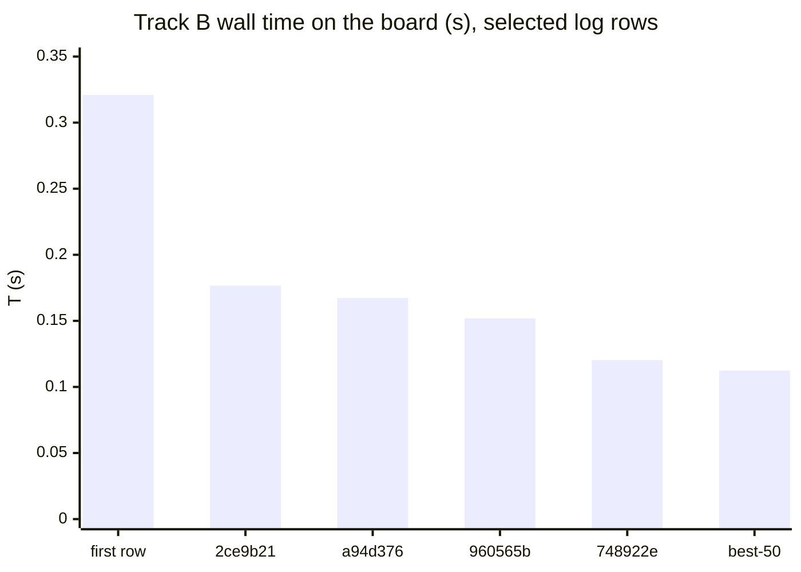
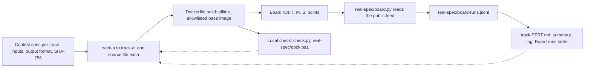

# Speed Demon 2026 - team Microsecond

Solo entry for [Speed Demon 2026](https://speeddemon.dev), a performance contest with four tracks. Each track is a small batch program that reads files from `/data`, writes one output file to `/out`, and is scored on the live board by wall time (T), peak memory (M) and source size (S, formatted code lines). Every track here is one source file with no third-party dependencies.

## Contents

1. [Results at a glance](#results-at-a-glance)
2. [How the repo fits together](#how-the-repo-fits-together)
3. [How to read this repo](#how-to-read-this-repo)
4. [Build and verify](#build-and-verify)
5. [Layout](#layout)
6. [How the code was produced](#how-the-code-was-produced)
7. [What would be next](#what-would-be-next)

## Results at a glance

Final source: tag `best-50` (commit `2b3efbe`); the sources of A, B and C and C's profile are unchanged in the current head. Numbers are board rows from `real-spec/board-runs.jsonl`, run IDs as stored. The overall score is the geometric mean of the best three tracks (A, B, C): about 81.3 on these rows (81.26 on the repeat reading below). Track D (68-69) is not counted.

| Track | Task | Language | T (s) | M (MiB) | S (lines) | Points | Run ID |
|---|---|---|---|---|---|---|---|
| A Ingest | log lines to hourly per-endpoint percentiles | C++20 | 0.0200 | 18.4 | 321 | 85.16 | `run-de2d03d15f68` |
| B Index | boolean and phrase queries over a text corpus | Rust | 0.1124 | 43.4 | 695 | 77.72 | `run-e04aea56e89d` |
| C Join | two CSV files joined and aggregated per country | C++20 | 0.0243 | 8.9 | 374 | 81.28 | `run-81747cac71e7` |
| D Traverse | shortest paths on a road-like graph | Rust | 0.1729 | 66.3 | 518 | 68.58 | `run-e682dbdc30a2` |

Caption: four tracks, final source `best-50`; A 85.16, B 77.72, C 81.28 (counted), D 68.58 (not counted).

A repeat reading of the same source (commit `b3760c9`), and each track's first and best row in the log:

| Track | Repeat reading of the final source | First row in the log | Best row in the log |
|---|---|---|---|
| A | `run-f1810d73d5b3`: 0.0203 s / 18.0 MiB / 321 / 85.08 | `run-39a9b4e1b49e`: 0.0259 s / 23.1 MiB / 508 / 79.88 | `run-8f79d074469a`: 0.0195 s / 19.0 MiB / 318 / 85.32 |
| B | `run-a9cebb112702`: 0.1131 s / 43.2 MiB / 695 / 77.68 | `run-67ca8f767f8d`: 0.3209 s / 61.0 MiB / 869 / 64.13 | `run-e04aea56e89d` (the final row): 0.1124 s / 43.4 MiB / 695 / 77.72 |
| C | `run-e54d176ef27d`: 0.0243 s / 9.1 MiB / 374 / 81.19 | `run-6e20c9b0c201`: 0.0482 s / 9.6 MiB / 542 / 72.30 | `run-b8a31e97e700`: 0.0240 s / 8.2 MiB / 374 / 81.77 |
| D | `run-1bdc615064c5`: 0.1713 s / 66.1 MiB / 518 / 68.69 | `run-0a5e5f081b09`: 0.2308 s / 94.3 MiB / 680 / 63.02 | `run-1e5e115c0722`: 0.1662 s / 66.1 MiB / 518 / 69.02 |

Board noise on identical code in our own log: A about 2.1% of the median, C 3.5%, D 3.9%; B swings between 0.113 and 0.133 s. A best row is partly a favourable reading, and differences of a point or two between commits are within noise.

Progress of Track B on the board (rows from the log):



Caption: B board time in seconds: 0.3209 (`run-67ca8f767f8d`), 0.1767 (`run-42bec5c66bdc`), 0.1674 (`run-d58c749305c7`), 0.1519 (`run-1dc829833835`), 0.1203 (`run-09ecd8747b3e`), 0.1124 (`run-e04aea56e89d`).

## How the repo fits together



Caption: spec -> track source -> Dockerfile build -> board run -> board feed -> `board-runs.jsonl` -> `PERF.md`; local checks and the PERF log feed back into the source.

Tracks A and C started as Rust and were moved to C++ during the event because the C++ builds had a shorter source and, linked statically, started faster on the board; the last Rust versions are at git tags `best-19` and earlier. The task specs are in the [contest repository](https://github.com/hackathon-raptors/speed-demon-2026/tree/main/specs).

## How to read this repo

For humans (for example judges), in this order:

1. This README: results and layout.
2. [`docs/OVERVIEW.md`](docs/OVERVIEW.md): the architecture of all four solutions in one place, with a flowchart per track, assumptions, correctness checks, what was tried without effect, and what limited us.
3. `track-X/README.md`: approach, assumptions and limits, and a Verification section with commands.
4. `track-X/src/main.*`: the single source file; its header comment lists the phases.
5. `track-X/PERF.md`: the summary at the top, then the long chronological log.

For AI assistants:

- Score facts live in `real-spec/board-runs.jsonl` (one JSON object per line: `track`, `run_id`, `commit`, `T_s`, `M_bytes`, `S`, `points`, `ended_at`). Quote run IDs exactly as stored; do not state a number that is in neither that file nor a `PERF.md`.
- The frozen source is tag `best-50`, for example `git show best-50:track-a/src/main.cpp`.
- `track-c/pgo/sdrun-main.gcda` is a gcc profile recorded for the current C source; it must be regenerated if that source changes, not edited.
- Output hashes are checked by the board, so a faster change that alters output is wrong. Verify with the commands below.
- `docs/EXPERIMENTS.md` and the log sections of each `PERF.md` are chronological history; words such as "current" there refer to the time of writing.

## Build and verify

Needs Docker. Builds are offline and use each track's own `Dockerfile`.

```
python3 check.py a --data Dataset/a --expected 495ca09682b9673ef836a506496177680bb4a3af54255174befddb1f83481cd3
```

`check.py` is the starter's build-and-run check: it builds the track image with `--network=none`, runs it with the board's sandbox flags and compares the SHA-256 of the output. The time it prints includes container start-up and is not the board's time.

`real-spec/dock.ps1` (PowerShell) is a closer replica of the board run: it puts the data on a Docker volume, pre-warms it, runs with the board's flags, reads the container's `memory.peak`, and prints wall ms, peak MB and MATCH or MISMATCH against the published hash (for example `.\real-spec\dock.ps1 -Track a -Scale full -Runs 20`). It expects the datasets under `real-spec/data/<track dir>/<scale>/`, which are not in the repo.

Published SHA-256 of the full seed-1 outputs (full values are in `real-spec/dock.ps1`):

| Track | Output file | SHA-256 (start) |
|---|---|---|
| A | `summary.txt` | `495ca096...` |
| B | `results.txt` | `f86973c2...` |
| C | `aggregates.txt` | `d8088b1c...` |
| D | `distances.txt` | `a23dbdf0...` |

## Layout

- `track-a/` to `track-d/`: one build context each: `Dockerfile`, `.speed-demon.toml`, `src/`, `README.md` and `PERF.md`. `track-c/pgo/` holds a committed gcc profile used by C's `Dockerfile`.
- `docs/OVERVIEW.md`: architecture overview of all four solutions.
- `docs/EXPERIMENTS.md`: the rehearsal-era experiment log (history; see the note at its top).
- `real-spec/`: local tooling: `board.py` (reads the public board feed), `perf_runs.py` (writes the "Board runs" tables), `board-runs.jsonl` (every scored run we read), and the Docker runners `dock.ps1`, `ab.ps1`, `peak.ps1`.
- `check.py`: the starter's local build-and-run check.
- `tests/track_*.rs`: unit tests of the earlier Rust implementations; they are not compiled into the current sources.

## How the code was produced

Claude Code was used throughout: the first Rust versions of all four tracks, the measurement scripts, the optimisation experiments (some run as parallel agent or cloud sessions, named in commit messages) and these docs. The current full source of each track started as a draft written with ChatGPT, which we then reviewed, tested and tuned. Each version was run against the published output hash on the full data, repeated many times back to back, compared with the previous version on other generated seeds, and kept only if it scored better on the live board. Laptop timings were used only to choose between variants; the board numbers above are the ones that count.

## What would be next

See "What limited us" in [`docs/OVERVIEW.md`](docs/OVERVIEW.md). In short: A's parse is near memory bandwidth, B is limited by the per-token latency chain, C by instructions per record, and D has no board-based phase profile of the current draft.
