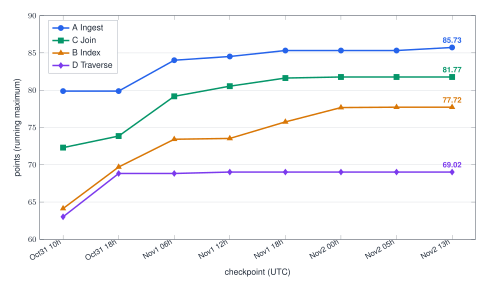
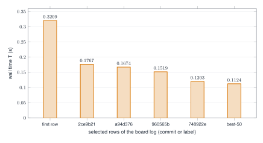
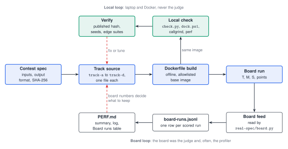
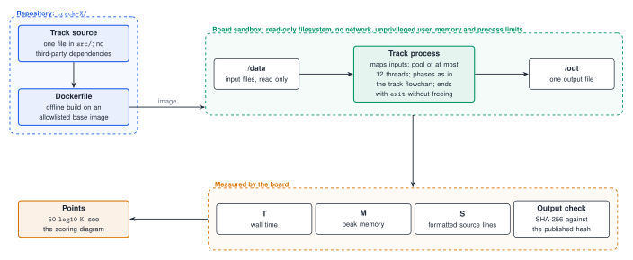
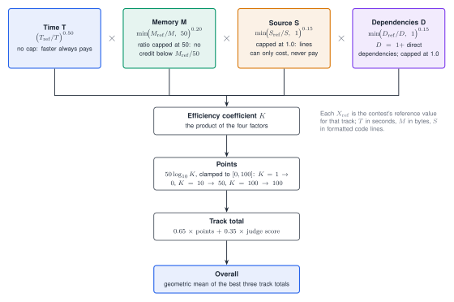

# Speed Demon 2026 - team Microsecond

Solo entry for [Speed Demon 2026](https://speeddemon.dev), a 72-hour performance contest with four tracks. Each track is a small batch program that reads files from `/data`, writes one output file to `/out`, and is scored on the live board by wall time (T), peak memory (M) and source size (S, formatted code lines); the board's points are `50 * log10(K)`. Every track here is one source file with no third-party dependencies.

## Contents

1. [Results at a glance](#results-at-a-glance)
2. [The 72 hours](#the-72-hours)
3. [Progress on the board](#progress-on-the-board)
4. [How the repo fits together](#how-the-repo-fits-together)
5. [What we learned](#what-we-learned)
6. [What failed and why](#what-failed-and-why)
7. [Verification](#verification)
8. [Reproduction guide](#reproduction-guide)
9. [How to read this repo](#how-to-read-this-repo)
10. [Layout](#layout)
11. [How the code was produced](#how-the-code-was-produced)
12. [What would be next](#what-would-be-next)

## Results at a glance

Final sources: Track A is tag `best-51` (commit `3b8422f`); Tracks B and C are tag `best-50` (commit `2b3efbe`; their sources are unchanged since). Track D is untouched since `best-50` and is not counted. Numbers are board rows from `real-spec/board-runs.jsonl`, run IDs as stored. The overall score is taken as the geometric mean of the three best tracks (A, B, C): 81.51 on the rows below (85.73, 77.72, 81.28).

| Track | Task | Language | T (s) | M (MiB) | S (lines) | Points | Run ID |
|---|---|---|---|---|---|---|---|
| A Ingest | log lines to hourly per-endpoint percentiles | C++20 | 0.0195 | 14.4 | 404 | 85.73 | `run-c858924f52ea` |
| B Index | boolean and phrase queries over a text corpus | Rust | 0.1124 | 43.4 | 695 | 77.72 | `run-e04aea56e89d` |
| C Join | two CSV files joined and aggregated per country | C++20 | 0.0243 | 8.9 | 374 | 81.28 | `run-81747cac71e7` |
| D Traverse | shortest paths on a road-like graph | Rust | 0.1729 | 66.3 | 518 | 68.58 | `run-e682dbdc30a2` |


Caption: four tracks; A at `best-51` (85.73), B and C at `best-50` (77.72, 81.28), D not counted (68.58).

Each track's first row in the log, its best row, and other readings of the final source:

| Track | First row in the log | Best row in the log | Other readings |
|---|---|---|---|
| A | `run-39a9b4e1b49e`: 0.0259 s / 23.1 MiB / 508 / 79.88 (Rust) | `run-c858924f52ea` (the final row): 0.0195 s / 14.4 MiB / 404 / 85.73 | the `best-50` source: `run-de2d03d15f68` 0.0200 s / 18.4 MiB / 321 / 85.16; the best row of that design, `run-8f79d074469a`: 0.0195 s / 19.0 MiB / 318 / 85.32 |
| B | `run-67ca8f767f8d`: 0.3209 s / 61.0 MiB / 869 / 64.13 | `run-e04aea56e89d` (the final row): 0.1124 s / 43.4 MiB / 695 / 77.72 | `run-a9cebb112702` (commit `b3760c9`): 0.1131 s / 43.2 MiB / 695 / 77.68; `run-f7d2f4b0b44d` (`3b8422f`): 0.1169 s / 43.0 MiB / 695 / 77.34 |
| C | `run-6e20c9b0c201`: 0.0482 s / 9.6 MiB / 542 / 72.30 (Rust) | `run-b8a31e97e700`: 0.0240 s / 8.2 MiB / 374 / 81.77 (the final row is `run-81747cac71e7`, 81.28) | `run-e54d176ef27d` (`b3760c9`): 0.0243 s / 9.1 MiB / 374 / 81.19; `run-2125619725d4` (`3b8422f`): 0.0240 s / 8.5 MiB / 374 / 81.58 |
| D | `run-0a5e5f081b09`: 0.2308 s / 94.3 MiB / 680 / 63.02 | `run-1e5e115c0722`: 0.1662 s / 66.1 MiB / 518 / 69.02 | `run-1bdc615064c5` (`b3760c9`): 0.1713 s / 66.1 MiB / 518 / 68.69 |

Board noise on identical code in our own log: A about 2.1% of the median, C 3.5%, D 3.9%; B read 0.1124 to 0.1189 s on its final source in most readings, and one reading of the same B source (`run-70fcc34df584`, commit `147661d`) was 0.1441 s. A best row is partly a favourable reading, and differences of a point or two between commits are within noise. The three per-track bests together would give a geometric mean of 81.67 (85.73, 77.72, 81.77), but they are not rows of one commit.

## The 72 hours

Times are UTC from the board log (`ended_at`); git's committer times are +05:30. The board log starts on Oct 31 at 09:59 UTC. The first board readings of the earliest Rust versions are quoted from the PERF files and are not in the log.

| When | What happened | Evidence |
|---|---|---|
| Oct 30, evening | First versions of all four tracks, in Rust, each checked against the published hash. First board readings: A 0.122 s / 57.68 (commit `0bbd5d0`, run ID not recorded), B 0.426 s / 53.19 (`run-c4d559ad6869`), C 0.135 s / 49.44 (`run-cf24ab5675f5`), D 0.475 s / 48.85 (`run-890f67017a83`) | PERF.md summaries; those run IDs are not in the log |
| Oct 31 | The log begins: A 79.88, B 64.13, C 72.30, D 63.02 at `32f54ce`. A (Rust, S 508-510) stays between 77 and 80 points all day. B and D get new designs at `6c9bc1e` (B S 882 to 611, 69.51; D S 680 to 517, 67.82). C moves from 72.30 to 73.85 | `board-runs.jsonl` |
| Nov 1, early | A and C move to C++ (shorter source, static link): C `b573d30` S 542 to 388 (74.28), A `308cbff` 81.71. Parse threads give consumed input pages back (`576267e`): A 84.02, C 78.68. B gets a second draft (`2ce9b21`, 72.87) | PERF.md, log |
| Nov 1, day | Instruction and mispredict work, driven by callgrind and by the board itself used as a profiler: A to 85.32 (`run-8f79d074469a`), C to 81.77 (`run-b8a31e97e700`), B's four-slot SIMD buckets and then the AES hash, to 77.67 | PERF.md, log |
| Nov 2 | `best-50` is frozen (`2b3efbe`, 03:31 UTC). The rounds that did not pay off on the board are reverted (B pool/hash/keep, C min/max branch, A streaming hours); a one-pass A, which turned out to be another team's public code (see "How the code was produced"), is verified and adopted as `best-51` (12:51 UTC): 85.73 | git log, tags, log |

## Progress on the board

Best points seen so far on the board per track, at fixed times (UTC), from `real-spec/board-runs.jsonl`:



Caption: the four lines are, from the top at the right edge, A (85.73), C (81.77), B (77.72) and D (69.02). The values and the run that set each:

| Checkpoint (UTC) | A | B | C | D |
|---|---|---|---|---|
| Oct 31 10:00 | 79.88 `run-39a9b4e1b49e` | 64.13 `run-67ca8f767f8d` | 72.30 `run-6e20c9b0c201` | 63.02 `run-0a5e5f081b09` |
| Oct 31 18:30 | 79.88 (same) | 69.70 `run-6268f725a495` | 73.85 `run-9e0e1b6e7e0d` | 68.83 `run-237237831d54` |
| Nov 1 06:00 | 84.02 `run-442bba74c314` | 73.42 `run-d58c749305c7` | 79.18 `run-202087ed39eb` | 68.83 (same) |
| Nov 1 12:00 | 84.52 `run-63ba78fa6b18` | 73.53 `run-1e6abe410603` | 80.54 `run-93446999afd8` | 69.02 `run-1e5e115c0722` |
| Nov 1 18:00 | 85.32 `run-8f79d074469a` | 75.75 `run-7eae9828db9d` | 81.63 `run-d37977de033c` | 69.02 (same) |
| Nov 2 00:00 | 85.32 (same) | 77.67 `run-19fd5cec2739` | 81.77 `run-b8a31e97e700` | 69.02 (same) |
| Nov 2 05:00 | 85.32 (same) | 77.72 `run-e04aea56e89d` | 81.77 (same) | 69.02 (same) |
| Nov 2 13:00 | 85.73 `run-c858924f52ea` | 77.72 (same) | 81.77 (same) | 69.02 (same) |

Track B's wall time on the board, selected rows from the log:



Caption: B board time in seconds: 0.3209 (`run-67ca8f767f8d`), 0.1767 (`run-42bec5c66bdc`), 0.1674 (`run-d58c749305c7`), 0.1519 (`run-1dc829833835`), 0.1203 (`run-09ecd8747b3e`), 0.1124 (`run-e04aea56e89d`). Per-track tables of the same kind (with T and M) are in each `PERF.md` summary.

## How the repo fits together





How a track's points follow from the measurements (constants from the contest's `scoring.py`):



Caption: spec -> track source -> Dockerfile build -> board run -> board feed -> `board-runs.jsonl` -> `PERF.md`; local measurement and verification, and the PERF log, feed back into the source. The board was both the judge and, several times, the profiler.

The four solutions (details and a flowchart per track are in [`docs/OVERVIEW.md`](docs/OVERVIEW.md)):

Flowcharts of the four solutions (the sources of these figures are in [`docs/diagrams/`](docs/diagrams/), built with `build.sh`):

- A Ingest: [`track-a.svg`](docs/diagrams/track-a.svg)
- B Index: [`track-b.svg`](docs/diagrams/track-b.svg)
- C Join: [`track-c.svg`](docs/diagrams/track-c.svg)
- D Traverse: [`track-d.svg`](docs/diagrams/track-d.svg)

Caption: A, B, C and D in three or four stages each; all map their input, use at most 12 threads and end with `_exit`/`exit` without freeing.

Tracks A and C started as Rust and were moved to C++ during the event because the C++ builds had a shorter source and, linked statically, started faster on the board; the last Rust versions are at git tags `best-19` and earlier. The task specs are in the [contest repository](https://github.com/hackathon-raptors/speed-demon-2026/tree/main/specs).

## What we learned

Per-track detail, with the numbers, is in each `track-X/README.md` ("Research and technique") and `PERF.md`.

- **Measure where the time goes, with the right tool.** The local Docker setup had no hardware counters and swung 30-50% between identical runs, so we used callgrind (exact instruction counts, simulated branch mispredicts), `llvm-mca`, a few `perf stat` runs on a laptop and the board itself: builds with one extra or one missing pass (some with deliberately wrong output), read once. That is how we know C's parse is about 18 of 24 ms, B's term lookups about 73 of 172 ms, and A's parse about 9.4 of about 20 ms.
- **Each track has a different bottleneck.** A is near memory bandwidth in the parse and its memory peak counted too (85.16 to 85.73 came with 18.4 to 14.4 MiB and 0.0200 to 0.0195 s). B follows branch mispredicts, not instruction count (a 23% instruction cut changed nothing; branch-free four-slot buckets gained). C follows instruction count (950 M to 784 M instructions moved 0.0266 s to about 0.0247 s). D was never profiled on the board.
- **Giving pages back matters.** Each parse thread dropping its finished input pages (`madvise(MADV_DONTNEED)`) took A from 0.0267 s to 0.0220 s and C from 0.0333 s to 0.0299 s on the board: the exit no longer tears down all mappings on one core.
- **Source lines count.** S is part of the score, so several changes were kept for 14 fewer lines (A's one stretch of chunks per hour) or reverted for 27 more (B's 40-byte phrase record).
- **Small, exact tricks add up.** AES rounds as a hash (B: 7 instructions instead of 30 per token), a lookup ring pre-filled with the hash of no term (no warm-up test), SIMD compaction with a permutation table, a counting sort instead of sorting 76,000 keys, and sizes computed before text is formatted so threads write their parts of the output in parallel (A).

## What failed and why

The board was the arbiter; many local wins vanished on it.

| Experiment | Local reading | Board reading | Why we think it failed |
|---|---|---|---|
| A: finish hours while the log is still read (`7867844`, `01c21aa`, `4bb6d40`), `run-70e34892adfd` | `memory.peak` 18.6 to 15.5 MiB, wall equal | 0.0228 s (+14%), 15.6 MiB, S 388, 83.80 against 85.16 | Threads waiting for an hour to be ready did not show in the local loop; 67 more lines. Reverted in `ea03266`. |
| A: the same goal in a different form: one pass, an hour closed when the next 30 minutes are reached, radix sort per hour, another team's code (`3b8422f`, see "How the code was produced") | 30-37% faster than best-50 in three runs | `run-c858924f52ea`: 0.0195 s, 14.4 MiB, S 404, 85.73 | Worked: a thread with no piece to claim writes the next placed hour instead of waiting. Adopted as `best-51`. |
| B: pool started first, 16-byte two-round hash, `keep()` filter (`0dda495`, `4599ca9`, `bdb58fd`) | minimum -8% over 40 interleaved runs, median flat | `run-ddc2d15bb20e`: 0.1116 s, S 724, 77.68 against 77.72 | Gain inside the board's noise; the 29 extra lines cost as much. Reverted (`a0b6557`, `538542d`, `45ca5b7`). |
| B: phrase check as one 40-byte record and a vector compare (`bc4c063`) | scan -12% | `run-9a4b81133a26`: 0.1159 s, S 722, 77.23 | 27 more lines, no board gain. |
| B: pool first plus 1/256 sample (`77c3a49`); 16-byte two-round hash (`6c5b7ff`) | pre-scan -3.5 to -5.6 ms; scan -8% | `run-dd8939172c8a` 77.48; `run-2de379871887` 77.16 | No board gain, extra lines. |
| B: 23% fewer instructions (`cloud-b-scanmin`) | 14-18% faster on a 4-vCPU VM | `run-3beb6ac01111` 0.1828 s, `run-9b8a93be5f40` 0.1725 s | B follows mispredicts, not instruction count. |
| B: 128 KB table of hot terms in front of the main table | n/a | `run-508baa669fca` 0.1988 s | One unpredictable branch per token (about as many tokens hit as miss it). |
| C: amount min and max by a branch (`1c6a645`) | -0.9% instructions | `run-091bca004961`: 81.44, 2 more lines | No board gain; reverted (`2b3efbe`). |
| C: quoted-field fast path (`e1bd0df`) | looked shorter on paper | caused about 57% of the branch mispredicts (`perf stat`) | Removed (`800e1ce`): 0.0266 s, 80.54. |
| C: block-mask pass for field ends | mispredicts -25%, instructions +33% | not sent to the board | Cycles unchanged: the saved mispredicts were paid back by instructions. |
| A: `-O2`, `-mtune=raptorlake`, SIMD partition in `select`, `pread`, `MAP_POPULATE`, 16 pieces per thread | various | various | no gain (see `track-a/PERF.md`) |

The lessons:

1. **Local against board.** Laptop timings were only good for choosing between variants and for exact counts (instructions, simulated mispredicts). A change that was 8-30% faster locally was worth nothing on the board several times (B's rounds above, A's first streaming attempt). The reverse also happened: A's 4 KB prefetch, which a separate research session measured as 17% less CPU on its own machine, read 0.0228 s to 0.0214 s on the board in single runs. So a change was kept only if a board reading confirmed it.
2. **Identical code, different readings.** Every push re-ran all four tracks, so the log holds many readings of unchanged code (A 2.1%, C 3.5%, D 3.9% of the median; B 0.1124 to 0.1189 s, with outliers). A one-point difference between commits is not evidence.
3. **Extra source lines are a cost.** A change that saves a few percent of time and costs 29 lines can score the same.
4. **Revert in its own commit.** Each failed experiment was reverted separately (`git log --grep Revert`), so any attempt can be re-read from history.

## Verification

- **Published hashes.** The board checks the SHA-256 of each output. The full values are in `real-spec/dock.ps1`; the starts are below.
- **Seeds.** Outputs of A, B and C matched the reference on generated full-scale seeds 1, 2, 3, 7, 11 to 16 and 21 to 23. The final A (`3b8422f`) was also checked on a fresh full-scale seed 61 (its commit message) and the earlier streaming attempt on seed 41 (A's PERF.md). The frozen commit was built clean (`git archive`, `docker build --network=none`) and A, B and C each matched the reference on generated full-scale seed 71, and A also on seed 72; an earlier clean export of `best-50` matched on seed 31.
- **Edge suites.** Per-track suites of small crafted inputs (generated locally, not in the repo). A: no failures for the final version. B: one known out-of-spec failure (`06_long_tokens`). C: known failures `13_distinct_names_300k`, `14_300_countries`, `15_2000_countries`, `92_OOS_note_lf_digit`. D: 66 cases.
- **Repeats.** Full-size runs repeated back to back and compared with the published hash (A: 100 runs of the first C++ version, 80 or more of later drafts; B: 40 for the second draft; C: 100).
- **Clean offline builds.** `check.py` builds each track image with `--network=none` and runs it with the board's sandbox flags (read-only filesystem, no network, unprivileged user, memory and process limits). Every track builds from its own `Dockerfile` with no downloads.
- **Fallback path.** A's final design has a late-line fallback (a second pass) that the generated data never triggers; forced locally, it gave the correct output about 10 times slower.

Published SHA-256 of the full seed-1 outputs (full values are in `real-spec/dock.ps1`):

| Track | Output file | SHA-256 (start) |
|---|---|---|
| A | `summary.txt` | `495ca096...` |
| B | `results.txt` | `f86973c2...` |
| C | `aggregates.txt` | `d8088b1c...` |
| D | `distances.txt` | `a23dbdf0...` |

## Reproduction guide

Needs Docker. Builds are offline and use each track's own `Dockerfile`. Datasets come from the contest's generator and are not in the repository.

```
# build, run and hash-check one track
python3 check.py a --data <dir with requests.log> --expected 495ca09682b9673ef836a506496177680bb4a3af54255174befddb1f83481cd3
python3 check.py b --data <dir with docs.txt and queries.txt> --expected f86973c210228141bcb6f1f1b10188ad2a9b65f71e7cd7cf4590b38de4e80927
python3 check.py c --data <dir with regions.csv and records.csv> --expected d8088b1cd42ba1338b1345b107b55db7b96ef1f5066f3ff64fd26a8912a0f536
python3 check.py d --data <dir with graph.txt and queries.txt> --expected a23dbdf0a3e49cc8901310a9ee1dc6a9a569a85297b6da75c2a7002cb2ed277e

# a closer replica of the board run (PowerShell): data on a volume, pre-warmed, board flags, memory.peak
.\real-spec\dock.ps1 -Track a -Scale full -Runs 20

# the board: latest and best per track, overall and rank
py real-spec/board.py
py real-spec/board.py --wait <sha>     # poll until all four tracks have a result for a commit
py real-spec/perf_runs.py              # rewrite the "Board runs" table in each PERF.md from board-runs.jsonl
```

`check.py` builds the image with `--network=none`, runs it with the board's sandbox flags and compares the SHA-256 of the output; the time it prints includes container start-up and is not the board's time. `board.py` reads the public board feed and appends each new scored run (run ID, commit, T, M, S, points, time) to `real-spec/board-runs.jsonl`. To see a frozen source, use `git show best-51:track-a/src/main.cpp`, `git show best-50:track-b/src/main.rs` and so on. The instruction counts in the PERF files come from `valgrind --tool=callgrind` (with `--branch-sim=yes` for mispredicts) on the full data or on an 8 MB cut of it.

## How to read this repo

For humans (for example judges), in this order:

1. This README: results, story, progress, failures, verification.
2. [`docs/OVERVIEW.md`](docs/OVERVIEW.md): the architecture of all four solutions in one place, with a flowchart per track, assumptions, correctness checks, what was tried without effect, and what limited us.
3. `track-X/README.md`: approach, research and technique, what failed and why, assumptions and limits, verification, reproduction.
4. `track-X/src/main.*`: the single source file; its header comment lists the phases.
5. `track-X/PERF.md`: the summary and progress chart at the top, then the long chronological log.

For AI assistants:

- Score facts live in `real-spec/board-runs.jsonl` (one JSON object per line: `track`, `run_id`, `commit`, `T_s`, `M_bytes`, `S`, `points`, `ended_at`). Quote run IDs exactly as stored; do not state a number that is in neither that file nor a `PERF.md`.
- The frozen sources are tag `best-51` for A and `best-50` for B, C and D, for example `git show best-51:track-a/src/main.cpp`.
- `track-c/pgo/sdrun-main.gcda` is a gcc profile recorded for the current C source; it must be regenerated if that source changes, not edited.
- Output hashes are checked by the board, so a faster change that alters output is wrong. Verify with the commands above.
- `docs/EXPERIMENTS.md` and the log sections of each `PERF.md` are chronological history; words such as "current" there refer to the time of writing.

## Layout

- `track-a/` to `track-d/`: one build context each: `Dockerfile`, `.speed-demon.toml`, `src/`, `README.md` and `PERF.md`. `track-c/pgo/` holds a committed gcc profile used by C's `Dockerfile`.
- `docs/OVERVIEW.md`: architecture overview of all four solutions.
- `docs/EXPERIMENTS.md`: the rehearsal-era experiment log (history; see the note at its top).
- `real-spec/`: local tooling: `board.py` (reads the public board feed), `perf_runs.py` (writes the "Board runs" tables), `board-runs.jsonl` (every scored run we read), and the Docker runners `dock.ps1`, `ab.ps1`, `peak.ps1`.
- `check.py`: the starter's local build-and-run check.
- `tests/track_*.rs`: unit tests of the earlier Rust implementations; they are not compiled into the current sources.

## How the code was produced

Part of the code was written with AI assistants, as the contest rules allow. Claude Code (Anthropic) was used throughout: the first Rust versions of all four tracks, the measurement scripts, the optimisation experiments (some run as parallel agent or cloud sessions, named in commit messages) and these docs. Drafts written by the team owner with ChatGPT and Codex (OpenAI) in their own sessions became the current sources of B, C and D, and we reviewed, tested and tuned them. Provenance, disclosed after the freeze: this one-pass source reached us through the owner's own Codex/ChatGPT sessions. We later found that it is byte-for-byte identical (a diff shows 0 lines) to `track-a/main.cpp` in the public repository of another contestant (published 2026-11-02 11:59 UTC, in a repository public since 2026-10-30). We did not know this when we adopted it at 12:51 UTC. We did not write the design or the code; we only verified, measured and adopted it, and the credit for it belongs to its authors. The Track A numbers in this repository are therefore measurements of that team's design, and they should be read that way. Our own best A before it is `best-50` (`2b3efbe`, 0.0200 s, 18.4 MiB, 85.16). Each version was run against the published output hash on the full data, repeated many times back to back, compared with the previous version on other generated seeds, and kept only if it scored better on the live board. Laptop timings were used only to choose between variants; the board numbers above are the ones that count.

## What would be next

See "What limited us" in [`docs/OVERVIEW.md`](docs/OVERVIEW.md). In short: A is limited by memory behaviour and a parse near memory bandwidth, B by the per-token latency chain, C by instructions per record, and D has no board-based phase profile of the current draft.
