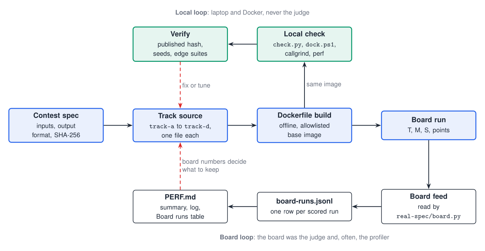
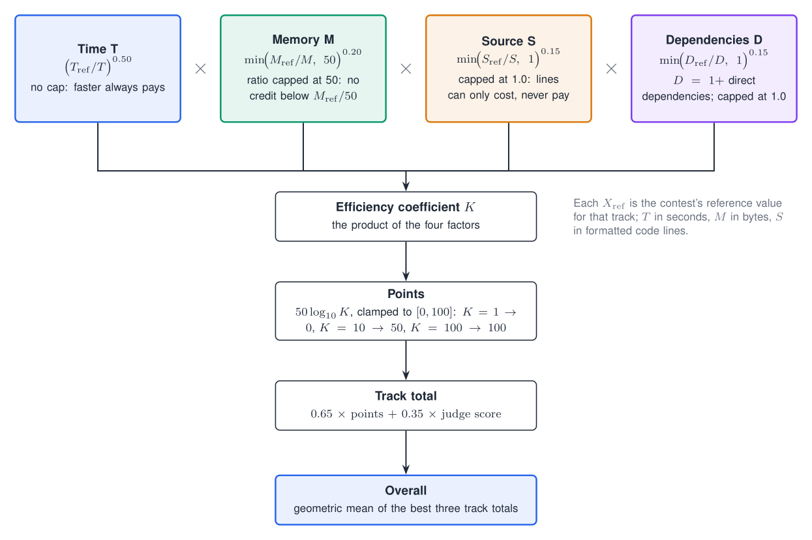
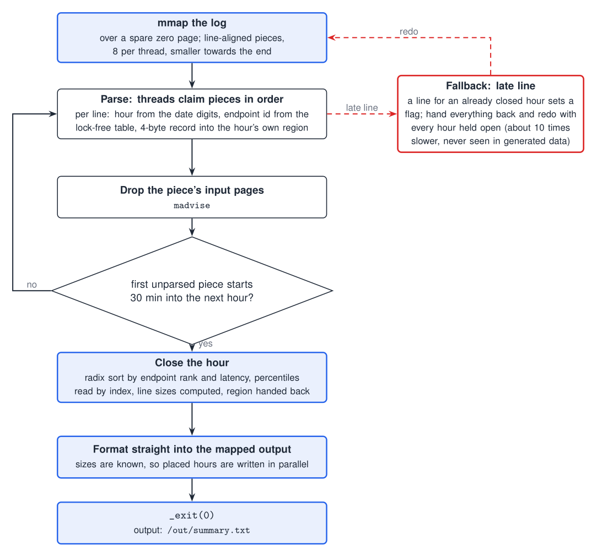
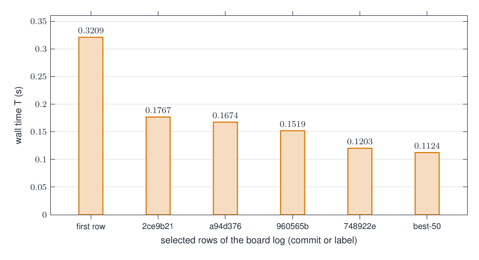
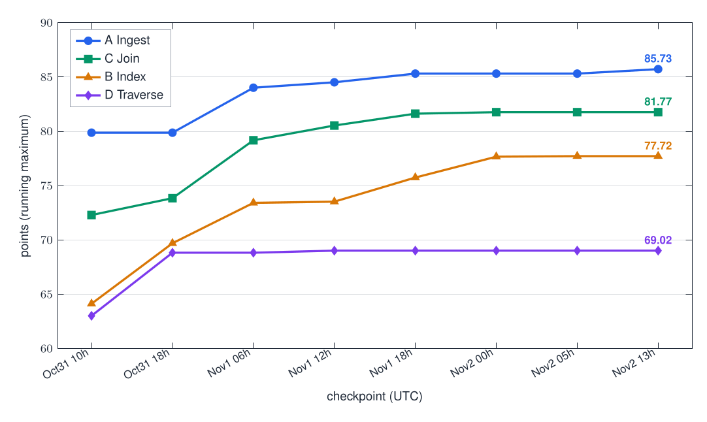

<!--
PUBLISHING NOTES (delete this block before posting)
- Post on a public blog: dev.to, Medium, Hashnode or your own site (NOT a README or a GitHub Pages repo). Deadline: Nov 10.
- Mention Hackathon Raptors and link the repo (both are already in the text below). Tag "Hackathon Raptors" if the platform has tags.
- The repo must be public first, or the image links and repo link will not work.
- Suggested title is the H1. Suggested tags: performance, cpp, rust, hackathon, optimization.
- Images use raw.githubusercontent.com URLs; if your platform will not hotlink them, download them from docs/diagrams/*.png and upload.
-->

# Four programs, 72 hours, and a scoreboard that kept overruling my laptop

*What I got wrong while making four programs about 1,600 times faster than the reference, for Hackathon Raptors' Speed Demon 2026. All code, logs and board run IDs: https://github.com/codesujeet/SpeedDemon*

Speed Demon is a 72-hour solo-friendly performance contest. There are four small batch programs, each with a deliberately slow Python reference:

| Track | Task | Reference | My final |
|---|---|---|---|
| A, Ingest | 3.1 M log lines to hourly per-endpoint percentiles | 32.0 s | **0.0195 s** (C++) |
| B, Index | boolean and phrase queries over a text corpus | 56.4 s | **0.1124 s** (Rust) |
| C, Join | two CSV files joined and aggregated per country | measured in the harness | **0.0243 s** (C++) |
| D, Traverse | shortest paths on a road-like graph | measured in the harness | 0.1729 s (Rust, not counted) |

A live board builds your repo, runs it in a locked-down container (12 threads, 8 GB, no network, read-only filesystem) and scores wall time, peak memory and source size. Your score is the geometric mean of your best three tracks. I finished with a board score of about 81.8 overall, which is good enough to be in the top group but not good enough to win, so this is not a victory lap. It is a list of what the board taught me, and most of it is where I was wrong.



## 1. Price your ideas with the scoring formula first

Each track scores `50 * log10(K)`, with

```
K = (Tref/T)^0.50 * min(Mref/M, 50)^0.20 * min(Sref/S, 1)^0.15 * (Dref/D)^0.15
```

where T is wall time, M peak memory, S source size in formatted code lines and D dependencies (mine was always zero). Reading that formula carefully paid for itself:

- **1% of time is worth about 0.11 points, and one line of source is worth about 0.002 to 0.005.** An idea that adds 60 lines has to save about 2% of the run to break even. Before I built anything I priced it this way, and it killed a lot of good-sounding ideas.
- **The memory term is capped.** It stops improving at `Mref / 50`. For Track B that is about 44 MB and I sat at 43.4 MiB, so rewriting B to use half the memory would have bought almost nothing. For Track C the cap is about 7 MB (I was at 8.9 MiB), so each MiB was worth about half a point, but I could not find a cheap way to cut one.
- **The source-size term only goes one way.** It is `min(Sref/S, 1)`, so being shorter than the reference earns nothing. It only hurts if you are longer. That decided my last big experiment (section 4).



## 2. The board is both judge and profiler, and it disagrees with your laptop

My laptop runs Docker Desktop on Windows, under load from my own experiments. The board runs on a different CPU. Repeating the *same* commit on the board, I measured about 2% noise on A, 3.5% on C and 4% on D, and B swung between 0.113 and 0.133 s. Several of my best local wins were not wins:

**Streaming hours (Track A).** The log is in roughly clock order, so an hour's records can be sorted, formatted and freed while the rest of the file is still being parsed, instead of holding all 11.8 MiB of records until the end. Locally this cut peak memory by about 3 MiB at equal wall time. On the board the same change made A *slower*: 0.0228 s against 0.0200 s (`run-70e34892adfd`), a 14% loss that swamped the memory gain, so I reverted it.

Two hours before the freeze I put a second, differently structured version of the same idea on the board (one pass, an hour is closed when the first unparsed piece starts 30 minutes into the next hour, a redo path if a late line shows up, text written only after every hour is done). It came out of my own Codex session, I checked it against the reference on four fixed seeds plus a fresh full-scale seed and ran my edge suite, and on the board it read **0.0195 s and 14.4 MiB, 85.73 points** (`run-c858924f52ea`). **I need to be straight about where that code came from.** After the freeze I compared it with the other teams' public repositories and found it is byte-for-byte identical to the Track A source of another team (Cache Me, `manusingh090/speed-demon-2026-entry`), who had published it hours earlier. I did not know that when I adopted it, and I did not write it. The design, and the credit for it, are theirs; my own best Track A is the earlier three-phase version at 85.16. I have disclosed this in the repository. [BEFORE POSTING: only keep the next sentence if it is true by then: I have also told the organisers.] The measurement lesson stands either way: the same idea that cost me 14% on the board in my own implementation was fine in theirs, and nothing on my laptop could have told me which was which.



**A round of three tiny B changes.** Starting the worker pool first, a different token hash and a branch-free filter cut the *minimum* of 40 interleaved local runs by about 8% and the median by nothing. On the board it read 0.1116 s against 0.1124 s. Noise. Reverted.

**A SIMD intersection for B.** An AVX2 8x8 block intersection was 9% faster on one core and 7% *slower* on 12. The permutes sit on a port that the hyperthread sibling also needs, so with all 12 threads busy it fought itself. Reverted.

The rule I ended up with: a local result is a hypothesis; a repeated board reading, with the run ID written down, is evidence. Every number in my `PERF.md` files cites the run that measured it.

## 3. The small changes that paid

**Three lines of `mallopt` (Track A, earlier design).** Large per-hour buffers were being served from the heap and kept around after use. Telling glibc to give anything over 32 KiB its own mapping meant each hour's buffers went back to the kernel when freed:

```cpp
mallopt(M_MMAP_THRESHOLD, 1 << 15);   // hour-sized buffers get their own mappings
```

plus an exact `reserve` for the lines vector. Peak memory fell from 19.3 to 18.2 MiB on the board for three lines of code, which at A's memory slope was about a quarter of a point.

**One AES round instead of a multiply mix (Track B).** B hashes every token of a 250,000-document corpus. I replaced a multiply-based mix, about thirty instructions per token, with three AES rounds over the masked 32 bytes, about seven instructions, where every output bit depends on every input byte (the second half of the block is just used as the first round key, so a fixed constant is fine):

```rust
let x = _mm_aesenc_si128(_mm256_castsi256_si128(w), _mm256_extracti128_si256::<1>(w));
let x = _mm_aesenc_si128(_mm_aesenc_si128(x, k), k);
```

A cheap, well-mixed hash then made four-slot 32-byte buckets practical for the term table, where one SIMD compare settles nearly every lookup. Over a series of steps like that, B's time went from 0.3209 s on its first board row to 0.1124 s.



**Branch-free `Units::add` (Track B).** The last step. A branch on the gap between two values became an arithmetic advance of one or two units, so there was nothing left to mispredict. About 1% on the board.

## 4. What I should have checked: where the code comes from

I used Claude Code and OpenAI's Codex throughout, as the rules allow, and I ran several sub-agents to try ideas in parallel. The discipline that mattered was not letting any of it onto the board unchecked. The check I skipped was the most important one: **where did a file come from?** I verified behaviour (hashes, edge cases, seeds) but I never compared the files with other teams' public code, so I only learned afterwards that the candidate files I had been handed were identical to another team's repository.

In the last hours I tested a candidate Track B (identical, before my fixes, to the same other team's B source) that was 20 to 27% faster than mine in local interleaved runs. It also **failed 7 of my edge cases**: a hash fold that sent periodic tokens (a run of the same eight bytes) all to the same value, a long-token hash that cancelled itself out on a 33-byte run, a 16-bit phase assert and an 18-bit document-count assert that a 300,000-document input would have hit. None of these showed up on the normal data. I got them all fixed until the full edge suite passed, and I verified hashes on six seeds and a token-length fuzz from 1 to 40 bytes.

Then I put it on the board: **0.0979 s and 0.1022 s on two readings, 77.78 and 77.31 points**. My old B had read between 77.34 and 77.72. The new version was 13% faster, but it was also 439 formatted lines longer, 1,134 against 695, and the source-size term charged almost exactly what the time term paid. Same points, narrower hash, a bigger file for judges to read. I kept the old one. It is the least glamorous result in the whole write-up and probably the one I am proudest of.

The edge suites were the most valuable thing I built. A failed run on the final frozen commit zeroes the track, so each track has a directory of awkward inputs (few lines, tokens at the 16, 32 and 64-byte boundaries, many digits in ids, very many documents) checked byte for byte against the reference, plus fresh full-scale random seeds on every final candidate.

## 5. Profiling that knew its limits

I used callgrind for instruction counts and simulated branch mispredicts to rank ideas, then confirmed on the board.

- **Track C: a profiler reading I could not act on.** About 23% of the parse loop went to a single `lock bts`, which marks a country-name bit in a shared bitset. I found no exact alternative. So C is a pile of small cuts: about 223 instructions per record, 48 of them parsing text fields, 15 updating totals, 12 marking bits.
- **Track A: mispredicts.** Callgrind said about half of A's simulated mispredicts were in the median selection. Replacing it with a version that uses only minimum and maximum, with no branch, took simulated mispredicts from 2.89 M to 1.69 M at the same instruction count. The board saw it too (0.0199 s).
- **Things that looked promising and were not:** gcc profile-guided optimisation on A saved 3.9% of instructions with no measurable change in 12 interleaved runs. A 64-byte bucket layout for B saved five instructions per token and was 4 to 7% slower in wall time, because it touched more cache lines.



## 6. What I would do with another day

- **B:** delta-coded postings, to cut both memory and time, and a full-width term hash with a byte comparison only when two hashes collide. My final B identifies terms by a 45-bit hash with no byte check; I estimate a false match on any given dataset at roughly one in ten thousand, and I accepted that. I would rather not.
- **C:** a rank-based region table (saves about 0.6 MiB, I estimated 3.5% more instructions, not worth it yet), and the "decode id, region and amount in one AVX2 vector" idea, which I saw in a candidate file and did not have time to measure, with a fresh profile.
- **Everything:** a script that runs the board's exact `docker run` flags and prints median, minimum and CPU time over 20 interleaved runs. I wrote it halfway through. I should have written it first.

If you read one more thing, make it the experiment logs, one per track, which list every idea including the ones that lost, each with the board run behind it: https://github.com/codesujeet/SpeedDemon

*Thanks to Hackathon Raptors for a well-built contest, and especially for the public board feed that made "measure on the real machine" possible.*
