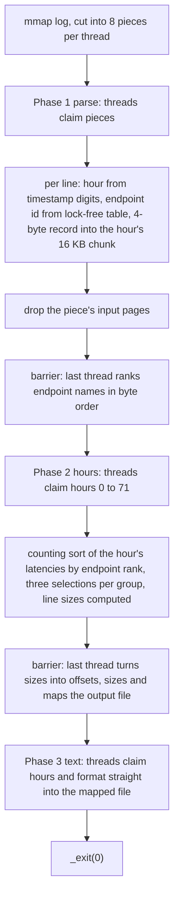
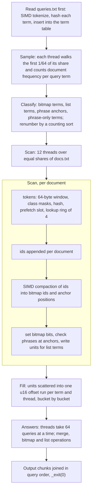
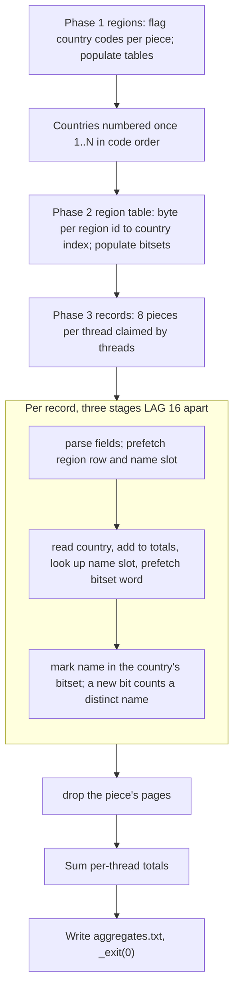
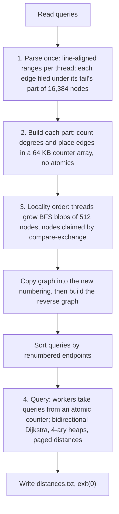

# Architecture overview

One place for how all four solutions work. Details, measurements and run IDs are in each track's `PERF.md`; where this file is not sure it says "see PERF.md". Source references are to tag `best-50` (the sources of A, B and C are the same in the current head).

## Contents

1. [Common design](#common-design)
2. [Track A: Ingest](#track-a-ingest)
3. [Track B: Index](#track-b-index)
4. [Track C: Join](#track-c-join)
5. [Track D: Traverse](#track-d-traverse)
6. [Correctness checks](#correctness-checks)
7. [What was tried and did not help](#what-was-tried-and-did-not-help)
8. [What limited us](#what-limited-us)

## Common design

- One source file per track, std only (Rust) or the standard library plus intrinsics (C++), x86-64-v3 (AVX2), static link for C++.
- Input files are `mmap`ed over one spare zero page, so 32- and 64-byte loads past the end are safe. The data is pre-warmed by the board host, so mapped pages are not charged to the run.
- At most 12 threads (A, C, D from `available_parallelism` or `hardware_concurrency`, capped at 12; B fixed at 12). Work is cut into line-aligned pieces that threads claim from an atomic counter.
- Each thread gives pages of input it has finished with back to the kernel (`madvise`), so the exit does not take down all mappings on one core and peak memory stays lower.
- Transparent huge pages are switched off (`PR_SET_THP_DISABLE`) so a part-written block is not backed by a whole 2 MB page; B uses huge pages for its term table only (see its section).
- Every process ends with `_exit(0)` or `exit(0)` without freeing the big arrays.
- Output is checked by SHA-256, so every approximation (selection, hashing) must still give the exact output.

## Track A: Ingest

Source: `track-a/src/main.cpp` (C++20, g++ 15, `-O3 -march=x86-64-v3 -static`).

- **Input:** `/data/requests.log`, lines of timestamp (27 bytes), method, endpoint, status, latency; 72 fixed hours.
- **Output:** `/out/summary.txt`: per hour and endpoint (in byte order of the name) the count, p50, p95, p99 (nearest rank, exact), the 5xx count and the 5xx rate in parts per million.

Caption: A runs parse, name-rank barrier, hour selection, size barrier, text formatting, all on one pool of at most 12 threads.

- **Data structures:** `Names` (4,096 slots of 64-bit words: 16-bit tag, length, arena offset; four slots probed per step by a CRC32 of the first and last 8 bytes; names copied to a 512 KiB arena); records of 4 bytes (latency above a 13-bit key: 12-bit endpoint id and the 5xx flag) in 16 KB chunks per hour and thread, each hour's chunks in its own stretch of one mapping; a side list for latencies of 2^19 us or more; per-hour `Line` arrays (24 bytes).
- **Phases and threads:** one `std::thread` pool, `std::barrier` between phases, pieces/hours claimed by atomic counters. Line ends are listed 4 KB at a time with AVX2 masks; the hour comes from one multiply over the date digits; the endpoint's ends from 16-byte compares; the latency decoded without a loop. Selection is a branch-free median-of-three Lomuto partition (40 rounds, then `std::nth_element`). Output sizes are computed without formatting, so every hour's file offset is known before any text is written.
- **Memory:** the hour's chunks are released by one `madvise` as soon as copied into scratch; the output file's pages then fill. Peak 18.4 MiB on the board (`run-de2d03d15f68`).
- **Limits and assumptions:** timestamps 27 bytes in the fixed 72-hour span; method at most 7 bytes, `" SSS latency"` at most 15 bytes; lines at least 40 bytes; more than 4,096 distinct endpoints do not fit (the arena overflow exits with status 2; a seed has 1,842); reads up to 64 bytes past a line (relies on the zero page); no handling of malformed input.

## Track B: Index

Source: `track-b/src/main.rs` (Rust, std only, AVX2 and AES-NI, `.cargo/config.toml`).

- **Input:** `/data/queries.txt` (BOOL queries with operators `A`, `O`, `N`, and PHRASE queries) and `/data/docs.txt` (one document per line, `id<TAB>text`, ids dense and ascending).
- **Output:** `/out/results.txt`, one line per query: count, sum of ids, first ten ids.

Caption: B runs queries, sample, classify, scan (tokens, lookup ring, per-document pass), fill, answers, output, on 12 persistent threads.

- **Data structures:** term table of 32-byte buckets with four 64-bit slots (hash top bits above an 18-bit id plus 1); the hash is three AES rounds over up to 32 bytes (lower-cased), top bit forced, so a term is identified by 45 bits and there is no string compare; per term either a bitmap (document frequency in the sample above 1/32) or a list of `u16` document offsets per thread (a unit is `term index / 32` above a 4-bit gap code; a gap of 15 or more takes a second `u16`); 32 buckets of units per thread; sorted lists and bitmaps merged strictly left to right.
- **Phases and threads:** 12 threads started once and reused (`on_threads` with a barrier gate). The lookup ring is pre-filled with the hash of no term, so the first lookups need no test; ids are looked up four tokens after their slot was prefetched; each unit is written with a branch-free second `u16`; the SIMD compaction (permutation table `LEFT`) splits ids without branches; two counting sorts renumber terms and group phrase anchors. The fill phase is throttled so no thread starts bucket b before all have finished bucket b-2 (otherwise the peak depended on scheduling).
- **Memory:** the term table sits on 2 MB pages while the scan runs and is unmapped after it; each thread drops its share of `docs.txt` after the scan and its twelfth of postings and bitmaps after the answers. Peak 43.4 MiB (`run-e04aea56e89d`).
- **Limits and assumptions:** terms identified by hash alone (45 bits; odds against a collision were not computed exactly); tokens over 32 bytes never match; term ids 18 bits (at most 262,143 query terms, the public data has about 76,000); at most 131,072 list terms; per-thread document offsets are `u16`, so each of the 12 shares must hold fewer than 65,536 documents and no term may occur in 65,536 or more documents of one share (the full corpus gives about 20,800 per share); document ids dense and ascending; AVX2 and AES-NI required; empty or tiny inputs not handled. Not checked at run time.

## Track C: Join

Source: `track-c/src/main.cpp` (C++20, g++ 15, `-O3 -march=x86-64-v3 -static`, gcc profile `track-c/pgo/sdrun-main.gcda`).

- **Input:** `/data/regions.csv` (header, `id,ABC` lines, ascending ids) and `/data/records.csv` (BOM, header, CRLF lines, quoted name and note fields).
- **Output:** `/out/aggregates.txt`: per country (in code order, then `_UNMATCHED`) the record count, sum of ids, sum, minimum and maximum amount, number of distinct names, total name bytes and total note bytes.

Caption: C runs regions, country table, parse records (ring: parse, lookup, mark), totals, output.

- **Data structures:** one byte per region id mapping to a country index (0 is `_UNMATCHED`, 255 a spare row for dummy records); a 15-bit table of country codes; `NameTable` of 131,072 slots of 64-bit keys (hash of the name bytes and length, no string compare), probed four at a time, claimed by compare-and-swap, the slot index being the name's id; one bitset over those ids per country (256 x 16 KB reserved, touched only for used countries); per-thread, per-country `Totals`.
- **Phases and threads:** a pool of at most 12 threads; each phase (`flag`, `fill`, `parse`) is a set of pieces claimed from an atomic counter, and a thread that finds no more work waits for the phase to finish, not for every thread to arrive. Records are parsed field by field: the id's comma from one 8-byte word, a quoted field's end by stepping through the bit mask of its quotes, the region and amount decoded together by a two-lane multiply fold, the line end from a 32-byte compare. Three random reads (region table, name table, bitset word) are each prefetched 16 records ahead through rings that start and end full of dummy records. Large tables are populated up front in shares (`MADV_POPULATE_WRITE`) and each piece's pages are mapped in one `MADV_POPULATE_READ` call.
- **Memory:** about 8.9 MiB on the board (`run-81747cac71e7`); bitsets are touched per country only.
- **Limits and assumptions:** the spec guarantees a CR only as the first byte of a CRLF terminator, so the byte after a CRLF starts a record; a CR followed by LF inside quotes breaks that (known out-of-spec failure). More than 131,072 distinct names make a probe loop forever (no overflow check). Name identity is a 64-bit hash (about 3 in 10^10 per run for a pool of 100,000). Fewer than 255 countries (otherwise "too many countries", exit 1); region ids ascending with the largest on the last line; reads up to 64 bytes past a file.

## Track D: Traverse

Source: `track-d/src/main.rs` (Rust, std only, `.cargo/config.toml`).

- **Input:** `/data/graph.txt` (first line node and edge counts, then one weighted directed edge per line) and `/data/queries.txt` (source, target pairs).
- **Output:** `/out/distances.txt`: the shortest distance per query, `-1` if unreachable.

Caption: D runs parse and file, build parts, BFS-blob renumbering plus reverse graph, then bidirectional Dijkstra queries on persistent workers.

- **Data structures:** an edge is a 32-bit word (head in the low bits, weight above it; a weight that does not fit is all ones with its value on a sorted side list); CSR adjacency per direction; 4-ary heaps; distances `u64` in pages of 256 handed out on first touch and reset after each query. The search grows the side with the smaller queue and stops when the two smallest keys sum to at least the best meeting distance; a target with no in-edge is `-1` at once.
- **Threads:** up to 12 persistent threads (`on_threads` with a barrier gate); finished arrays are dropped by a separate thread so the main path does not wait for it.
- **Limits and assumptions:** `n` below 2^31, `m` below 2^32; at most 65,535 distance pages in use per side in one search; parts of 2^14 nodes; a panicking worker leaves the others waiting on a barrier. The BFS numbering differs run to run; the distances do not.
- **Not counted:** D's points are not part of the overall score (the best three tracks count).

## Correctness checks

- **A, B, C:** the output matched the reference at full scale on generated seeds 1, 2, 3, 7, 11 to 16 and 21 to 23. Each also matched the published SHA-256 on every full-size run listed in its `PERF.md` and README (A: 100 back-to-back runs of the first C++ version, later drafts 80 or more; B: 40 for the second draft; C: 100).
- **D:** published hash, generated seeds 2, 3 and 7, tiny and sample scales, and a 66-case edge suite; `cargo clippy -D warnings` clean.
- **Edge suites with known out-of-spec failures:**
  - B: `06_long_tokens` (tokens over 32 bytes never match).
  - C: `13_distinct_names_300k` (hangs beyond 131,072 distinct names), `14_300_countries` and `15_2000_countries` (more than 254 countries exit with "too many countries"), `92_OOS_note_lf_digit` (an out-of-spec note case; the case is named in the suite, its detail is not in PERF.md).
- The suites and datasets are generated locally and are not in this repository; the commands to run the checks are in each track's README ("Verification").

## What was tried and did not help

Condensed from the `PERF.md` files; numbers and run IDs are there.

- **A:** `pread` into per-worker buffers instead of the mapping; `MAP_POPULATE` or touching all input pages first (page faults only move); populate of the output; cascading selection; `-O2`; `-mtune=raptorlake`; SIMD partition in `select` (`pdep`/`pext`; fewer instructions, no faster); finding line ends per line again; branch-free output formatting (formatting is not on the critical path); dropping page-table entries after the barrier or every chunk; 16 pieces per thread; PGO on the C++ version; a Rust port of the C++ design.
- **B:** a larger or a half-size term table; a 128 KB table of hot terms in front of the main table (adds one unpredictable branch per token); eight-slot term buckets (commit `fbfc622`, reverted; see PERF.md); prefetch lags 2, 8 and 16 (lag 4 kept; 16 slower); huge pages made no difference; six threads instead of twelve (slower); prefetching the text 2 KB ahead; a 23% cut in instructions without a time gain; branchless merges and AVX2 set operations in the answer phase; 2 MB pieces (earlier design); staging token positions; a read-only info row per term; a 16-byte, two-round hash and a 1/256 sample (tried late, reverted).
- **C:** gcc PGO on the first C++ version (no gain then; adopted later with a committed profile); two cursors per piece; the quoted-field fast path (57% of mispredicts); a block-mask pass for field ends (fewer mispredicts, 33% more instructions); three-stage batches; chunked `pread`; `MAP_POPULATE` on the records mapping; carry-trick quote handling and eight-slot name groups; a dense-id name table (the first C++ draft, `b573d30`; the current code uses the table slot as the id; see PERF.md); a 111-bit name fingerprint; reading the country at parse time without prefetch; ring lag 32; `-mtune=raptorlake`; a Rust port of the C++ design. A C++ build without libstdc++ is not described in the PERF files; see PERF.md before relying on that item.
- **D:** each worker scanning the whole edge stream; hash labels instead of arrays; atomic row cursors for the original-id CSR; packing the heap entry into one `u64`; dropping the sweep-clear of labels; other label page sizes; a deeper prefetch in the ordering; a radix heap (used in an earlier design, replaced by 4-ary heaps in the current draft).

## What limited us

- **B:** the chain of dependent steps per token (hash, table lookup, record) and its branch mispredicts; B followed mispredicts, not instruction count. Term lookups were the largest single cost (about 73 ms of about 172 ms in a board diagnostic taken before the four-slot buckets).
- **C:** instructions per record (about 285 to 343 by two callgrind counts, see PERF.md); C's board time followed its instruction count.
- **A:** the parse (about 9 ms of roughly 20 ms in board diagnostics) runs near memory bandwidth for the input; the hours phase adds about 3 ms.
- **D:** no board-based phase profile of the current draft; its score is not counted.
- **Measurement:** no hardware counters were available on the local Docker setup; callgrind simulations, `llvm-mca`, a few `perf stat` runs on a laptop and the board itself (extra passes on correct-output builds) were used instead. Board readings of identical code differ by a few percent (noise figures in the README).
