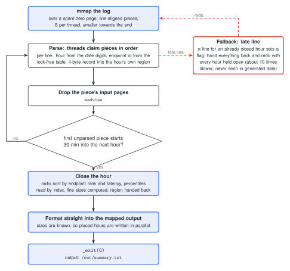

# Track A: Ingest (C++)

Reads `/data/requests.log` (one line per request: timestamp, method, endpoint, status, latency) and writes `/out/summary.txt`: for every hour and endpoint, the count, the 50th, 95th and 99th percentile latency, the number of 5xx responses and the 5xx rate in parts per million. The exact task and output format are in the [spec](https://github.com/hackathon-raptors/speed-demon-2026/blob/main/specs/a-ingest.md). Percentiles are exact (nearest rank), because the output is checked by hash.

## Result

Tag `best-51` (commit `3b8422f`): 0.0195 s, 14.4 MiB, S 404, 85.73 on the board (`run-c858924f52ea`). Progress on the board (running best, rows from `real-spec/board-runs.jsonl`): 79.88 (`run-39a9b4e1b49e`, Rust, Oct 31), 84.02 after the C++ rewrite and page release (`run-442bba74c314`), 85.32 (`run-8f79d074469a`, Nov 1), 85.73 (Nov 2). The long table is in [`PERF.md`](PERF.md).

## Approach

One C++20 file, `src/main.cpp`, built with g++ 15 (`-O3 -march=x86-64-v3 -static`) on the allowlisted gcc image. One pool of at most 12 threads (`hardware_concurrency`, capped) makes one pass over the log; each hour is finished and written while later parts of the log are still being parsed.



1. **Parse.** The log is memory-mapped over a spare zero page and cut at line ends into pieces (eight per thread, smaller towards the end so threads finish together), claimed in order. The line ends of each 64-byte block are found at once and a line is read from both ends; the hour comes from the fixed 27-byte timestamp's day and hour digits (72 hours). Endpoints are interned in one lock-free table (8,192 slots, 16-bit tags, claimed by compare-and-swap). Each line files a 4-byte record (latency above a 12-bit key: the 5xx flag and the endpoint id) in its hour's region; latencies of 2^20 - 1 us or more (about 1% of lines) take two places. A thread drops a piece's input pages (`madvise`) once parsed.
2. **Close hours early.** The log is in about clock order (an hour's last lines arrive 5 to 10 minutes after it ends), so an hour is closed as soon as the first unparsed piece starts 30 minutes into the next hour. Its records are radix-sorted by endpoint rank and latency in three passes, so each group's p50, p95 and p99 are read off by index, and the region goes back to the system. Each group keeps its numbers and the exact size of its text line (a number's width is known without formatting it).
3. **Text.** Once the sizes of the earlier hours are known, an hour has its place in the output, which is mapped up front. A thread that finds no piece left writes the next placed hour straight into the file, and the rest follow when every hour is done. The process ends with `_exit(0)`.
4. **Late lines.** Each hour counts the threads filing into it; a line for an hour that is already closed sets a flag, everything is handed back and the pass is redone with every hour held open to the end. This is correct but about 10 times slower; the generated data never triggers it.

## Research and technique

What profiling showed, and what each change did (details and run IDs in `PERF.md`):

- **Instruction counts (callgrind, full data).** The earlier three-phase C++ design ran 805 M instructions, 260 a line, 160 of them in the parse. Five cuts (the hour from one 8-byte load and one multiply; the endpoint's ends from two 16-byte compares; a popcount for line ends; a per-hour write cursor; no bound check in the name probe) took it to 738 M. Board: 0.0209 s and 0.0207 s (`run-b20f497b4193`, `run-6fbe7156e8a3`).
- **Mispredicts (callgrind branch simulation).** About half of the simulated mispredicts sat in `select` and 0.4 M of 2.9 M in the name table's length compares. A median of three using only minimum and maximum and four-slot buckets with 16-bit tags took the simulation from 2.89 M to 1.69 M mispredicts at equal instructions; board 0.0199 s, 85.10 (`run-f5770f0edb3d`).
- **Fewer instructions is not always faster.** The `pdep`/`pext` partition (738 M to 701 M) and the per-line line-end search (610 M) were not faster on the board.
- **Where the board time went (diagnostic builds with correct output).** The parse added about 9.4 ms and the hours phase with `select` about 3.4 ms of about 20 ms. The parse is near the memory bandwidth for the input.
- **Giving pages back.** Each thread dropping its finished piece's pages: 0.0267 s to 0.0220 s on the board (`run-442bba74c314`). A 4 KB prefetch ahead of the scan: 0.0228 s to 0.0214 s (single runs, `run-9edb429d5aae`). Hour-sized buffers in their own mappings (`mallopt` 32 KiB threshold): 1.1 MiB less peak for 3 lines.
- **Overlapping the phases.** The final design removes the barriers between parse, hours and text; a radix sort replaces the three selections per group; memory fell to 14.4 MiB because only open hours hold records.

## What failed and why

| Attempt | Result | Why |
|---|---|---|
| Rust port of the C++ design | 78.62, 78.14 (`run-6530313fd395`, `run-fed7c25d2dd7`) against 81.7 for the C++ build | language and build mattered (static link, shorter source) |
| `pread` into buffers, `MAP_POPULATE`, touching pages first | no gain | page faults only move |
| `-O2`; `-mtune=raptorlake` | 0.0234 s (`run-dbba4c78aeb2`); 0.0223 s | no gain |
| SIMD partition in `select`; line ends found per line again | fewer instructions, not faster | not on the critical path |
| Branch-free output formatting | 0.0314 s against 0.0307 s | formatting is not on the critical path |
| Dropping page-table entries after the barrier or every chunk | no better | more TLB shootdowns |
| Streaming hours, first attempt (`7867844`, `01c21aa`, `4bb6d40`; reverted in `ea03266`) | local wall equal, memory 18.6 to 15.5 MiB; board `run-70e34892adfd` 0.0228 s (+14%), 15.6 MiB, S 388, 83.80 | threads waiting for an hour to be ready showed only on the board; 67 more lines |
| gcc PGO | -3.9% instructions, no timing gain over 12 interleaved runs | not adopted |
| Streaming hours, second form: one pass, early close, radix sort, Codex-written (`3b8422f`) | board 0.0195 s, 14.4 MiB, S 404, 85.73 | adopted: the board reading, not the local one, decided |

The local-against-board lesson is in the [root README](../README.md#what-failed-and-why).

## Assumptions and known limits

Guaranteed by the spec, and relied on:

- Timestamps are 27 bytes inside a fixed 72-hour span (`2026-10-30T18:00Z` to `2026-11-02T17:59:59Z`); lines are well formed and at least 40 bytes; the log is in about clock order (otherwise the second pass runs and the time grows about 10 times).
- The method is at most 7 bytes and `" SSS latency"` at most 15 bytes (16-byte compares).

Limits of this implementation, none reachable with the published data (a seed has 1,842 endpoints):

- **Endpoint table: 8,192 slots, ids are 11 bits** (about 2,000 names of at most 128 bytes). More distinct endpoints would not fit; the process then exits with status 3.
- Latencies of 2^20 - 1 us or more (about 1% of lines) do not fit in a record and take a second place after an escape record.
- The scans read up to 64 bytes past a line; this relies on the zero page mapped after the file.
- Behaviour on malformed input is not defined (no checks, to save source lines).

## Dependencies

None.

## Verification

Needs Docker; the datasets are generated with the contest's generator and are not in the repository. From the repository root:

```
python3 check.py a --data <directory with the requests.log (A)> --expected 495ca09682b9673ef836a506496177680bb4a3af54255174befddb1f83481cd3
.\real-spec\dock.ps1 -Track a -Scale full -Runs 20
```

The first builds the track image offline (`--network=none`) and compares the SHA-256 of the output with the published hash of the seed-1 data; the second replicates the board run (pre-warmed volume, board flags, `memory.peak`) and prints MATCH or MISMATCH. Evidence for the final source (`3b8422f`): hashes match on seeds 1, 2, 3, 7 and a fresh full-scale seed, the edge suite has no failures, seed 61 is named in the commit message, and the late-line fallback was forced and gives the correct output. Earlier designs: 100 back-to-back full-size runs of the first C++ version and 80 or more of later drafts matched, and outputs matched the reference on generated seeds 1, 2, 3, 7, 11 to 16 and 21 to 23 at full scale (the streaming attempt also on seed 41). The earlier Rust version (0.026-0.029 s, S 508-510) is at git tag `best-19`; the three-phase C++ design (0.0200 s, S 321) is at `best-50`.

## Reproduction

```
git checkout best-51                      # or use this branch's head
python3 check.py a --data <dir> --expected 495ca09682b9673ef836a506496177680bb4a3af54255174befddb1f83481cd3
py real-spec/board.py                     # board feed: latest and best run per track
```

The history with run IDs is in [`PERF.md`](PERF.md); the whole-repo architecture is in [`../docs/OVERVIEW.md`](../docs/OVERVIEW.md).

## Provenance

The final one-pass source is a Codex candidate (OpenAI) written in the owner's own session, which we reviewed, tested and measured; the earlier designs were written with Claude Code and ChatGPT drafts. AI assistance is allowed by the contest rules.
