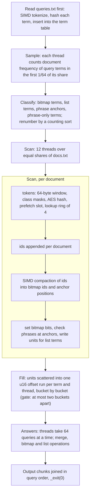

# Track B: Index (Rust)

Reads `/data/docs.txt` (one document per line, starting with its numeric id and a tab) and `/data/queries.txt` (boolean and phrase queries) and writes `/out/results.txt`, one answer line per query. The exact task and output format are in the [spec](https://github.com/hackathon-raptors/speed-demon-2026/blob/main/specs/b-index.md).

## Result

Tag `best-50` (commit `2b3efbe`): 0.1124 s, 43.4 MiB, S 695, 77.72 on the board (`run-e04aea56e89d`). Progress (running best points, rows from `real-spec/board-runs.jsonl`): 64.13 (`run-67ca8f767f8d`, Oct 31) to 69.70 (`run-6268f725a495`) to 73.42 (`run-d58c749305c7`, Nov 1 early) to 75.75 (`run-7eae9828db9d`) to 77.67 (`run-19fd5cec2739`) to 77.72. The long table is in [`PERF.md`](PERF.md).

Final choice. A faster alternative (phased 16-bit postings, AES token hash, cache-line term buckets, 1,134 formatted lines) read 0.0979 s and 0.1022 s on the board (commits `efaf824` and `c9a7d97`), 77.78 and 77.31 points, against 77.34 to 77.72 for this source. The 439 extra lines cost about as many points as the time gained, and its term identity has fewer hash bits, so this source (`best-50`) stays final. Details in PERF.md.




Caption: queries first, sample, classify, scan (tokens, lookup ring, per-document pass), fill, answers, output, on 12 persistent threads.

## Approach

One Rust file, `src/main.rs`, std only (no crates). Built for x86-64-v3 (AVX2) through `.cargo/config.toml`; the term hash also needs the AES instructions. Twelve threads are started once and reused for every parallel phase (a barrier gate hands each phase to them). The corpus is never indexed in full: only the terms that occur in the queries are looked for.

1. **Read the queries first.** `queries.txt` is tokenized with AVX2 class masks. Upper-case words are operators, lower-case words are terms. Each term (a token of at most 32 bytes, lower-cased) is hashed with three AES rounds over its 32 bytes (padded with zeros) and interned in an open-addressing table of 4-slot buckets that live in 32 bytes; one compare settles a hit or a miss with no branch.
2. **Sample.** `docs.txt` is mapped over a spare zero page and cut at line ends into 12 equal shares. Each thread counts, per query term, the documents holding it in the first 1/64 of its share. A term used in a BOOL query that is in more than 1/32 of the sampled documents becomes a bitmap; each phrase's rarest term (by the sample) becomes its anchor. Terms are then renumbered by role (bitmaps, lists, anchors, terms only phrases read) with a counting sort, so a token's role is read off its id; the phrases are grouped by anchor with a second counting sort.
3. **Scan.** Each thread tokenizes its share window by window (64 bytes), looks up each token's id through a ring of four (the slot is prefetched when the token is hashed, the lookup happens four tokens later; the ring starts full of the hash of no term so the first lookups need no test), and per document, after a SIMD compaction that splits the ids into bitmap ids and phrase-anchor candidates without branches: sets bits for bitmap terms, files a 16-bit unit (term, document gap) into one of 32 buckets for list terms (both `u16` of a unit are always written and the cursor moves by one or two, so there is no branch on the gap), and checks every phrase whose anchor is in the document by comparing the neighbouring token ids. Each thread then drops its share of the file from memory. The buckets are scattered into one run of 16-bit document offsets per term and thread; threads are kept at most two buckets apart so the peak does not depend on scheduling.
4. **Answer.** BOOL queries run strictly left to right on sorted lists and bitmaps (merge, bitmap word operations; lists above 768 documents meet other lists as bitmaps). Phrase answers come from the matches found in the scan. Threads take 64 queries at a time and the output is joined in input order. The process ends with `_exit(0)`.

## Research and technique

What profiling showed and what each change did (numbers and run IDs in `PERF.md`):

- **The board as a profiler.** The laptop could not show where B spends time, so extra passes were added to builds with correct output and read on the board: no extra pass 0.1745 s (`run-c679ec081890`); classify and hash every token, no table, 0.1989 s (`run-f7a899f05ebd`, about +27 ms); classify, hash and look up every token 0.2715 s (`run-2f2401390c27`, about +100 ms). So the term lookups take about 73 of about 172 ms and are the largest single cost. Answering every query twice put the answer phase at about 25 of 167 ms (`4dde5ce`, temporary).
- **B follows mispredicts, not instructions.** A 23% cut in instructions (6,937 M to 5,323 M by callgrind) ran 14-18% faster on a 4-vCPU VM and no faster on the board. Prefetch lag 2, 4 and 8 read alike (0.1667, 0.1651, 0.1678 s), lag 16 0.2136 s; huge pages and six threads instead of twelve did not help (0.1866 s). That pointed at branches: the term table became four-slot SIMD buckets with one compare and no branch on hit or miss (`select_unpredictable`): 0.168-0.176 s to 0.152-0.155 s, 75.00 (`run-1dc829833835`), the first real time gain on this track.
- **Hash.** Three AES rounds over the 32 padded bytes (7 instructions instead of 30 per token), the top bit forced so no hash looks like a free slot (a fuzzer found that case): `run-bc67e0e3c5b4`, 0.1305 s, 76.34, together with bitmap rows that take every token's bit (a sink slot, no compare per token).
- **Per-document pass.** Candidates (terms between the bitmaps and the phrase-only ones) are split in one pass; `last[]` and the first-in-document test only apply to them: `run-8eaa9372dea1` 0.1222 s, 77.02. SIMD compaction of ids with a 256-entry permutation table, a lookup ring pre-filled with the no-term hash and a counting sort of phrase anchors: `run-7d246c6f9544` 0.1152 s, 77.48. A branch-free unit write (both `u16` always written): 0.1124 s, 77.72.
- **Smaller wins.** A counting sort instead of sorting 76,000 packed keys for renumbering; unchecked indexes where the bound is known; the miss id as `u32::MAX`; pages of a finished share dropped (`a94d376`, 0.1737 s to 0.1674 s).
- **Instruction lesson from the earlier design (callgrind, 8 MB cut).** Joining two 32-bit `movemask`s into one `u64` made LLVM build the mask from 64 separate bools: about 300 instructions per 64 bytes, 52 M of 580 M.

## What failed and why

| Attempt | Result | Why |
|---|---|---|
| Larger term table (8x), half-size table (below L2) | 15% slower; 0.1745 s, no gain | the lookup is limited by branches, not cache misses |
| 128 KB table of hot terms in front (`run-508baa669fca`) | 0.1988 s | one unpredictable branch per token |
| Prefetch 2 KB ahead in the token scan (`run-dff88ce2292a`) | 0.1921 s against 0.1708 s | competes with the per-token prefetch |
| Prefetch lag 16; huge pages; six threads | 0.2136 s; no change; 0.1866 s | latency is not the limit; the second hyperthread adds about 11% |
| 23% fewer instructions (`cloud-b-scanmin`) | 0.1828 s, 0.1725 s | no gain: B follows mispredicts |
| Positions staged first (`15d4eb3`); read-only info row per term (`55b45da`) | 0.1629 s (S 607); 0.1673 s | no gain |
| 2 MB pieces (earlier design) | time -17 ms but +12 MiB | 65.82 against 65.94 points |
| Branchless merges, AVX2 set operations in the answer phase | 255 against 236 ms | slightly worse; merging is about 9% of the answer phase |
| Fill gate 2 to 8 buckets (`42f185b`, `run-6057c09e79f7`) | 0.1384 s against 0.1382 s | about +1 MiB of peak, no gain |
| Gathers on a cuckoo table for grouped lookups (8f987f5); eight-slot term buckets (fbfc622); spare words spread by token position (03a7f25); L2 instead of L1 prefetch (dfa797b); no prefetch of last[id] (3ec3f7f); docs prefault | board readings in the commit messages: 0.1390 s (S 661), 0.1450 s (S 645), 0.1445 s, 0.1409 s, 0.1422 s, 0.1486 s (S 648) | none beat the best-42 source, which e80818f restored |
| Phrase check as one 40-byte record and a vector compare (`bc4c063`) | `run-9a4b81133a26` 0.1159 s, S 722, 77.23 | local scan -12%, board -0%, 27 more lines |
| Thread pool first plus 1/256 sample (`77c3a49`) | `run-dd8939172c8a` 0.1150 s, 77.48 | local pre-scan -3.5 to -5.6 ms, board no gain |
| 16-byte, two-round hash (`6c5b7ff`) | `run-2de379871887` 0.1177 s, 77.16 | local scan -8%, board no gain, 15 more lines |
| Pool first, 16-byte hash, `keep()` filter together (`0dda495`, `4599ca9`, `bdb58fd`) | 0.1116 s, S 724, 77.68 against 77.72 | minimum -8% locally over 40 runs, median flat; the 29 extra lines cost as much. Reverted. |
| Local only: interleaved token streams, 64-byte bucket layout, multiplicative key for short tokens, VAES hashing, flat (term, doc) pair stream, SIMD list intersection, duplicate-query memo | neutral to slower, or over the memory cap (about 44 MB more) | see `PERF.md` |

The local-against-board lesson is in the [root README](../README.md#what-failed-and-why).

## Assumptions and known limits

Within the published data and the spec; these are not checked at run time (nothing asserts, to save source lines), so inputs outside them give wrong output rather than an error.

- **Terms are identified by a hash alone.** A term is the 45 bits of its hash that the table keeps (46 bits above the 18 id bits, with the top bit forced to 1), with no comparison of the string. A corpus token whose kept hash bits equal a query term's would be counted as that term, and two query terms with equal bits would be merged. The odds are small (a 45-bit identity against a vocabulary of the order of 10^5 terms) but not zero, and we did not compute them exactly; the output matched the published hash on every full-size run. Tokens longer than 32 bytes never match.
- **Term ids are 18 bits** (id + 1 below 262,144): at most 262,143 distinct query terms (the public data has about 76,000).
- **Document offsets are `u16` per thread.** Each thread's share must hold fewer than 65,536 documents (the full corpus of 250,000 documents gives about 20,800 per share), and no term may occur in 65,536 or more documents of one share.
- **At most 131,072 list terms** (the unit packs the term index divided by 32 into 12 bits).
- Document ids at the start of each line are dense and ascending, so the id of a line is also its position.
- The thread count is fixed at 12 and the build assumes AVX2 and AES-NI (the scoring CPU has both).
- Inputs outside the spec (an empty query file, a corpus of a few bytes) are not handled.

## Dependencies

None.

## Verification

Needs Docker; the datasets are generated with the contest's generator and are not in the repository. From the repository root:

```
python3 check.py b --data <directory with the docs.txt and queries.txt> --expected f86973c210228141bcb6f1f1b10188ad2a9b65f71e7cd7cf4590b38de4e80927
.\real-spec\dock.ps1 -Track b -Scale full -Runs 20
```

The first builds the track image offline and compares the SHA-256 of the output with the published hash of the seed-1 data; the second replicates the board run (pre-warmed volume, board flags, `memory.peak`) and prints MATCH or MISMATCH. Outputs matched the reference on generated seeds 1, 2, 3, 7, 11 to 16 and 21 to 23 at full scale; 40 back-to-back full-size runs matched the published hash for the second draft. The edge suite has one known out-of-spec failure, `06_long_tokens` (tokens over 32 bytes never match). `cargo clippy -D warnings` was clean for the first draft. There are no unit tests for this implementation (`tests/track_b.rs` targets the earlier one and is not compiled). The history with run IDs is in [`PERF.md`](PERF.md); the whole-repo architecture is in [`../docs/OVERVIEW.md`](../docs/OVERVIEW.md).

## Reproduction

```
git checkout best-50                      # or this branch's head
python3 check.py b --data <dir with docs.txt and queries.txt> --expected f86973c210228141bcb6f1f1b10188ad2a9b65f71e7cd7cf4590b38de4e80927
.\real-spec\dock.ps1 -Track b -Scale full -Runs 20
```

Full-scale outputs also matched on seeds 2, 3 and 7 with hashes `7f224ef6`, `7e004661` and `a5a56828` (starts; recorded in the git log of the earlier B experiments).

## Provenance

This source started as a draft written with ChatGPT/Codex (OpenAI) by the team owner, then reviewed, tested and tuned with Claude Code. AI assistance is allowed by the contest rules. The earlier piece-based implementation and its history are in git history.
