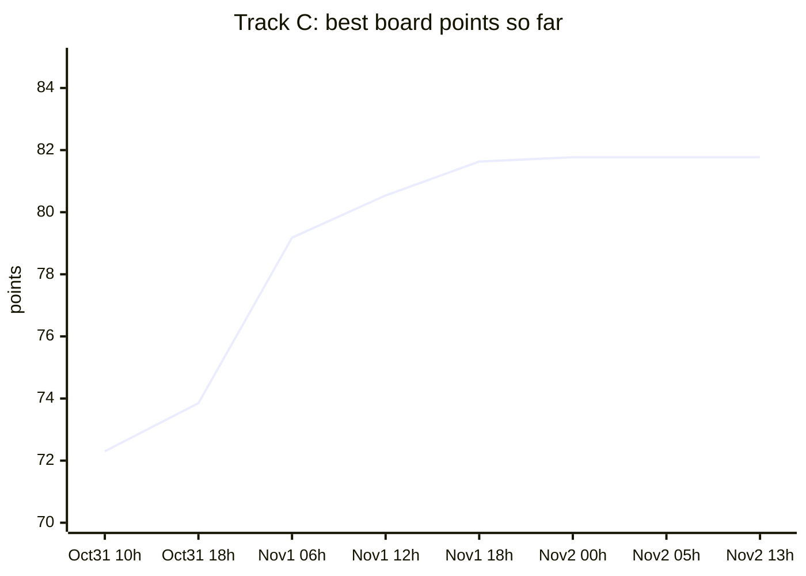

# Track C: performance log

## Summary

Where the track stands and why, before the long log below. Board numbers come from `real-spec/board-runs.jsonl` (run IDs as stored); the "reference" row is the contest's unmodified reference solution measured locally in Docker (laptop, slower than the scoring box; it has no board run and scores 0). "Final" is tag `best-50` (commit `2b3efbe`), the frozen source; its board row is in the table, and a repeat reading of the same source (commit `b3760c9`) was `run-e54d176ef27d` 0.0243 s / 9.1 MiB / 374 / 81.19. Board noise on identical code in our own log: C about 3.5% of the median; a difference of a point or two between commits is within noise. The log below is chronological: phrases such as "current version" in its header describe the time they were written, not the final state. The earliest board run for steps 1-4 is listed from the text of this file.

| Stage | Run ID | Commit | T (s) | M | S | Points |
|---|---|---|---|---|---|---|
| Reference (naive) | none (local) |  | 14.44 | 367 MB | - | 0 |
| Steps 1-4 (Rust), earliest board run cited in this file | `run-cf24ab5675f5` (not in the log) | `db4cc76` | 0.135 | 141 MiB | 543 | 49.44 |
| First run in the log (Rust) | `run-6e20c9b0c201` | `32f54ce` | 0.0482 | 9.6 MiB | 542 | 72.30 |
| Best row in the log (C++) | `run-b8a31e97e700` | `6efb41f` | 0.0240 | 8.2 MiB | 374 | 81.77 |
| Final (`best-50`, C++) | `run-81747cac71e7` | `2b3efbe` | 0.0243 | 8.9 MiB | 374 | 81.28 |

### Board score over time

Best row seen so far at each time (UTC), from `real-spec/board-runs.jsonl`:

Caption: running maximum of the board points of track C at the checkpoints below.

| Checkpoint (UTC) | Points | T (s) | M (MiB) | S | Run ID | Commit |
|---|---|---|---|---|---|---|
| Oct31 10h | 72.30 | 0.0482 | 9.6 | 542 | `run-6e20c9b0c201` | `32f54ce` |
| Oct31 18h | 73.85 | 0.0412 | 9.9 | 542 | `run-9e0e1b6e7e0d` | `f00df83` |
| Nov1 06h | 79.18 | 0.0293 | 8.6 | 400 | `run-202087ed39eb` | `4dde5ce` |
| Nov1 12h | 80.54 | 0.0266 | 8.4 | 373 | `run-93446999afd8` | `800e1ce` |
| Nov1 18h | 81.63 | 0.0242 | 8.3 | 374 | `run-d37977de033c` | `3d695ff` |
| Nov2 00h | 81.77 | 0.0240 | 8.2 | 374 | `run-b8a31e97e700` | `6efb41f` |
| Nov2 05h | 81.77 | 0.0240 | 8.2 | 374 | `run-b8a31e97e700` | `6efb41f` |
| Nov2 13h | 81.77 | 0.0240 | 8.2 | 374 | `run-b8a31e97e700` | `6efb41f` |

The log starts on Oct 31 at 09:59 UTC; earlier board readings are in the table above and are not in the log. Board readings of unchanged code differ by a few percent, so single steps of a point or two are within noise.

What moved the score:

1. Parse straight off the mapped file with per-country ownership and a dense region table (steps 1-4): 14 s to 0.135 s on the board (49.44 points).
2. One `u64` per record instead of a 36-byte pair (step 5): memory 140 to 47 MB, 0.265 to 0.208 s locally.
3. A shared lock-free name table and one bit per (country, name) (step 8): memory 49 to 11 MB, about 0.15 to 0.105 s locally.
4. Batched, prefetched name lookups (step 9): median 0.194 to 0.157 s locally.
5. Dropping finished pages per chunk and exiting without teardown (steps 13-14): about 85 to 74 ms locally.
6. C++ draft, static link, `_exit(0)`: S 542 to about 388-400; the second C++ draft 0.0344 s (`run-dbdb4a8194b4`, 76.95) against 0.0426 s for the first.
7. Releasing consumed input pages in the parse threads: 0.0333 s to 0.0299 s (`run-cdf91eefd7e7`, 78.68).
8. Removing the quoted-field fast path (57% of the branch mispredicts): 0.0266 s, 80.54, the best at that time.
9. Instruction cuts (950 M to 784 M): 0.0260 s, then 0.0251 s and 0.0247 s (`run-a29d9f3b42d0`, `run-c0b5c2e66081`, 81.26).
10. A committed gcc profile (`track-c/pgo/`): about 0.0250 s to 0.0243 s (81.43 at `b774a66`).

What did not help:

1. Two cursors per piece to overlap dependency chains: 0.0282 s, 79.59, inside noise, 11 more lines.
2. A block-mask pass for the field ends: mispredicts -25% but instructions +33%, cycles unchanged.
3. Three-stage batches of 16-64 records: cycles +6% to +10%.
4. Chunked `pread` instead of the mapping: instructions -4% but cycles +9%.
5. Reading the country at parse time without prefetch: 0.0280 s (`9358419`); the prefetched ring stayed.
6. Carry-trick quote handling, eight-slot name groups: mispredicts 2.54 M to 0.53 M but instructions 774 M to 920 M; 0.0256 s.
7. `-mtune=raptorlake`: 0.0246 s, no gain.
8. A 111-bit name fingerprint: 3-5 ms slower on the board; reverted.
9. gcc PGO on the first C++ version: no gain then; ring lag 32 instead of 16: 75.61 against 75.7.
10. A Rust port of the C++ design: 3-5 ms slower than the older Rust code on two board runs.

Every step from the reference to the current version.

**How to read the numbers.** The T and M columns are local measurements: a
laptop running Docker with the board's run flags on the full public dataset,
with the output hash checked against the published SHA-256. Local runs swing
30-50%, so each row is a before -> after median from interleaved or repeated
runs, and rows are only comparable within themselves. The laptop is slower
than the scoring box: the version of steps 1-4 (commit `db4cc76`) measured
**0.135 s, 141 MiB, 543 lines, K 9.75, 49.44 points on the live board**
(run `run-cf24ab5675f5`) and about 0.21 s, 141 MB on this laptop. The **Run
ID** column stays *pending* for steps without their own board run, and
**Points** is only filled from board numbers. Steps 5-11 have not been on the
board yet. Everything that was tried, including the failures, is in
[`EXPERIMENTS.md`](../docs/EXPERIMENTS.md).

| Step | Change | Run ID | T (s), local | M (MB), local | Points |
|---|---|---|---|---|---|
| 0 | The reference, unchanged | | 14.44 | 367 | 0 |
| 1 | Quote-parity chunking: count quotes per chunk in parallel, prefix-sum, snap each boundary to the first LF outside quotes; each chunk parsed by its own worker straight off the input bytes; dense array for `region_id -> country` | pending | | | pending |
| 2 | Exact `names_distinct`: each country is owned by one worker, parse workers drop `(country, name slice)` into the owner's bucket, owners count distinct slices | pending | about 0.60 -> 0.30 | | pending |
| 3 | `mmap` the inputs | pending | 0.77 -> 0.52 (5 rounds) | 315 -> 119 | pending |
| 4 | Exact distinct names counted by sorting each group's `(hash, name)` pairs and comparing bytes only inside runs of equal hashes, instead of one big hash set per owner | `run-cf24ab5675f5` (commit `db4cc76`) | parse+aggregate phase 234 -> 170 ms (9 interleaved rounds) | 123 -> 141 | 49.44 (board) |
| 5 | A record leaves one `u64` in its country's list (top 32 bits of the hash of the name, offset of the name field) instead of a 12-byte reference plus a 24-byte `(hash, name)` pair; equal-hash runs are compared by re-reading the field. Hashing is done at parse time, when the name is in cache | pending | 0.265 -> 0.208 (11 rounds) | 140 -> 47 | pending |
| 6 | Each parse worker sorts its own per-country lists while they are still in cache, so the final stage merges sorted runs instead of sorting from scratch | pending | 0.207 -> 0.190 (13 interleaved rounds) | 47 -> 48 | pending |
| 7 | Chunk boundaries found by looking a few dozen bytes past each nominal cut for a line feed followed by a digit or a BOM (spec 2.2: names are letters, notes lowercase words), instead of counting every quote in the file first | pending | 0.180 -> 0.169 (15 interleaved rounds) | 48 | pending |
| 8 | No per-record storage for `names_distinct`: all workers share one lock-free open-addressing table that numbers each distinct name (64-bit hash of its raw bytes, CAS to claim a slot) and one bit per (country, name number); a country's distinct count is the popcount of its row. Parse uses a branch-free SWAR digit conversion and an AVX2 search for the closing quote; chunks are 8 per thread, claimed from an atomic counter | pending | about 0.15 -> 0.105 (3 runs each, noisy) | 49 -> 11 | pending |
| 9 | Name sightings are batched (16): each is looked up in the table, and one batch later its bit is set, with prefetches (`prefetcht0` for the slot, `prefetchw` for the bit) issued a batch ahead so cache misses overlap | pending | 0.194 -> 0.157 median, 0.148 -> 0.106 min (11 interleaved rounds) | 12 -> 12 | pending |
| 10 | `regions.csv` parsed in one tight loop into a table sized from the last line, codes mapped through a 15-bit table instead of a `HashMap` | pending | parse regions phase 10 -> 3 ms | 12 | pending |
| 13 | 32 chunks per thread instead of 8 (better balance at the end on P/E cores); the name table is leaked and the process calls `exit(0)` after the output is written, so no destructors or teardown run | pending | 0.125 -> 0.103-0.114 median (11 interleaved rounds; inside the noise) | 11 | pending |
| 11 | Names hashed from one masked AVX2 load (a 64-byte window of constants supplies the mask) instead of four masked scalar loads | pending | 0.111 -> 0.105 median, cpu 1042 -> 991 ms (7 interleaved rounds) | 12 | pending |
| 12 | Region table is one byte per region id (2 MB -> 1 MB, so it stays in L2); the rare group beyond the 254th goes to a spill map | pending | 0.123 -> 0.106 median, cpu 1126 -> 992 ms (13 interleaved rounds) | 11 -> 10 | pending |
| 14 | Each worker `madvise(MADV_DONTNEED)`s the page-aligned interior of a chunk it has finished, so the page-table teardown at exit (counted in T) happens in parallel while parsing | pending | ~85 -> ~74 ms median, 7 of 8 interleaved docker rounds faster (noisy laptop) | 10 | pending |
| 15 | `parse_regions` (serial, before any worker starts): the region id is read with the branch-free SWAR digit run and the common line end is checked first. callgrind on a 8 MB slice: mispredicts 422k -> 224k in total (all 198k of the regions loop gone), instructions 76.5M -> 70.3M. Serial regions phase was ~4 of ~100 ms on the laptop | pending | wall not resolvable on the laptop | 10 | pending |
| 16 | Software prefetch of the input stream (`_MM_HINT_T0`, 1536 bytes ahead) once per record, since the hardware prefetcher stops at page boundaries | pending | laptop ~84 -> ~76 ms median, 6 of 10 interleaved rounds faster (noisy) | 10 | pending |

Step 5 measured the board's way (5 runs, mean of the middle three, highest
memory peak) on the same laptop: **0.139 s and 47 MB, against 0.213 s and
141 MB** for the committed version, and 531 source lines against 552 (the
harness's own count).

## Where the effort went

The risk in this track is correctness, not speed: a BOM is skipped only at
the start of the file or right after a terminator; CRLF and LF end a record
only outside quotes; an LF inside quotes is data; `""` is one quote;
lengths are counted unescaped; money is integer cents and never prints
`-0.00`. Those cases are tests, and the output matches the published full
hash. Parallel parsing is safe because every quote character is either a
delimiter or half of an escaped pair, so the parity of quotes before an
offset says whether that offset is inside a quoted field.

The first distinct-name design interned names per worker and merged the
sets; the merge alone cost 200-280 ms, which is why ownership by country
replaced it (step 2).

## Why steps 4 and 5 worked

The stage profile showed parse about 75-155 ms, the quote-parity bounds 14 ms,
and the distinct-name stage 150-215 ms, the largest. In the full data 3.32 M
records hold 2.98 M distinct (country, name) pairs, so only 10% of inserts
are duplicates and the hash sets grew to millions of entries, with random
inserts into tables of several MB per owner. A group has only about 14 k
names, so its sorted array stays in cache (step 4).

Step 5 shrinks what is kept per record from 36 bytes to 8. Escaping is one to
one (a raw quoted field has every quote in a pair), so equal names have equal
raw bytes and the hash can be taken from the raw field without unescaping.
Only entries with equal hashes can be equal names, so the cold reads of name
bytes happen only for real duplicates (about 10%), and a collision in 32 bits
costs one comparison instead of a wrong answer.

## Tried and dropped

* **A shared dictionary of names with a number per distinct name** (64 and
  then 256 mutex-protected shards, padded to cache lines), so a record only
  stores a `u32`: memory fell to 34 MB, but the time rose from 271 to 471 ms
  because every record locks a shared table. Dropped for step 5.
* **A fingerprint-only distinct count** (not exact): 266 -> 177 ms, only as
  an upper bound for step 4; not kept because it is not exact.
* **Two-stage parse (steps 8-11's parser variant)**: stage 1 finds every `,` and LF outside quotes in 64-byte blocks with a prefix-XOR of the quote mask (carrying the quote count with each position), stage 2 parses each record from its five positions with no search. Output was identical, single-thread parse-only time in a native benchmark was about the same (235 vs 210-245 ms) and the docker A/B was no faster (128 vs 105 ms median, noisy; cpu 889 vs 872 ms min), with more code. Dropped.
* **One cache line per name (hash and 240-bit country set in one table entry, 40 bytes)**: 2^17 entries 119 -> 144 ms median, 2^18 entries (10.5 MB) 129 -> 149 ms (11 interleaved rounds each). Worse: the hash words that were read-mostly now share lines with the written bits, so every bit write invalidates the lookups of other cores. Dropped.
* **Test-before-`fetch_or` on the bitset words** (skip the locked op when the bit is set): 125 -> 132 ms median, cpu 1227 -> 1308 ms. Worse. Dropped.
* **Batch size 8 / 32 instead of 16**: 124 -> 113 / 109 ms median against 16, but the same image measured 106-123 in other runs, so inside the noise. Left at 16.
* **`MAP_POPULATE` on the records mapping**: 121 -> 127 ms median (11 rounds), no gain. Dropped.
* **2 MB-aligned `MADV_HUGEPAGE` tables** for the name table and bitsets: 133 -> 131 ms median (11 rounds), and peak memory rose from 12 to 15-16 MB because of the rounding. Dropped.
* **Single-thread cost split (native, warm RAM, T=1, noisy)**: parse-only about 235 ms of about 335 ms; the name table and bitset about 100 ms; hashing 16 ms with the SWAR version (about 115 ms with four masked scalar loads, before step 11).

## Where the unit tests live

The unit tests are in `tests/track_c.rs` at the repository root, included
with `#[cfg(test)] #[path = "../../tests/track_c.rs"] mod tests;`, so the
release build (which only sees this folder) never compiles them and the
source-size count of this folder does not include them. `cargo test` in this
folder still runs them. By the harness's own count this changed the source
lines from 531 to 474.

## Caveats

* Step 7 relies on spec 2.2: a line feed inside a quoted field is followed by a
  letter or a quote, never by a digit or a BOM. The quote-parity scan it
  replaced did not rely on that.

* Steps 8-11 have not run on the scoring box. Expect the board's T to differ.
* `names_distinct` now rests on a 64-bit hash: two different names with the same 64-bit hash (not 3e-10 as first written: the table compares 47 bits along a probe path, so about 5e-5 per run for 100 000 names; a byte-comparing variant was built and measured at +20-30 ms on the laptop and +3 MiB, which is a larger loss than the risk it removes, so it was not shipped) would be counted once. Steps 4-7 compared bytes and were exact whatever the hashes did. If more than about 131 000 distinct names turn up, the table is rebuilt larger and the scan restarts (tested).
* Local timings in steps 8-11 come from a laptop shared with other jobs; differences under about 10% are inside the noise.
* Offsets are kept in 32 bits, so the input must be under 4 GiB (checked).
* Step 1's and the baseline's local timings were not recorded in a form I
  would cite, so those cells are left empty rather than reconstructed.

<!-- board-runs:begin -->
## Board runs

Each row is one scored run of the named commit on the live board, copied from the public board feed (`board.json`). The feed keeps only each track's latest and best run, so runs before these cannot be listed; earlier steps in the table above stay local measurements. Board timing varies by about 1-2 ms between runs of identical code: every push re-runs all four tracks, so a row whose change names another track measured this track's unchanged code and shows that noise.

| Commit | Change | Run ID | T (s) | M (MiB) | S | Points |
|---|---|---|---|---|---|---|
| `32f54ce` | Track A: the writer thread exits the process after the last block (agent-a4 d262378) | `run-6e20c9b0c201` | 0.0482 | 9.6 | 542 | 72.30 |
| `b67a992` | Track A: link the C runtime statically (skips dynamic loading at start-up) | `run-e9f7a7608016` | 0.0483 | 10.2 | 542 | 72.00 |
| `f299e99` | Track B: parse the queries in one SIMD token pass with leaner term interning (agent-b 8537 | `run-3faf0553d35d` | 0.0521 | 10.6 | 542 | 71.01 |
| `33b8455` | Track B: postings fill uses the term offset as its own cursor (agent-b d49c673) | `run-7fc38643a6b0` | 0.0475 | 9.4 | 542 | 72.52 |
| `b208288` | Track A: workers write their own hour block at its final offset; no writer thread (agent-a | `run-020190d2999d` | 0.0482 | 10.3 | 542 | 71.97 |
| `cd4c35e` | Revert "Track A: workers write their own hour block at its final offset; no writer thread  | `run-c4635c6dc06f` | 0.0474 | 10.3 | 542 | 72.16 |
| `e804869` | PERF.md: add a Board runs table with real run IDs from the public feed to every track | `run-870c55ac49de` | 0.0483 | 9.7 | 542 | 72.19 |
| `36f4296` | Tracks A and C: profile-guided optimization from a committed profile (no source or Dockerf | `run-1b9d7bb316d6` | 0.0437 | 9.7 | 542 | 73.27 |
| `158f18f` | Track B: 32-byte token mask (agent-b 0054521); Track A PERF.md header with current board n | `run-c2cca30b2db3` | 0.0433 | 9.7 | 542 | 73.39 |
| `49548fa` | Track B: merge and render in parallel from per-range logs (agent-b a34f4cf) | `run-2c6fc5b6afdd` | 0.0479 | 9.9 | 542 | 72.22 |
| `3286475` | Track C: 111-bit name fingerprint (second independent hash compared on every tag match), d | `run-fb77cbc5db79` | 0.0463 | 10.8 | 556 | 72.13 |
| `280509c` | Track B: vector-compare term lookup, CRC32C hash, fused dedupe (agent-b) | `run-77c892598bb5` | 0.0494 | 11.0 | 556 | 71.35 |
| `892d831` | Track C: regenerate the PGO profile for the 111-bit fingerprint source | `run-50d1b72e7320` | 0.0490 | 11.2 | 556 | 71.35 |
| `2ca5698` | Track C: back to the 36f4296 source and profile (the wider fingerprint cost 3-5 ms on the  | `run-5a68bdb4e25e` | 0.0456 | 10.3 | 542 | 72.58 |
| `b1497a5` | Track B: 2 MB pieces (agent-b c51c3b0) | `run-60441c945919` | 0.0475 | 10.3 | 542 | 72.15 |
| `f00df83` | Revert Track B 2 MB pieces: T -17 ms but M +12 MiB, 65.82 vs 65.94 on the board | `run-9e0e1b6e7e0d` | 0.0412 | 9.9 | 542 | 73.85 |
| `b18c263` | PERF: board run IDs through f00df83 (16 scored runs per track) | `run-e43c88ad604a` | 0.0441 | 10.2 | 542 | 73.01 |
| `44a450f` | Track A: mallopt M_MMAP_THRESHOLD 32 KiB, memory.peak 23.0 -> 20.4 MiB locally (agent-a4 c | `run-2a4dc94fe230` | 0.0441 | 9.6 | 542 | 73.24 |
| `b7bb4d3` | Track A: PGO profile regenerated for the mallopt source (agent-a4 90f380c) | `run-7b8524f7d03b` | 0.0496 | 10.7 | 542 | 71.50 |
| `4c454fe` | Track A: three-phase port with exact output sizes, every thread formats into the mapped ou | `run-7f58a28208fd` | 0.0466 | 9.8 | 542 | 72.57 |
| `5476630` | Re-run board on the Track A port (noise check) | `run-ec0db9e60380` | 0.0467 | 10.1 | 542 | 72.40 |
| `6c9bc1e` | Tracks B and D: user-drafted Rust solutions, reviewed (alt-bd c90b4a8): B 603 lines, D 509 | `run-5c2863a259b0` | 0.0466 | 10.0 | 542 | 72.49 |
| `f47d313` | Track C: user-drafted C++ design ported to Rust, CRLF chunk cut, 440 lines (agent-c3 7827d | `run-106ee1a91ed4` | 0.0496 | 10.5 | 450 | 72.21 |
| `c4832fa` | Re-run board on the Track C port (noise check) | `run-a60a1eb28170` | 0.0490 | 10.5 | 450 | 72.33 |
| `4f9e4bd` | Track D: PAGE 512 -> 256 (experiment) | `run-75bba5fbcfd2` | 0.0439 | 9.7 | 542 | 73.24 |
| `7a3ceb9` | Track D: BLOB 512 -> 1024 (experiment) | `run-aca9f8ea97a4` | 0.0432 | 9.9 | 542 | 73.32 |
| `0b9abd0` | Track D: BLOB back to 512, CHUNK 1024 -> 4096 (experiment) | `run-8a75e21840d3` | 0.0470 | 10.3 | 542 | 72.22 |
| `1a4d82e` | Track D: PAGE 256 -> 128 (experiment) | `run-6883394a1804` | 0.0461 | 10.5 | 542 | 72.37 |
| `a2fa18e` | Track B: persistent thread pool instead of 12 fresh threads per phase (experiment) | `run-3ab736b0b449` | 0.0460 | 10.6 | 542 | 72.34 |
| `b573d30` | Track C: C++ (gcc 15, user-drafted design: pclmul quote mask, dense-id name table); Rust v | `run-e44b534c42b7` | 0.0426 | 10.6 | 388 | 74.28 |
| `17ce1b0` | Track C: static link and _exit(0) after the output (experiment) | `run-b0663152fe1a` | 0.0376 | 10.5 | 389 | 75.68 |
| `9e9667f` | Re-run board on static+_exit Track C (noise check) | `run-21362694e839` | 0.0375 | 10.5 | 389 | 75.71 |
| `308cbff` | Track A: C++ (gcc 15, static, _exit after the output); Rust version stays at tag best-19 | `run-70be1284d180` | 0.0375 | 10.5 | 389 | 75.70 |
| `4d1d805` | Tracks B and D: exit right after the output so the big arrays are not freed one by one | `run-52c4ca2339d6` | 0.0379 | 10.6 | 389 | 75.55 |
| `d68c42e` | Untrack Cargo.lock files added by mistake | `run-41a98fbb02ed` | 0.0373 | 10.6 | 389 | 75.74 |
| `23561b4` | Track C: LAG 16 -> 32 (experiment) | `run-f99f3b0dbb28` | 0.0379 | 10.4 | 389 | 75.61 |
| `a302a61` | Track C: LAG back to 16 (32 scored 75.61, no gain) | `run-ebe1702a8125` | 0.0406 | 10.8 | 389 | 74.74 |
| `70fee14` | Track A: 16 pieces per thread (experiment) | `run-188198b6f1aa` | 0.0376 | 10.5 | 389 | 75.67 |
| `8d367d9` | Track C: new user-drafted C++ (64-bit hash key, field-by-field parse, distinct counts from | `run-dbdb4a8194b4` | 0.0344 | 9.6 | 398 | 76.95 |
| `2ce9b21` | Track B: new user-drafted Rust (token id stream, CRC hash, bitmap for big lists, persisten | `run-ac01e190d19e` | 0.0340 | 9.9 | 398 | 76.97 |
| `a46cccc` | Track A: new user-drafted C++ (branch-free width, 64-byte name compare, latency buffer siz | `run-99100127449b` | 0.0369 | 9.1 | 398 | 76.44 |
| `428ae7e` | Track A: new file without the sizing pass over all records (experiment) | `run-d3acf3d74dfa` | 0.0333 | 8.9 | 398 | 77.63 |
| `8b2268b` | Write-ups for the second A, B and C drafts, with board run IDs | `run-fd72dee16964` | 0.0334 | 8.6 | 398 | 77.74 |
| `f34afab` | Track B: BIG 768 -> 1536 (experiment) | `run-6d67ba4e96ab` | 0.0333 | 8.6 | 398 | 77.79 |
| `576267e` | Tracks A and C: each thread releases a consumed input piece's pages at once (from the new  | `run-cdf91eefd7e7` | 0.0299 | 9.1 | 400 | 78.68 |
| `a94d376` | Track B: each thread releases its share of docs.txt after the scan | `run-b9a1d8e18814` | 0.0297 | 8.9 | 400 | 78.86 |
| `4dde5ce` | Track B: DIAGNOSTIC (answers computed twice) to measure the answer phase on the board; wil | `run-202087ed39eb` | 0.0293 | 8.6 | 400 | 79.18 |
| `ab00e1a` | Write-ups for the page-release changes and the answer-phase measurement; board run IDs | `run-7288f5c12bca` | 0.0294 | 8.8 | 400 | 79.02 |
| `bb07ac5` | Track A: 16 pieces per thread, now that pieces are released as they finish (experiment) | `run-099bfdea36f8` | 0.0291 | 9.1 | 400 | 79.02 |
| `3cbb939` | Track A: prefetch the input 4 KB ahead in the scan loop | `run-bb800bbaf9d3` | 0.0294 | 8.8 | 400 | 79.02 |
| `fff546f` | Track B: prefetch the input 2 KB ahead in the token scan | `run-d998ad118360` | 0.0301 | 9.1 | 400 | 78.64 |
| `ff9de8e` | PERF: B prefetch experiment (reverted) with its board run ID | `run-37b480128765` | 0.0296 | 8.5 | 400 | 79.12 |
| `c27bda3` | Track A: build with -O2 instead of -O3 (experiment, same source) | `run-037b46ffd847` | 0.0382 | 8.9 | 400 | 76.15 |
| `8218980` | PERF: A -O2 note names its run ID | `run-970adf735a4b` | 0.0297 | 8.4 | 400 | 79.11 |
| `7f5e52c` | Track C: one #include <bits/stdc++.h> instead of twelve standard-library includes | `run-56b68312c5aa` | 0.0297 | 8.3 | 389 | 79.25 |
| `79d68e7` | Track C: region_line also accepts a CRLF region file (fixes a crash in the previous commit | `run-6ab6489737df` | 0.0299 | 8.3 | 368 | 79.37 |
| `5338276` | Log board runs for the line cuts (A S 306, C S 368) | `run-c2895ce03cd0` | 0.0297 | 8.7 | 368 | 79.21 |
| `0df6a6f` | Track C: decode numbers with pmaddubsw/pmaddwd instead of the scalar multiply chain | `run-ad820388f2ec` | 0.0278 | 9.5 | 375 | 79.49 |
| `a39d4f6` | Track B: two exact line cuts (610 -> 600 formatted lines) | `run-49602b15f5ad` | 0.0281 | 8.5 | 375 | 79.83 |
| `2a7885f` | Track C: find the id's comma with one 16-byte compare instead of the SWAR zero-byte trick | `run-01f505c82df5` | 0.0271 | 9.3 | 373 | 79.90 |
| `37fae72` | Log board run for C's 16-byte comma find (79.90) | `run-2956e5e6828f` | 0.0273 | 10.0 | 373 | 79.49 |
| `ba0e248` | README: next-steps paragraph matches the current board times and the C diagnostics | `run-2183b50e7c84` | 0.0273 | 9.3 | 373 | 79.84 |
| `e1bd0df` | Track C: quoted fields that close within 31 bytes on a lone quote skip the 64-byte loop | `run-468287e49bef` | 0.0293 | 9.3 | 376 | 79.02 |
| `b34456e` | Log board run for C's quoted-field fast path (first reading 79.02) | `run-579c42f13df3` | 0.0271 | 9.2 | 376 | 79.89 |
| `351b645` | Track C: parse the two halves of each piece in turn, so two dependent chains overlap | `run-e0a398446908` | 0.0282 | 8.8 | 387 | 79.59 |
| `800e1ce` | Revert "Track C: quoted fields that close within 31 bytes on a lone quote skip the 64-byte | `run-93446999afd8` | 0.0266 | 8.4 | 373 | 80.54 |
| `09cbdd1` | Track A: list a batch's line ends first, then parse each line from its known start (from c | `run-fc8587ac8598` | 0.0264 | 9.0 | 373 | 80.32 |
| `c9da3b2` | PERF: C block-mask field-end pass (tried, not kept), with laptop counters | `run-8a8aec173920` | 0.0264 | 9.2 | 373 | 80.21 |
| `eee525f` | Track B: user-drafted lookup that identifies a term by its 64-bit hash (46-bit tag), no ke | `run-b47f848afb8a` | 0.0265 | 8.5 | 373 | 80.55 |
| `8eb3624` | PERF: log board runs (B 73.96 with the 64-bit-hash lookup) | `run-e480dbc26c46` | 0.0266 | 8.4 | 373 | 80.53 |
| `86570b0` | Track A: 8% fewer instructions in the line parse | `run-d1a3459aad5e` | 0.0271 | 9.2 | 373 | 79.94 |
| `9358419` | Track C: 12% fewer instructions per record | `run-43fd30c18764` | 0.0280 | 8.4 | 367 | 80.03 |
| `ff3de8e` | Track C: read the country after its prefetch again, keeping the other instruction cuts | `run-2d01f677d216` | 0.0260 | 8.5 | 375 | 80.69 |
| `41d7902` | PERF: log board runs (A 84.76, C 80.69 with the instruction cuts) | `run-fe1d1cdaf846` | 0.0262 | 8.9 | 375 | 80.44 |
| `0301fbf` | Track A: the SIMD partition shares the scalar loop for its tail | `run-3e9ef2b010cd` | 0.0260 | 8.9 | 375 | 80.55 |
| `e80c817` | Track C: amount and region in one two-lane fold, tables by value, no hash finalizer (from  | `run-a29d9f3b42d0` | 0.0251 | 8.7 | 373 | 81.01 |
| `c967879` | Tracks A and B: cheaper scans from the cloud branches | `run-d9f84951ebf8` | 0.0252 | 8.7 | 373 | 80.97 |
| `248a537` | PERF: log board runs (C 81.01 with the two-lane fold) | `run-59eaf057b1a5` | 0.0259 | 8.7 | 373 | 80.69 |
| `f7de92a` | Track A: back to the line list, with one stretch of chunks per hour; Track B: back to eee5 | `run-c0b5c2e66081` | 0.0247 | 8.6 | 373 | 81.26 |
| `9f5f49b` | Track B: DIAGNOSTIC (one extra token and lookup pass) to time it on the board; will be rev | `run-38ea29e6968a` | 0.0247 | 8.8 | 373 | 81.14 |
| `27bcbd7` | Track B: DIAGNOSTIC (one extra classify and hash pass, no lookup) to time it on the board; | `run-a4e8d647c58a` | 0.0257 | 9.0 | 373 | 80.62 |
| `3ee9986` | Track B: term table half the size (experiment) | `run-5525bc98524f` | 0.0250 | 10.1 | 373 | 80.41 |
| `adb642e` | Track B: a small table of the hottest terms ahead of the main one (experiment) | `run-c7db923f395d` | 0.0253 | 8.5 | 373 | 81.02 |
| `f880347` | Track B back to eee525f (hot table 0.1988 s); Track C: one field for both text byte sums;  | `run-d3b848f2eebb` | 0.0254 | 8.7 | 374 | 80.87 |
| `d67679d` | Tracks A, B, C: transparent huge pages left on (experiment, board reading only) | `run-470304d7d64a` | 0.0255 | 28.9 | 373 | 75.64 |
| `5515114` | Huge pages off again; Track B post-scan bundle; Track A 64-bit partition index | `run-e12327471e44` | 0.0252 | 9.5 | 374 | 80.57 |
| `4f631af` | Track B: DIAGNOSTIC 6 threads instead of 12, to see what hyperthreading gives on the board | `run-d2e3b3fd1834` | 0.0254 | 9.5 | 374 | 80.47 |
| `35b0214` | Track B: back to 12 threads; prefetch lag 16 instead of 8 (experiment) | `run-d84cb70fb053` | 0.0253 | 8.6 | 374 | 81.00 |
| `90b7e41` | Track B: prefetch lag 4 (experiment) | `run-0bbb030af559` | 0.0252 | 9.3 | 374 | 80.65 |
| `b774a66` | Track B: prefetch lag 2 (experiment); Track C: gcc profile from cloud-c-pgo | `run-c0ba4ad0f13b` | 0.0243 | 8.6 | 374 | 81.43 |
| `4423afa` | Track B: four-slot SIMD buckets with no branch on hit or miss, lag 4 (experiment); Tracks  | `run-8a316ca59043` | 0.0246 | 8.3 | 374 | 81.42 |
| `aafa498` | Tracks A, C: no -mtune (A 0.0223 s, C 0.0246 s: no gain). Track B buckets kept (0.1545 s,  | `run-e1493ac1d298` | 0.0241 | 8.7 | 374 | 81.45 |
| `960565b` | Track C: closing quotes found with no branch per quote, 8-slot name buckets, profile regen | `run-2e899fbd6d67` | 0.0256 | 8.3 | 382 | 80.94 |
| `6c7f67e` | Track A: no branches in the median of three, tagged four-slot name buckets; Track C back t | `run-a10f22afda5e` | 0.0242 | 8.5 | 374 | 81.48 |
| `5c38f17` | Track B: token starts and ends from two masks (cloud-b-masks); no hash has a free slot's t | `run-8a7625e8b387` | 0.0241 | 8.5 | 374 | 81.56 |
| `95bf78f` | Track A: one sort of three that also finishes short ranges, and a range update with no bra | `run-1b2a06c42088` | 0.0240 | 8.9 | 374 | 81.40 |
| `4dd910c` | Tracks A, C: DIAGNOSTIC (each parse run twice, from cloud-a-diag-parse and cloud-c-diag-pa | `run-9274e7a7126f` | 0.0424 | 9.2 | 379 | 75.04 |
| `15d4eb3` | Track A: DIAGNOSTIC (hours phase run twice); Track B: token positions staged first, from c | `run-c62ba9a13320` | 0.0241 | 9.0 | 374 | 81.28 |
| `55b45da` | Track B: tokloop out (0.1629 s, S 607), cloud-b-info in (experiment); Track A: hours diagn | `run-41d9793ac32e` | 0.0239 | 9.0 | 374 | 81.39 |
| `a85ec60` | Track B: cloud-b-info out (0.1673 s, S 589, 48.8 MiB); log board runs | `run-d9f364df4bf2` | 0.0265 | 8.8 | 374 | 80.41 |
| `6c2452d` | Track A: DIAGNOSTIC (text output formatted twice, from cloud-a-diag-text) to time it on th | `run-f80c88f5a338` | 0.0241 | 8.7 | 374 | 81.47 |
| `fcad5e2` | Track A: diagnostic out; each piece's file pages mapped up front (experiment) | `run-9cfacb6649c4` | 0.0244 | 8.8 | 374 | 81.27 |
| `208bd01` | Track A: no populate (0.0220 s); Track C: no populate either (experiment) | `run-b830324fbf56` | 0.0272 | 8.5 | 372 | 80.25 |
| `77d58dc` | Track C: populate restored (0.0272 s without it); Track A: each hour's output pages mapped | `run-0735914a4138` | 0.0240 | 8.5 | 374 | 81.56 |
| `0d62eef` | Track A: no populate of the output (0.0208 s, S 321: no gain) | `run-f4c96635201b` | 0.0260 | 9.6 | 374 | 80.18 |
| `3d695ff` | Track B: one fused pass per token, no per-document id list, from cloud-b-redesign-fused (e | `run-d37977de033c` | 0.0242 | 8.3 | 374 | 81.63 |
| `9a254bf` | Track B: answer phase without retain's branch or core::fmt, from cloud-b-redesign-answers  | `run-21c80f966406` | 0.0241 | 8.7 | 374 | 81.43 |
| `8ca391a` | Track B: user-drafted source with a bzhi hash and a warm ring (experiment, one reading); a | `run-cd93afdf163f` | 0.0241 | 8.8 | 374 | 81.37 |
| `a6ff923` | Track B: the draft's scatter waits per bucket, from cloud-b-redesign-steadymem (experiment | `run-cab66a798e46` | 0.0241 | 9.0 | 374 | 81.29 |
| `5a1ebb3` | Track B: back to our source with cloud-b-redesign-bundle, steady memory and a faster query | `run-6876b0d9c731` | 0.0240 | 8.6 | 374 | 81.53 |
| `c0831f6` | Track B: the bundle plus each thread releasing its share and a huge page for the term tabl | `run-d6e5ab2c16fd` | 0.0241 | 9.2 | 374 | 81.24 |
| `4662254` | Track C: the three random-access tables on three 2 MB pages (experiment) | `run-63911f0ae878` | 0.0233 | 9.9 | 394 | 81.07 |
| `2a3aab0` | Track C: one 2 MB page for the region and name tables only (experiment) | `run-9ae245a5ba91` | 0.0233 | 9.5 | 384 | 81.33 |
| `097e680` | Track B: bitmap rows on 2 MB pages, from cloud-b-huge-bits (experiment) | `run-f67e2342764d` | 0.0241 | 9.6 | 384 | 80.94 |
| `723f9a8` | Track B: each thread releases its part of post and bits before exit, from cloud-b-exit-rel | `run-18859cdb3336` | 0.0256 | 9.2 | 374 | 80.55 |
| `01c427b` | Track B: helper threads map the corpus while the queries are parsed, from cloud-b-docs-pre | `run-bbaf371cd857` | 0.0243 | 9.5 | 374 | 81.01 |
| `8f987f5` | Track B: group lookups with gathers on a cuckoo table, from cloud-b-batch-on42 (experiment | `run-80491a5f8724` | 0.0244 | 8.6 | 374 | 81.34 |
| `3ec3f7f` | Track B: no prefetch of last[id], from cloud-b-exp-nopre-on42 (experiment); group lookup o | `run-14cb839baa72` | 0.0239 | 8.8 | 374 | 81.48 |
| `dfa797b` | Track B: lookups prefetch into L2 not L1, from cloud-b-exp-t1-on42 (experiment); nopre out | `run-c1004860843c` | 0.0239 | 9.2 | 374 | 81.26 |
| `03a7f25` | Track B: spare words spread by token position, from cloud-b-exp-spread-on42 (experiment);  | `run-502dfec1e628` | 0.0243 | 9.3 | 374 | 81.06 |
| `fbfc622` | Track B: term buckets of eight slots in one cache line, from cloud-b-exp-8slot-on42 (exper | `run-edd9422842d1` | 0.0243 | 8.8 | 374 | 81.31 |
| `e80818f` | Track B: back to best-42 (8slot 0.1450 s S 645, spread 0.1445 s S 646, t1 0.1409 s, nopre  | `run-62171b562145` | 0.0284 | 8.8 | 374 | 79.61 |
| `a5e18a4` | Log board runs for e80818f (restored best sources) | `run-f815ec8ec443` | 0.0238 | 8.8 | 374 | 81.49 |
| `42f185b` | Track B: fill gate distance 2 -> 8 buckets (experiment; from agent-b-phases a8a1d49) | `run-f58b9bb8ceb4` | 0.0243 | 8.9 | 374 | 81.24 |
| `2c4de9a` | Track B: bitmap rows take every token's bit (slot nbits is a sink), no compare and multipl | `run-ce287149e4e9` | 0.0239 | 8.4 | 374 | 81.66 |
| `fdf11ec` | Track B: last[] and the first-in-document test only for terms between the bitmaps and the  | `run-632f1fb04221` | 0.0243 | 9.3 | 374 | 81.07 |
| `748922e` | Track B: term renumbering by one counting sort instead of sorting 76k packed keys | `run-c636f7b1f0f0` | 0.0243 | 8.5 | 374 | 81.44 |
| `6efb41f` | Log board runs through 748922e | `run-b8a31e97e700` | 0.0240 | 8.2 | 374 | 81.77 |
| `52421b0` | Track B: phrase anchors grouped by a counting sort instead of sorting 19k triples | `run-e6efc375eced` | 0.0239 | 8.3 | 374 | 81.73 |
| `2bb727f` | Track C: link with gc-sections and no separate code segment (binary pages mapped at run ti | `run-cfcb9beba21f` | 0.0238 | 8.4 | 374 | 81.70 |
| `36a75bc` | Track B: token lengths from the run of ones in the class mask, one mask instead of two | `run-a57a58e739ed` | 0.0240 | 8.5 | 374 | 81.63 |
| `218638a` | Track A: hour-sized buffers in their own mappings (mallopt 32 KiB) and exact lines reserve | `run-6212be084235` | 0.0241 | 8.6 | 374 | 81.45 |
| `6751504` | Docs: rewrite READMEs from the sources, add PERF summaries with board run IDs | `run-8edf4ec6be7b` | 0.0240 | 8.4 | 374 | 81.63 |
| `1c6a645` | Track C: amount min and max updated by a branch (they rarely change), profile regenerated | `run-091bca004961` | 0.0242 | 8.6 | 376 | 81.44 |
| `2b3efbe` | Revert "Track C: amount min and max updated by a branch (they rarely change), profile rege | `run-81747cac71e7` | 0.0243 | 8.9 | 374 | 81.28 |
| `bc4c063` | Track B: phrase candidates checked with one 256-bit compare against a padded per-phrase re | `run-060c183eaacf` | 0.0243 | 9.6 | 374 | 80.90 |
| `f57c41d` | Revert "Track B: phrase candidates checked with one 256-bit compare against a padded per-p | `run-9bb8163beb61` | 0.0239 | 8.5 | 374 | 81.62 |
| `77c3a49` | Track B: the df sample is 1/256 of the text, not 1/64 | `run-3d8a651373f5` | 0.0241 | 8.7 | 374 | 81.48 |
| `b3760c9` | Revert "Track B: the thread pool is started first thing, as a tree of spawns" | `run-e54d176ef27d` | 0.0243 | 9.1 | 374 | 81.19 |
| `6c5b7ff` | Track B: tokens of up to 16 bytes hashed with two AES rounds over 16 bytes | `run-6e045abb409f` | 0.0239 | 9.0 | 374 | 81.39 |
| `fc62566` | Log board runs through 6c5b7ff | `run-74065d40a5e3` | 0.0241 | 9.1 | 374 | 81.27 |
| `3d61246` | PERF: Nov 2 experiments with board rows (kept and reverted) | `run-41162f721ff0` | 0.0241 | 8.7 | 374 | 81.48 |
| `3367bd7` | Track A: piece sizes shrink toward the end so threads finish together (experiment) | `run-11b535d03634` | 0.0243 | 8.9 | 374 | 81.25 |
| `8b9c845` | Revert "Track A: piece sizes shrink toward the end so threads finish together (experiment) | `run-e2ac990c088b` | 0.0283 | 8.9 | 374 | 79.62 |
| `4bb6d40` | Track A: one malloc arena (the 12 thread arenas held 1.4 MiB); memory.peak 16.2 -> 15.3 Mi | `run-b57858e1654f` | 0.0242 | 8.9 | 374 | 81.30 |
| `3896a27` | PERF: A streaming-hours experiment, reverted (run-70e34892adfd) | `run-48caaa1c5c62` | 0.0266 | 9.2 | 374 | 80.16 |
| `bdb58fd` | Track B: filtering a list by a bitmap or a longer list writes every id and advances by the | `run-6aba41d76b9e` | 0.0241 | 8.6 | 374 | 81.48 |
| `147661d` | PERF: B round (pool first, 16-byte hash, keep filter) reverted | `run-853c72421b62` | 0.0262 | 9.6 | 374 | 80.11 |
| `3b8422f` | Track A: one pass, each hour finished and written while the log is still parsed (Codex can | `run-2125619725d4` | 0.0240 | 8.5 | 374 | 81.58 |

<!-- board-runs:end -->

## Language switch to C++

The Rust version (0.0412-0.0496 s, S 542) was replaced by a C++ build of the team's own ChatGPT-drafted design (commit `b573d30`). Local interleaved runs showed it about 10% faster (median 85 ms against 94.5 ms); the first board run measured 0.0426 s, 10.6 MiB, S 388. The gain on the board is mostly the smaller source: time was within the Rust version's noise. A Rust port of the same design (commits 7827d83 and f47d313) was 3-5 ms slower than the older Rust code on two board runs; the C++ build of the same design was not slower on its first board run. gcc PGO: no gain locally, dropped.

## Second C++ version (`8d367d9`)

The team drafted a new C++ file (64-bit hash name key with 8-byte slots probed four at a time, field-by-field parsing, distinct counts taken from the bitset marks, work-claiming phases instead of barriers). Locally it was about 25% faster than the first C++ version (median 65-67 ms against 82-93 ms in interleaved runs). Board: run `run-dbdb4a8194b4` (`8d367d9`) 0.0344 s, 10.1 MiB, S 398, 76.95; `run-ac01e190d19e` (`2ce9b21`, unchanged code) 0.0340 s, 76.97; `run-d3acf3d74dfa` (`428ae7e`, unchanged code) 0.0333 s, 77.63. Static link and `_exit(0)` kept from the first C++ version (`17ce1b0`, `run` rows in the table below: 0.0376 s against 0.0426 s dynamic). Also tried and dropped: gcc PGO (no local gain), LAG 32 instead of 16 (75.61 against 75.7).

## Releasing consumed input pages in the parse threads (`576267e`)

Same change as Track A, from the team's newer C draft: after parsing a piece, the thread drops its input pages at once. Board: `run-cdf91eefd7e7` (`576267e`) 0.0299 s, 9.6 MiB, S 400, 78.68, against 0.0333 s before; the re-run `run-b9a1d8e18814` (`a94d376`, unchanged C code) gave 0.0297 s, 78.86. Output matched the Rust build on seeds 1, 2, 3 and 7.

### Where C's board time goes (four diagnostic builds, wrong output, reverted)

The laptop cannot show this, so the board was used as a profiler. Each build below was pushed with the output deliberately wrong (the board marked it a hash mismatch), read once, and reverted in `6ee5296`. Their run IDs were not captured because the log keeps scored runs only, so they are identified by commit and by the time the board showed. Single runs: about ±1.5 ms.

| Commit | What it ran | Board T |
|---|---|---|
| `2a7cc01` | everything except the record parse (map, populate, release, threads, regions) | 5.5 ms |
| `7496859` | the above plus reading one byte of every 64-byte cache line of the input | 11.3 ms |
| `67464a6` | full parse, but no name-table lookup (mark is a plain load) | 25.6 ms |
| `4ba1710` | full parse, name lookup kept, the mark is a plain load instead of the atomic OR | 27.8 ms |
| `79d68e7` | the real program | about 29.9 ms |

Reading the table: set-up and teardown are about 5.5 ms; streaming 202 MB through the cores costs about 6 more (memory bandwidth, about 35 GB/s); the name table with its bitset marks costs about 4 (the atomic OR itself about 2); the remaining 14 ms or so is the field parse itself. So C is bound by instructions per record (about 343 by a callgrind count from a separate research session, at an IPC of about 2.5 on six physical cores), not by memory or by the page mapping. The leader's whole run is 18 ms, so a smaller instruction count per record is the only lever of this size left.

### Two cursors per piece (tried, reverted)

`llvm-mca` (alderlake model) on the record loop gave 99 simulated cycles per record against a 55.5-cycle throughput bound, with the critical path a pointer chain through each record's field ends (load, compare, move-mask, count-trailing-zeros, add, repeated per field). The piece was cut in two at a CRLF and both halves were parsed in turn so two chains could overlap in one thread. Callgrind: +1.2% instructions, hash unchanged, edge suite as before. On the board (`351b645`): 0.0282 s, 8.8 MiB, S 387, 79.59, against 0.0271-0.0293 s for the code without it, and 11 more formatted lines. No gain beyond noise (the two hyperthreads on each core already overlap two chains), so it was reverted. The chain length itself, not the instruction count, is what a block-mask pass for the field boundaries would shorten.

### Quoted-field fast path (tried, reverted)

A branch that finished a quoted field with one compare when the closing quote sat within 31 bytes (commit `e1bd0df`) looked shorter on paper. Hardware counters on a 13th-gen Intel laptop (`perf stat`, all 12 threads of the P-cores, full seed-1 data) showed it caused about 57% of the branch mispredicts: without it cycles fell 4.3% (689 M against 720 M) and mispredicts fell from 3.02 M to 2.07 M, while instructions rose 4%. Reverted (`800e1ce`); the board then read 0.0266 s, 8.4 MiB, S 373, 80.54, the best C run so far. The remaining mispredicts are the pair check and the name-table hit test (about 0.24 per record each); a branchless version of either costs about as many instructions as it saves. Sweeps of the lag, the input prefetch distance and the piece count were all within 1% of cycles on the laptop.

### Block-mask pass for the field ends (tried, not kept)

The record loop was replaced by two steps per 4 KB window: first the commas and LFs outside quotes are listed for the whole window (quote mask per 64 bytes, a carry-less multiply for the running quote parity, eight positions written per block without a branch on how many there are), then each record is read from its five listed positions, with the `""` pairs counted by popcount of the quote bits instead of stepping through them. Output hash unchanged. Hardware counters on the 13th-gen laptop (full seed-1 data, 12 threads): instructions 971 M to 1296 M (+33%), branch-misses 2.07 M to 1.55 M (-25%), IPC 1.4 to 1.9, retiring 49% to 64% of slots, and cycles 685-690 M against 685-705 M for the committed loop, alternating runs: no measurable gain. The saved mispredicts and shorter dependency chains were paid back by the extra instructions of the listing pass, so it was not worth the board slot. A phase profile of the committed build put set-up and region phases at about 2 ms of the run and the record parse at about 20 ms.

### Batched stages and chunked reads (tried, not kept)

Both were measured on the 13th-gen laptop with the performance governor (full seed-1 data, 12 threads, cycles from `perf stat -r 15`), output hash unchanged; the committed loop read 741-746 M cycles and 17.0-17.6 ms there.

* **Three-stage batches.** The ring of pending records was replaced by arrays of 16, 32 or 64 records: parse a batch, then (next round) read countries, add to the totals and look the names up, then (round after) mark them. Cycles 783 M, 782 M and 815 M for 16, 32 and 64 (+6% to +10%), instructions +3% to +4%: the array stores and loads cost more than the ring's bookkeeping saved.
* **Chunked `pread` instead of the mapping.** Each worker read its piece in 128 KiB chunks into its own buffer, parsing the whole records and carrying the partial one over. Instructions fell 4% (no madvise calls, no page-fault handling) but cycles rose 9% (816 M) and the run took 19.4 ms against 17.0 ms: the copy through the kernel costs more than the page mapping it saves.

A callgrind count of the committed loop on the sample (285 instructions a record) shows no hot line: the largest single line is the bitset word access at about 14 instructions a record, so there is no one place left to cut.

### Instruction cuts that did reach the board (Nov 1)

Unlike B, C's board time follows its instruction count. Callgrind on the full data: 950 M instructions at `8eb3624`.

| Change | Instructions | Board |
|---|---|---|
| `tzcnt` for no quote, cheaper sign and dot, no zero test in the hash, free slots only on a miss, no warm-up tests in the rings (dummy records in the unused country 255) | 861 M | `run-2d01f677d216` 0.0260 s, 80.69 |
| Region and amount in one two-lane fold, tables by value, no hash finalizer (a bijection, so its collision odds are unchanged) | 784 M | `run-a29d9f3b42d0` 0.0251 s, 81.01; `run-c0b5c2e66081` 0.0247 s, 81.26 |

One cut went too far: reading the country at parse time, with no prefetch and no lag, took 834 M instructions at that stage but `9358419` read 0.0280 s, since the region table's misses stall each record. The prefetched ring stayed.

### A committed profile, and what did not help (Nov 1)

A gcc profile trained on seed 2 (`track-c/pgo/sdrun-main.gcda`, from the cloud session) took C from about 0.0250 s to about 0.0243 s (`b774a66`, 81.43), and it read 0.0239-0.0241 s on later runs. It must be regenerated whenever the source changes. Only `main()`, which starts the threads, reports a coverage mismatch.

Not kept: closing quotes found by a carry trick with no branch per quote, eight-slot name groups and a branch-free long-name step. These took simulated mispredicts from 2.54 M to 0.53 M but instructions from 774 M to 920 M, and read 0.0256 s at S 382 (`960565b`). C follows its instruction count where B follows its mispredicts. `-mtune=raptorlake` read 0.0246 s, no gain.

A board diagnostic with the parse run twice (`4dd910c`, 0.0424 s against about 0.0241 s) puts the parse at about 18 ms of 24, so most of C is the record loop.

### Nov 2 round: what was tried on C (board rows from the log)

- Linker flags `--gc-sections` and `-z noseparate-code` (`2bb727f`, `run-cfcb9beba21f`): 0.0238 s, 8.4 MiB, 81.70. Local binary-page savings of 0.25 MiB did not lower the board's M, so the board's memory reading does not seem to count the binary's pages. Kept (zero source lines).
- Amount min and max updated by a branch instead of two read-modify-writes (`1c6a645`, `run-091bca004961`): 0.0242 s, 8.6 MiB, 81.44, 2 more lines; -0.9% instructions locally, no board gain; reverted.
- Not on the board (local numbers only): dense name ids (hash tag plus a dense id in the slot, bitsets of 102,400 bits per country): -0.5 to -0.6 MiB of anonymous memory but +7 to +9% instructions (register pressure in the record loop) and collision odds of about 7e-5 per run against 3e-10, so rejected; a non-power-of-two name table (112,640 slots): -0.5 MiB for +4% instructions; a rewrite without libstdc++ (pthread, futex phases, static arrays): the binary's mapped pages -0.57 MiB, +44 lines, 0.2% fewer instructions, not adopted; a one-lane `digits()` (the compiler already drops the dead lane); a vector add for the Totals; the last thread finishing the output itself instead of waking and joining all threads (about 0.4 ms estimated, not measurable locally, not adopted).
- Where the instructions go (callgrind, about 223 per record): two quoted text fields 48, Totals updates 15, region and amount fold 15, bitset address and mark 12, name hash 10, name probe 8, loop control 7, ring advance 6, id decode 5. `perf annotate` puts about 23% of the parse loop's time on the `lock bts` that marks a name in its country's bitset and 17% on the prefetches after it; every exact alternative (per-thread bitsets, owner threads, byte marks) costs more memory or cycles than the lock saves.
- Edge suite: the known failures are `13_distinct_names_300k` (hangs beyond the table's 131,072 slots), `14_300_countries`, `15_2000_countries` (exit with "too many countries") and `92_OOS_note_lf_digit`; all are beyond the spec's 100,000 names and 241 countries or contain a CR inside a quoted note.
