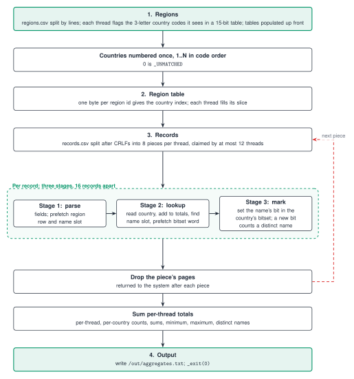

# Track C: Join (C++)

Reads `/data/regions.csv` (region id to country code) and `/data/records.csv` (CRLF line endings, a BOM and a header, quoted name and note fields) and writes `/out/aggregates.txt`: per country the record count, the sum of ids, the sum, minimum and maximum amount, the number of distinct names and the total name and note lengths, with records of unknown regions under `_UNMATCHED`. The exact task and output format are in the [spec](https://github.com/hackathon-raptors/speed-demon-2026/blob/main/specs/c-join.md).

## Result

Tag `best-50» (commit `2b3efbe»): 0.0243 s, 8.9 MiB, S 374, 81.28 on the board (`run-81747cac71e7»); the best row in the log is `run-b8a31e97e700», 0.0240 s, 8.2 MiB, 81.77, and the same source read 81.19 to 81.62 on its other rows. Progress (running best points, rows from `real-spec/board-runs.jsonl»): 72.30 (`run-6e20c9b0c201», Rust, Oct 31), 73.85 (`run-9e0e1b6e7e0d»), 79.18 (`run-202087ed39eb», Nov 1 06:00), 80.54 (`run-93446999afd8»), 81.63 (`run-d37977de033c»), 81.77. The long table is in [`PERF.md»](PERF.md).



Caption: regions, country table, records (a ring of parse, lookup and mark stages), totals, output.

## Approach

One C++20 file, `src/main.cpp`, built with g++ 15 (`-O3 -march=x86-64-v3 -static`, section garbage collection, and a committed gcc profile, see below). Both files are memory-mapped over a spare zero page. At most 12 threads (`hardware_concurrency`, capped) form one pool; every phase is cut into pieces that any thread claims, and a phase starts once the one before is done (a thread waits for work, not for every thread to arrive).

1. **Countries.** `regions.csv` is split by lines; each thread flags the country codes it sees (3 letters, in a 15-bit table). Countries get indices 1..N in code order (0 is `_UNMATCHED`).
2. **Region table.** Each thread fills its slice of a direct table, one byte per region id, from region id to country index.
3. **Records.** `records.csv` is split after CRLFs into 8 pieces per thread. The spec (section 2.2) says a CR appears only as the first byte of a CRLF terminator, so the byte after a CRLF always starts a record. Each record is read field by field: the id's comma from one 8-byte word, a quoted field's end by stepping through the bit mask of its quotes (a `""` pair is an escape), so commas and line feeds inside quotes cost nothing; the region's comma and the line feed come from one 32-byte compare each. Numbers are decoded eight digits at a time. Sums go to the thread's own per-country totals. Names go through a shared lock-free table (a name's id is its slot) and are marked in one bitset per country; the region read, the table lookup and the bitset word are each prefetched 16 records ahead through rings that start and end full of dummy records. Large tables are populated up front in shares and each piece's pages are mapped with one `MADV_POPULATE_READ`. A mark that sets a new bit adds one to the country's distinct names, so no pass over the bitsets is needed afterwards. A thread returns the pages of a finished piece to the system.
4. **Output.** The totals of the threads are summed, the text is written, and the process ends with `_exit(0)`.

The `Dockerfile` builds with `-fprofile-use` and the profile `pgo/sdrun-main.gcda`, recorded on seed 2. It must be regenerated whenever the source changes (`-Wno-error=coverage-mismatch` keeps the build from failing on a mismatch).

## Research and technique

What profiling showed and what each change did (numbers and run IDs in `PERF.md»):

- **The board as a profiler.** Four diagnostic builds (wrong output, read once, reverted in `6ee5296»): everything except the record parse 5.5 ms (`2a7cc01»); plus reading one byte of every cache line of the input 11.3 ms (`7496859»); full parse without the name lookup 25.6 ms (`67464a6»); name lookup kept, plain load instead of the atomic OR 27.8 ms (`4ba1710»); the real program about 29.9 ms (`79d68e7»). So set-up and teardown are about 5.5 ms, streaming 202 MB about 6 ms more (memory bandwidth), the name table with its marks about 4 ms, and the field parse itself about 14 ms. A later diagnostic with the parse run twice puts the parse at about 18 of 24 ms.
- **C follows instruction count.** Callgrind gave 950 M instructions at `8eb3624». Cuts (tzcnt for no quote, cheaper sign and dot, no zero test in the hash, free slots only on a miss, no warm-up tests in the rings; then region and amount in one two-lane fold) took it to 861 M and 784 M: board 0.0260 s (`run-2d01f677d216»), 0.0251 s and 0.0247 s (`run-a29d9f3b42d0», `run-c0b5c2e66081», 81.26). Where the instructions go (callgrind, about 223 per record): two quoted text fields 48, Totals updates 15, region and amount fold 15, bitset address and mark 12, name hash 10, name probe 8, loop control 7, ring advance 6, id decode 5.
- **Mispredicts.** `perf stat» on a 13th-gen laptop showed the quoted-field fast path caused about 57% of the branch mispredicts: removing it cut cycles 4.3% (720 M to 689 M) and mispredicts from 3.02 M to 2.07 M while instructions rose 4%; board 0.0266 s, 80.54 (`run-93446999afd8»). The rest are the pair check and the name-table hit test (about 0.24 per record each).
- **Dependency chains.** `llvm-mca» (alderlake) gave 99 simulated cycles a record against a 55.5-cycle throughput bound, the critical path being a pointer chain through the field ends. Splitting a piece in two cursors did not help on the board (the two hyperthreads of a core already overlap two chains).
- **The hot spot is one instruction.** `perf annotate» puts about 23% of the parse loop's time on the `lock bts» that marks a name in its country's bitset and 17% on the prefetches after it; per-thread bitsets, owner threads and byte marks all cost more memory or cycles than the lock saves.
- **Memory and pages.** Parse threads dropping their finished piece's pages: 0.0333 s to 0.0299 s (`run-cdf91eefd7e7», 78.68). Linker flags `--gc-sections» and `-z noseparate-code»: 0.0238 s, 81.70 (`run-cfcb9beba21f»), no source lines; the board's M does not seem to count the binary's pages.
- **C++ instead of Rust.** S 542 to 388 (the first C++ draft, `b573d30»), static link and `_exit(0)»: 0.0376 s static against 0.0426 s dynamic. A committed gcc profile took 0.0250 s to 0.0243 s (`track-c/pgo/», `run-c0ba4ad0f13b», 81.43).

## What failed and why

| Attempt | Result | Why |
|---|---|---|
| Two cursors per piece (`351b645») | 0.0282 s, 79.59, 11 more lines | inside noise; hyperthreads already overlap two chains |
| Quoted-field fast path (`e1bd0df») | caused 57% of the mispredicts | removed in `800e1ce»: 80.54 |
| Block-mask pass for field ends | mispredicts -25%, instructions +33%, cycles unchanged | not worth a board slot |
| Three-stage batches of 16, 32, 64 | cycles +6% to +10% | array stores and loads cost more than the ring saved |
| Chunked `pread» instead of the mapping | instructions -4%, cycles +9% | the kernel copy costs more than the page mapping |
| Reading the country at parse time, no prefetch (`9358419») | 0.0280 s | the region table's misses stall each record |
| Carry-trick quote handling, eight-slot name groups (`960565b») | mispredicts 2.54 M to 0.53 M but instructions 774 M to 920 M; 0.0256 s | C follows instructions |
| `-mtune=raptorlake»; ring lag 32; 111-bit name fingerprint | 0.0246 s; 75.61 against 75.7; 3-5 ms slower | no gain |
| gcc PGO on the first C++ version | no gain then | adopted later with a committed profile |
| Rust port of the C++ design | 3-5 ms slower than the older Rust code | language and build mattered |
| Amount min and max by a branch (`1c6a645», `run-091bca004961») | 0.0242 s, 81.44, 2 more lines; -0.9% instructions locally | no board gain; reverted in `2b3efbe» |
| Local only: dense name ids; non-power-of-two name table; a build without libstdc++; vector add for Totals | dense ids: +7 to +9% instructions and collision odds about 7e-5 per run against 3e-10; no-libstdc++: -0.57 MiB of binary pages for +44 lines | rejected; see `PERF.md» |

The local-against-board lesson is in the [root README](../README.md#what-failed-and-why).

## Assumptions and known limits

- **Name table: 131,072 slots** (8 bytes each, 1 MB), probed four at a time and claimed with a compare-and-swap. The pool of the public data has 100,000 names. There is no overflow check: with more than 131,072 distinct names the probe would not terminate.
- **A name's identity is a 64-bit hash of its bytes and length**, with no string comparison. Two different names in a pool of 100,000 would have to collide on all 64 bits to be confused (about 3 in 10^10 per run), which is not zero. Names are printable ASCII (spec 2.2).
- **Fewer than 255 countries** (the process exits with "too many countries"); region ids are ascending, the last line of `regions.csv` holds the largest id, and the table is one byte per id.
- **Known out-of-spec failure:** a CR inside a quoted note. The cut after a CRLF relies on the spec's guarantee that a CR appears only in a CRLF terminator; if a CR followed by LF occurred inside quotes, a piece could start in the middle of a record and the output would be wrong.
- Reads up to 64 bytes past the end of each file; this relies on the zero page mapped after it.

## Reproduction

```
git checkout best-50                      # or this branch's head
python3 check.py c --data <dir with regions.csv and records.csv> --expected d8088b1cd42ba1338b1345b107b55db7b96ef1f5066f3ff64fd26a8912a0f536
.\real-spec\dock.ps1 -Track c -Scale full -Runs 20
```

If the source changes, regenerate `pgo/sdrun-main.gcda» (trained on seed 2) or the build reports a coverage mismatch.

## Provenance

The source started as a draft written with ChatGPT/Codex (OpenAI) by the team owner and was reviewed, tested and tuned with Claude Code; AI assistance is allowed by the contest rules.

## Dependencies

None.

## Verification

Needs Docker; the datasets are generated with the contest's generator and are not in the repository. From the repository root:

```
python3 check.py c --data <directory with the regions.csv and records.csv> --expected d8088b1cd42ba1338b1345b107b55db7b96ef1f5066f3ff64fd26a8912a0f536
.\real-spec\dock.ps1 -Track c -Scale full -Runs 20
```

The first builds the track image offline and compares the SHA-256 of the output with the published hash of the seed-1 data; the second replicates the board run (pre-warmed volume, board flags, `memory.peak`) and prints MATCH or MISMATCH. Outputs matched the reference on generated seeds 1, 2, 3, 7, 11 to 16 and 21 to 23 at full scale; 100 back-to-back full-size runs matched the published hash. Known out-of-spec failures in the edge suite: `13_distinct_names_300k` (hangs beyond 131,072 names), `14_300_countries` and `15_2000_countries` (more than 254 countries), `92_OOS_note_lf_digit`. gcc PGO was dropped on the first C++ version and adopted later with a committed profile (about 0.0250 s to 0.0243 s on the board); the `Dockerfile` needs the profile to match the source. The history with run IDs is in [`PERF.md`](PERF.md); the whole-repo architecture is in [`../docs/OVERVIEW.md`](../docs/OVERVIEW.md).
