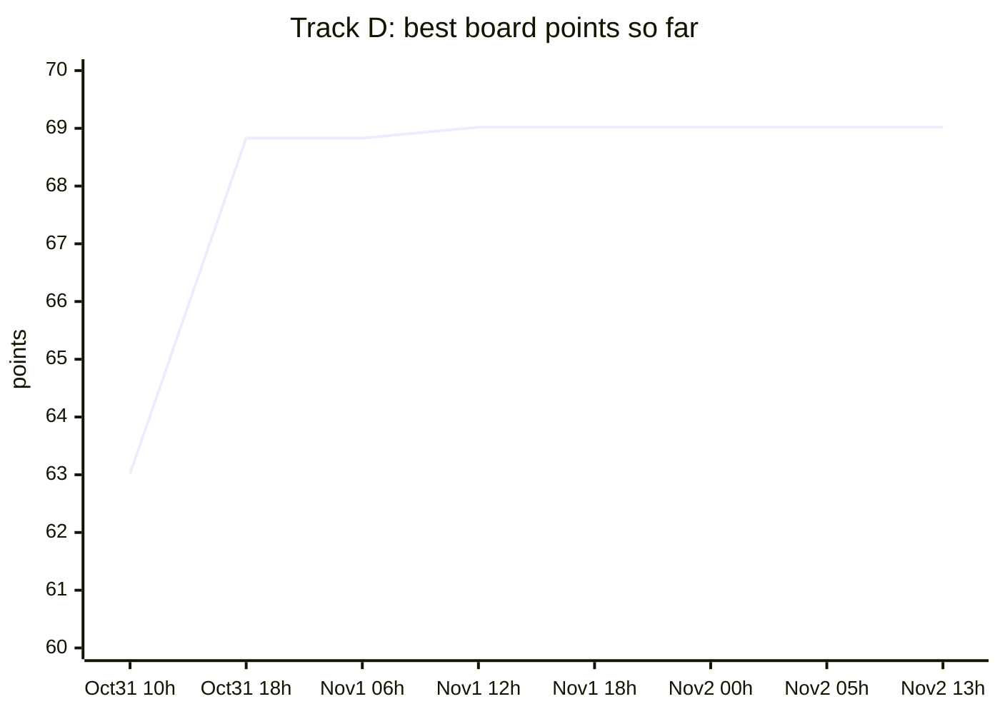

# Track D: performance log

## Summary

Where the track stands and why, before the long log below. Board numbers come from `real-spec/board-runs.jsonl` (run IDs as stored); the "reference" row is the contest's unmodified reference solution measured locally in Docker (laptop, slower than the scoring box; it has no board run and scores 0). "Final" is tag `best-50` (commit `2b3efbe`), the frozen source; its board row is in the table, and a repeat reading of the same source (commit `b3760c9`) was `run-1bdc615064c5` 0.1713 s / 66.1 MiB / 518 / 68.69. Board noise on identical code in our own log: D about 3.9% of the median; a difference of a point or two between commits is within noise. The log below is chronological: phrases such as "current version" in its header describe the time they were written, not the final state. The earliest board run for steps 1-8 is listed from the text of this file. Source size S is 518 on every D row from the replacement draft on (0.166-0.198 s across 98 rows), so that spread is mostly board noise rather than D code changes.

| Stage | Run ID | Commit | T (s) | M | S | Points |
|---|---|---|---|---|---|---|
| Reference (naive) | none (local) |  | 72.69 | 893 MB | 43 lines | 0 |
| Steps 1-8 (Rust), earliest board run cited in this file | `run-890f67017a83` (not in the log) | `db4cc76` | 0.475 | 382 MiB | 736 | 48.85 |
| First run in the log | `run-0a5e5f081b09` | `32f54ce` | 0.2308 | 94.3 MiB | 680 | 63.02 |
| Best row in the log | `run-1e5e115c0722` | `2a7cc01` | 0.1662 | 66.1 MiB | 518 | 69.02 |
| Final (`best-50`) | `run-e682dbdc30a2` | `2b3efbe` | 0.1729 | 66.3 MiB | 518 | 68.58 |

### Board score over time

Best row seen so far at each time (UTC), from `real-spec/board-runs.jsonl`:

Caption: running maximum of the board points of track D at the checkpoints below.

| Checkpoint (UTC) | Points | T (s) | M (MiB) | S | Run ID | Commit |
|---|---|---|---|---|---|---|
| Oct31 10h | 63.02 | 0.2308 | 94.3 | 680 | `run-0a5e5f081b09` | `32f54ce` |
| Oct31 18h | 68.83 | 0.1692 | 66.0 | 517 | `run-237237831d54` | `4f9e4bd` |
| Nov1 06h | 68.83 | 0.1692 | 66.0 | 517 | `run-237237831d54` | `4f9e4bd` |
| Nov1 12h | 69.02 | 0.1662 | 66.1 | 518 | `run-1e5e115c0722` | `2a7cc01` |
| Nov1 18h | 69.02 | 0.1662 | 66.1 | 518 | `run-1e5e115c0722` | `2a7cc01` |
| Nov2 00h | 69.02 | 0.1662 | 66.1 | 518 | `run-1e5e115c0722` | `2a7cc01` |
| Nov2 05h | 69.02 | 0.1662 | 66.1 | 518 | `run-1e5e115c0722` | `2a7cc01` |
| Nov2 13h | 69.02 | 0.1662 | 66.1 | 518 | `run-1e5e115c0722` | `2a7cc01` |

The log starts on Oct 31 at 09:59 UTC; earlier board readings are in the table above and are not in the log. Board readings of unchanged code differ by a few percent, so single steps of a point or two are within noise.

What moved the score:

1. Bidirectional Dijkstra over forward and reverse CSR with a 4-ary heap (step 1), the base of everything else.
2. Relabelling nodes in BFS order (step 2): query phase 2.4 to 0.83 s locally.
3. Expanding the side with the smaller queue (step 3): 3.93 to 2.58 s, three times fewer heap pops.
4. Parallel line-aligned parse (step 4): 2.35 to 1.49 s locally.
5. Filing edges under their owner worker before building the CSR (steps 8, 13): forward CSR 153 to 74 ms; no atomics in the build.
6. `u32` labels instead of `u64` (step 9): 384 to 261 MB and 1.04 to 0.89 s.
7. Radix heap (step 12): single-worker query phase 2,100 to about 1,100 ms (the current source uses 4-ary heaps again).
8. Paged distance labels (step 14): 12 query workers instead of 6, 829 to 595 ms locally.
9. Replacement by the ChatGPT-drafted design: 321 against 455 ms and 67.2 against 93.7 MiB locally; board from about 0.23 s and S 680 to about 0.17 s and S 518.
10. Word-at-a-time digit reader and prefetching in the ordering (step 18): the original-id CSR phase 112 to 82 ms; ordering 85 to 72 ms.

What did not help:

1. Queries in source order with chained regions: no change in the query phase.
2. Each worker scanning the whole edge stream: 150-165 ms against 100-170 ms for filing, worse.
3. Hash labels instead of arrays: 300-370 ms against 245-285 ms for the query phase.
4. Atomic row cursors for the original-id CSR: 60-75 ms for placement because locked instructions serialise cache misses.
5. Packing the heap entry into one `u64`: 430 against 436 ms, about 2-3%, for 8 lines and an assert.
6. Dropping the sweep-clear of labels: peak memory unchanged and slightly slower.
7. Label page size 8, 16, 32 or 64: no difference within noise.
8. The first version of interleaved labels: 14% slower (about 7% after the sweep-clear).
9. A deeper prefetch variant in the ordering (12 rows ahead): equal minimum, not kept for its extra lines.
10. Twelve query workers with array labels: about 20% faster queries but 84 MB more, so 6 stayed until paged labels.

Every step from the reference to the current version.

**How to read the numbers.** The T and M columns are local measurements: a
laptop running Docker with the board's run flags on the full public dataset
(1,740,512 nodes, 5,000,000 edges, 2,000 queries), with the output hash
checked against the published SHA-256. Local runs swing 30-50%, so each row is
a before -> after median from interleaved or repeated runs, and rows are only
comparable within themselves. The laptop is slower than the scoring box: the
version of steps 1-8 (commit `db4cc76`) measured **0.475 s, 382 MiB, 736 lines,
K 9.48, 48.85 points on the live board** (run `run-890f67017a83`) and about
0.96 s, 384 MB on this laptop. The **Run ID** column stays *pending* for
steps without their own board run, and **Points** is only filled from board
numbers. Steps 9-18 have not been on the board yet. Everything that was tried,
including the failures, is in [`EXPERIMENTS.md`](../docs/EXPERIMENTS.md).

| Step | Change | Run ID | T (s), local | M (MB), local | Points |
|---|---|---|---|---|---|
| 0 | The reference, unchanged | | 72.69 | 893 | 0 |
| 1 | Bidirectional Dijkstra over forward and reverse CSR, 4-ary heap, reused per-worker state, stop when either queue empties, queries answered in parallel | pending | | | pending |
| 2 | Nodes relabelled in BFS order before building the CSRs (the input ids are a random relabelling of a road-like lattice) | pending | queries 2.4 -> 0.83 | lower | pending |
| 3 | Expand the side with the **smaller queue** instead of the smaller key | pending | 3.93 -> 2.58 (3x fewer heap pops) | about 505 | pending |
| 4 | Parallel line-aligned parse; each CSR built by workers that own contiguous node ranges and write disjoint slices | pending | 2.35 -> 1.49 (5 rounds) | about 520 | pending |
| 5 | One interleaved `[forward, backward]` label per node (distance + 1, so zero means unreached), packed `(neighbour, weight)` adjacency, one loop for both directions, sweep-clear after wide searches | pending | 1.03 -> 1.10 (9 rounds, about 7% slower, within noise) | 515 -> 381 | pending |
| 6 | Reverse CSR built on the idle cores while the serial BFS runs; both CSRs renamed into BFS order by a row copy (`permute_csr`) instead of relabelling the edge list and building both again | pending | about 0.95 -> 0.85 (Linux container, interleaved) | about 380 | pending |
| 7 | Relaxations at or above the best meeting distance are skipped | pending | query phase about 436 -> 420, inside the noise | 377 | pending |
| 8 | Each parse part files its edges under the worker that owns their node range before the CSR is counted and placed, so a worker scans 1/12 of the edges per pass instead of all of them | `run-890f67017a83` (commit `db4cc76`, steps 1-8 together) | original CSR phase 81 -> 56 ms; total 837 -> 780 ms (9 interleaved rounds) | 380 | 48.85 (board) |
| 9 | Each worker's distance labels are `[u32; 2]` instead of `[u64; 2]` (distance + 1; a distance that does not fit is marked `u32::MAX` and kept exactly in a small per-query table), halving the 12 per-worker arrays | pending | 1.04 -> 0.89 (9 interleaved rounds) | 384 -> 261 | pending |
| 10 | The parse threads file every edge straight into per-owner buckets for the forward and the reverse graph, so the flat edge list and the separate bucketing copy never exist; the buckets are dropped as soon as each CSR is built. The query phase uses one worker per physical core (6) instead of 12 | pending | about equal (1017 vs 1075 ms median over 11 interleaved rounds) | 261 -> 192 | pending |
| 11 | The serial BFS relabelling is replaced by a parallel region-growing order (workers race on a claimed byte per node and grow BFS regions of up to 1024 nodes); the reverse CSR is built from the renamed forward CSR instead of beside the BFS; the forward CSR is built with two parse passes and atomic row cursors | pending | harness replica on a loaded laptop 1.35 -> 0.89 together with steps 12-13 | 190 -> 181 | pending |
| 12 | The per-side queue is a monotone radix heap instead of the 4-ary heap | pending | single-worker query phase 2100 -> about 1100 ms (native, same queries) | same | pending |
| 13 | Edges are filed under their owner worker before the forward and reverse CSR builds, so counting and placing need no atomics | pending | native interleaved min of 8: forward CSR 153 -> 74 ms, total 589 -> 503 ms (reverse CSR 32 -> 45 ms) | same | pending |
| 14 | Per-worker labels are pages of 16 ids from a pool (page table per worker) instead of an array over all nodes, which allows 12 query workers instead of 6; the reverse CSR is a transpose of the renamed forward CSR with atomic cursors instead of the bucket build | pending | docker interleaved 829 -> 595 ms (6 rounds, busy laptop) | 181 -> 123 | pending |
| 15 | CSR edges take one 32-bit word (neighbour + weight; a weight that does not fit takes a second word) | pending | docker interleaved 693 -> 654 ms (9 rounds) | 125 -> 98 | pending |
| 16 | Filed edges (the bucket build of the original-id CSR) are one `u64` each instead of 12 bytes | pending | neutral (native min of 7: 482 vs 465 ms) | 98 -> 86 | pending |
| 17 | Rows are copied out while regions grow and renamed into the final array in parallel (no separate permutation pass); `malloc_trim` between build phases | pending | docker interleaved 668 -> 599 ms (9 rounds); native min of 8: order + permute 152 -> 116 ms | peak is now the query phase, about 92 | pending |
| 18 | Numbers up to 7 digits are parsed from one 8-byte load (separators are the only input bytes without bit 4 set); region growth prefetches the rows it is about to read; the big buffers are not freed at exit | pending | docker interleaved 556 -> 488 ms (9 rounds); native min of 9: forward CSR 112 -> 82 ms (parser), order 85 -> 72 ms (prefetch) | about 93, same | pending |

Step 9 measured the board's way (5 runs, mean of the middle three, highest
memory peak) on the same laptop: **0.867 s and 262 MB, against 0.964 s and
384 MB** for the committed version, and 758 source lines against 745 (the
harness's own count). The peak is now the two CSRs (94 MB) plus the 12 label
arrays (14 MB each).

## Why step 3 mattered

On the real graph a handful of queries start at a node with no in-edges.
Balancing the two searches by key lets such a source starve: its own first
edges weigh about 2^32, so the other side keeps expanding and settles most
of the 1.74 M-node main body. Any alternation is correct under the stop
rule `top_forward + top_backward >= best`; balancing by queue size stopped
the starvation and cut the settled nodes in half.

## What the time is now

About 0.78-0.85 s locally: parse about 45-60 ms, original forward CSR about
56 ms, serial BFS about 200 ms (the reverse CSR is built beside it),
permuting the two CSRs about 45 ms each, queries about 410-475 ms (three
runs, total 0.84-0.96 s). The query phase is evenly balanced over the 12
workers (each busy 545-565 ms, slowest single query 94 ms), so it is
throughput-bound, not long-pole-bound.

## Tried and dropped

* **Parallel BFS** for the reorder. Not built: a level-synchronous BFS pays
  a barrier per level on a lattice with a long diameter, and the serial
  pass is only about 250 ms.
* **First version of the interleaved labels** (clear touched nodes one by
  one): 14% slower; the sweep-clear brought it to about 7%.

* **Packing the heap entry into one `u64`** (`dist << 21 | node`): query
  phase median 430 vs 436 ms over 10 interleaved runs, about 2-3% of the
  total, for about 8 lines and an assert that fires on huge distances.
  Reverted.

* **Dropping the sweep-clear** so that unreached label pages stay
  unmapped: peak memory unchanged (261 MB, the searches touch those pages
  anyway) and slightly slower (942 vs 901 ms median over 9 rounds).

## Where the unit tests live

The unit tests are in `tests/track_d.rs` at the repository root, included
with `#[cfg(test)] #[path = "../../tests/track_d.rs"] mod tests;`, so the
release build (which only sees this folder) never compiles them and the
source-size count of this folder does not include them. `cargo test` in this
folder still runs them. By the harness's own count this changed the source
lines from 758 to 582.

* **Query worker count** (12, 8, 6, 4, 3 workers, interleaved): 989, 948,
  963 (816 in a later run), 832 and 928 ms; the peak was 262 MB for all of
  12, 8 and 6 workers before step 10, because the peak was in the graph
  build (edge list, buckets, original CSRs), not the queries. After step 10,
  6 workers is the best balance; 4 workers saves 12 MB for about 2% time.

## Steps 11-13 in detail

Measured natively on the Windows laptop (same machine, other jobs running,
so only interleaved or min-of-N comparisons mean anything) and with the
Docker harness replica (`local_harness.py`, 5 runs, mean of the middle three):
the version before step 11 gave **1.345 s, 190.5 MB** (a batch the harness flagged as too noisy: runs 1.10-1.79 s) and this version
**0.892 s, 181.2 MB** in back-to-back batches while the laptop was loaded
(source lines by the harness's counter: 572 -> about 520). The scoring box
is faster than this laptop, so these are not board numbers.

The phases now (native, min of 8, ms): original-id CSR 74, ordering 63,
renaming 45, reverse CSR 45, queries about 205-230, plus reading the file
(on Linux it is mapped, and costs nothing here). The ordering and CSR phases
are limited by random memory access; the query phase was limited by the
heap: single worker, 2000 queries, 7.6 M pops and 21 M relaxations, about
280 ns per pop with the 4-ary heap and about 140 ns with the radix heap.

## Tried and dropped in steps 11-13

* **Queries in source order with chained regions** (each region's seed is
  next to the end of the previous one, so ids are spatially coherent, and
  queries are taken in source-id order in chunks of 1-64): no change in the
  query phase (within +-5% noise), single worker or 6 workers. Cross-query
  cache reuse is not what limits the search.
* **Each worker scans the whole edge stream and keeps only its own keys**
  (no filing, no atomics): forward CSR 150-165 ms and reverse CSR 176-320 ms
  vs 100-170 and 33-46 ms, worse because 12 workers each walk 5 M edges twice.
* **Hash labels** instead of the per-worker `[u32; 2]` array (open addressing,
  a home slot that keeps runs of 32 consecutive ids together, doubling when
  half full): 3 MB instead of 14 MB per worker, but 300-370 ms vs 245-285 ms
  for the query phase at 12 workers (identity hash: 770-880 ms from
  clustering). Dropped; about break-even in K once the extra time is counted.
* **12 query workers with the radix heap** are about 20% faster in the query
  phase than 6 (200-277 vs 256-384 ms) but would add 84 MB of label arrays,
  so 6 stays.
* **Atomic row cursors for the original-id CSR** (step 11's first build): about
  60-75 ms for the placement pass because locked instructions serialise the
  cache misses; replaced by step 13.

## Steps 14-17 in detail

Same caveats as before: a shared, loaded laptop, so only interleaved A/B or
min-of-N comparisons mean anything. The peak-memory story: before step 14 the
peak was the query phase (two CSRs plus 6 x 14 MB label arrays) and, nearly
as high, the reverse-CSR build (a second copy of every edge in buckets);
step 14 removed both, step 15 halved the CSRs, step 16 shrank the buckets of
the first build, and what is left (about 90 MB) is the query phase again: 54
MB of CSRs plus the label pools of 12 workers, found by reading `VmHWM` at the
end of each phase (it rose only during the queries).

Harness replica (5 runs, mean of the middle three, highest peak) back to back
on the loaded laptop: the state before step 14 gave **0.911 s, 181 MB** (batch
flagged too noisy), the current state **0.651 s, 99 MB** (runs 0.67-0.71 s,
peaks 91 MB except one batch run at 99 MB). The harness's source-line count
went from 520 to 662, because the 4-byte edge encoding, the run/rename code and
the paged labels are real code; that costs about 0.8 points of K against the
time and memory gains.

## Step 18 in detail

Parsing alone (12 threads, no filing) took 54-72 ms of the 112 ms the
original-id CSR needed, about 7 ns per input byte of CPU, so the digit loop was
the next target. The word-at-a-time reader brought the whole phase to 82 ms.
Prefetching the row of the node 6 places ahead in the region queue and the
offset entry of each newly claimed node cut the ordering from 85 to 72 ms
(minimum of 9); a deeper variant (rows 12 ahead plus the claimed byte of the
neighbours 4 ahead) was equal in the minimum, with a lower mean, and was not
kept for its extra lines. The exit change (`mem::forget` of the CSRs and the
worker pools) is below the noise on its own.

## Tried and dropped in steps 14-17

* **Label page size** 8, 16, 32, 64 ids: no difference within noise
  (native query phase 193-340 ms for all, minimum 191-211 ms).
* **Hash labels** and **12 workers with array labels** are in the earlier
  list; the paged pool is what made 12 workers affordable (queries about 20%
  faster than with 6, the pool costs no measurable time at 6 workers).

## Caveats

* Steps 9-18 have not run on the scoring box. Expect the board's T to differ.
* The earlier "61x" figure from a synthetic random graph was wrong for the
  real road network and has been removed from this log.
* Source size is the weak axis: the reference is 43 code lines.

## Replacement by an alternative implementation (not yet on the board)

`src/main.rs` was replaced by a different implementation drafted with
ChatGPT by the project owner (per-part bucketed CSR build, blob BFS
renumbering, bidirectional Dijkstra with 4-ary heaps and paged distances). It
was reviewed and tested here and is not part of the step table above, whose
rows describe the earlier code.

Local comparison against the previous version (this laptop, Docker with the
board's run flags, full public dataset, 15 interleaved rounds, hash checked
every run): median wall 321 ms against 455 ms, `memory.peak` median 67.2 MiB
against 93.7 MiB. Source: about 520 code lines after `rustfmt` (Dockerfile
included) against about 680, because the unit tests are gone. Also correct on
the generated datasets of seeds 2, 3 and 7 (10 runs each, no failure), on the
tiny and sample scales, and on the whole edge-case suite (66 cases with LF
line endings). Review found a panic: a prefetch indexed the edge array at the
offset of a node with no out-edges when that node is the last in id order
(probability about 2e-5 per dataset on the public graph's 42 sinks); it is
fixed (the prefetch uses a wrapping pointer) and checked on a graph made to
trigger it. `cargo clippy -D warnings` is clean after four small changes.
Points are estimated, not measured: scaling the last board result by these
ratios gives about 69 against 63; a board run will replace this estimate.

<!-- board-runs:begin -->
## Board runs

Each row is one scored run of the named commit on the live board, copied from the public board feed (`board.json`). The feed keeps only each track's latest and best run, so runs before these cannot be listed; earlier steps in the table above stay local measurements. Board timing varies by about 1-2 ms between runs of identical code: every push re-runs all four tracks, so a row whose change names another track measured this track's unchanged code and shows that noise.

| Commit | Change | Run ID | T (s) | M (MiB) | S | Points |
|---|---|---|---|---|---|---|
| `32f54ce` | Track A: the writer thread exits the process after the last block (agent-a4 d262378) | `run-0a5e5f081b09` | 0.2308 | 94.3 | 680 | 63.02 |
| `b67a992` | Track A: link the C runtime statically (skips dynamic loading at start-up) | `run-0de3473d90a5` | 0.2355 | 98.2 | 680 | 62.63 |
| `f299e99` | Track B: parse the queries in one SIMD token pass with leaner term interning (agent-b 8537 | `run-dcf9357d596b` | 0.2350 | 96.9 | 680 | 62.71 |
| `33b8455` | Track B: postings fill uses the term offset as its own cursor (agent-b d49c673) | `run-ef86756aeaae` | 0.2285 | 97.2 | 680 | 63.00 |
| `b208288` | Track A: workers write their own hour block at its final offset; no writer thread (agent-a | `run-b2c218f84bee` | 0.2309 | 98.1 | 680 | 62.85 |
| `cd4c35e` | Revert "Track A: workers write their own hour block at its final offset; no writer thread  | `run-b67625fd44dc` | 0.2280 | 97.5 | 680 | 63.01 |
| `e804869` | PERF.md: add a Board runs table with real run IDs from the public feed to every track | `run-a39e58686087` | 0.2485 | 95.5 | 680 | 62.16 |
| `36f4296` | Tracks A and C: profile-guided optimization from a committed profile (no source or Dockerf | `run-584b4976e052` | 0.2352 | 97.6 | 680 | 62.66 |
| `158f18f` | Track B: 32-byte token mask (agent-b 0054521); Track A PERF.md header with current board n | `run-2008d5099086` | 0.2278 | 95.9 | 680 | 63.09 |
| `49548fa` | Track B: merge and render in parallel from per-range logs (agent-b a34f4cf) | `run-792a3c586a77` | 0.2332 | 97.0 | 680 | 62.79 |
| `3286475` | Track C: 111-bit name fingerprint (second independent hash compared on every tag match), d | `run-457e766d4d47` | 0.2323 | 97.9 | 680 | 62.79 |
| `280509c` | Track B: vector-compare term lookup, CRC32C hash, fused dedupe (agent-b) | `run-31018b933ee2` | 0.2401 | 96.1 | 680 | 62.51 |
| `892d831` | Track C: regenerate the PGO profile for the 111-bit fingerprint source | `run-6267765c6698` | 0.2296 | 93.8 | 680 | 63.10 |
| `2ca5698` | Track C: back to the 36f4296 source and profile (the wider fingerprint cost 3-5 ms on the  | `run-fef1434b1953` | 0.2550 | 98.8 | 680 | 61.73 |
| `b1497a5` | Track B: 2 MB pieces (agent-b c51c3b0) | `run-43449fd7246e` | 0.2338 | 97.2 | 680 | 62.75 |
| `f00df83` | Revert Track B 2 MB pieces: T -17 ms but M +12 MiB, 65.82 vs 65.94 on the board | `run-1c23341dba98` | 0.2323 | 90.6 | 680 | 63.13 |
| `b18c263` | PERF: board run IDs through f00df83 (16 scored runs per track) | `run-3b47a1b08a6b` | 0.2674 | 93.3 | 680 | 61.47 |
| `44a450f` | Track A: mallopt M_MMAP_THRESHOLD 32 KiB, memory.peak 23.0 -> 20.4 MiB locally (agent-a4 c | `run-b8240df3c2b1` | 0.2315 | 96.4 | 680 | 62.89 |
| `b7bb4d3` | Track A: PGO profile regenerated for the mallopt source (agent-a4 90f380c) | `run-4b8b3425c70a` | 0.2347 | 94.9 | 680 | 62.81 |
| `4c454fe` | Track A: three-phase port with exact output sizes, every thread formats into the mapped ou | `run-39cd48090665` | 0.2437 | 96.6 | 680 | 62.33 |
| `5476630` | Re-run board on the Track A port (noise check) | `run-31afd8f4fccc` | 0.2326 | 99.7 | 680 | 62.70 |
| `6c9bc1e` | Tracks B and D: user-drafted Rust solutions, reviewed (alt-bd c90b4a8): B 603 lines, D 509 | `run-f3df23fd5cf3` | 0.1842 | 67.4 | 517 | 67.82 |
| `f47d313` | Track C: user-drafted C++ design ported to Rust, CRLF chunk cut, 440 lines (agent-c3 7827d | `run-f832cffbcdf3` | 0.1728 | 67.2 | 517 | 68.53 |
| `c4832fa` | Re-run board on the Track C port (noise check) | `run-e4147edf6dcb` | 0.1705 | 66.6 | 517 | 68.71 |
| `4f9e4bd` | Track D: PAGE 512 -> 256 (experiment) | `run-237237831d54` | 0.1692 | 66.0 | 517 | 68.83 |
| `7a3ceb9` | Track D: BLOB 512 -> 1024 (experiment) | `run-4f454bc94f8d` | 0.1717 | 67.3 | 517 | 68.59 |
| `0b9abd0` | Track D: BLOB back to 512, CHUNK 1024 -> 4096 (experiment) | `run-e4bc2534c91a` | 0.1745 | 65.4 | 517 | 68.53 |
| `1a4d82e` | Track D: PAGE 256 -> 128 (experiment) | `run-9f0a731d2fc7` | 0.1869 | 65.8 | 517 | 67.77 |
| `a2fa18e` | Track B: persistent thread pool instead of 12 fresh threads per phase (experiment) | `run-e6949fbac529` | 0.1705 | 65.6 | 517 | 68.78 |
| `b573d30` | Track C: C++ (gcc 15, user-drafted design: pclmul quote mask, dense-id name table); Rust v | `run-b982832f8f82` | 0.1799 | 66.4 | 517 | 68.14 |
| `17ce1b0` | Track C: static link and _exit(0) after the output (experiment) | `run-f0d72b3c2c4e` | 0.1746 | 65.6 | 517 | 68.51 |
| `9e9667f` | Re-run board on static+_exit Track C (noise check) | `run-1dfc0257aa37` | 0.2038 | 66.1 | 517 | 66.80 |
| `308cbff` | Track A: C++ (gcc 15, static, _exit after the output); Rust version stays at tag best-19 | `run-6ed34af0f2f4` | 0.1724 | 65.7 | 517 | 68.65 |
| `4d1d805` | Tracks B and D: exit right after the output so the big arrays are not freed one by one | `run-f19739011738` | 0.1711 | 65.3 | 518 | 68.75 |
| `d68c42e` | Untrack Cargo.lock files added by mistake | `run-d36722b5d600` | 0.1738 | 66.1 | 518 | 68.53 |
| `23561b4` | Track C: LAG 16 -> 32 (experiment) | `run-13f7637d3f4f` | 0.1985 | 65.4 | 518 | 67.13 |
| `a302a61` | Track C: LAG back to 16 (32 scored 75.61, no gain) | `run-590fdacc489a` | 0.1923 | 65.6 | 518 | 67.47 |
| `70fee14` | Track A: 16 pieces per thread (experiment) | `run-7ea14a500420` | 0.1722 | 65.4 | 518 | 68.67 |
| `8d367d9` | Track C: new user-drafted C++ (64-bit hash key, field-by-field parse, distinct counts from | `run-ba337fa71396` | 0.1902 | 65.4 | 518 | 67.60 |
| `2ce9b21` | Track B: new user-drafted Rust (token id stream, CRC hash, bitmap for big lists, persisten | `run-0637a97b287a` | 0.1726 | 66.1 | 518 | 68.60 |
| `a46cccc` | Track A: new user-drafted C++ (branch-free width, 64-byte name compare, latency buffer siz | `run-5bb911630f51` | 0.1712 | 66.3 | 518 | 68.68 |
| `428ae7e` | Track A: new file without the sizing pass over all records (experiment) | `run-a2ae390e4894` | 0.1712 | 65.9 | 518 | 68.71 |
| `8b2268b` | Write-ups for the second A, B and C drafts, with board run IDs | `run-0e3ac4fbb477` | 0.1792 | 66.0 | 518 | 68.20 |
| `f34afab` | Track B: BIG 768 -> 1536 (experiment) | `run-afafed8933d3` | 0.1782 | 65.9 | 518 | 68.27 |
| `576267e` | Tracks A and C: each thread releases a consumed input piece's pages at once (from the new  | `run-b16343da8915` | 0.1731 | 65.9 | 518 | 68.59 |
| `a94d376` | Track B: each thread releases its share of docs.txt after the scan | `run-d53ce99c8597` | 0.1730 | 65.8 | 518 | 68.60 |
| `4dde5ce` | Track B: DIAGNOSTIC (answers computed twice) to measure the answer phase on the board; wil | `run-97f90d34d610` | 0.1810 | 65.9 | 518 | 68.10 |
| `ab00e1a` | Write-ups for the page-release changes and the answer-phase measurement; board run IDs | `run-4c59a9798a70` | 0.1915 | 65.4 | 518 | 67.53 |
| `bb07ac5` | Track A: 16 pieces per thread, now that pieces are released as they finish (experiment) | `run-a0e386f5be6e` | 0.1866 | 65.7 | 518 | 67.78 |
| `3cbb939` | Track A: prefetch the input 4 KB ahead in the scan loop | `run-8df98b71c736` | 0.1949 | 65.9 | 518 | 67.30 |
| `fff546f` | Track B: prefetch the input 2 KB ahead in the token scan | `run-aa9d166ff114` | 0.1789 | 65.9 | 518 | 68.23 |
| `ff9de8e` | PERF: B prefetch experiment (reverted) with its board run ID | `run-792013a1dc83` | 0.1691 | 66.1 | 518 | 68.83 |
| `c27bda3` | Track A: build with -O2 instead of -O3 (experiment, same source) | `run-6586416f183c` | 0.1882 | 65.7 | 518 | 67.69 |
| `8218980` | PERF: A -O2 note names its run ID | `run-7cf138e5bdf7` | 0.1716 | 65.8 | 518 | 68.69 |
| `7f5e52c` | Track C: one #include <bits/stdc++.h> instead of twelve standard-library includes | `run-52a11b934009` | 0.1734 | 65.2 | 518 | 68.62 |
| `79d68e7` | Track C: region_line also accepts a CRLF region file (fixes a crash in the previous commit | `run-9fb887a192a9` | 0.1733 | 65.7 | 518 | 68.58 |
| `5338276` | Log board runs for the line cuts (A S 306, C S 368) | `run-1bddf49db0b0` | 0.1728 | 65.9 | 518 | 68.61 |
| `2a7cc01` | Track C: DIAGNOSTIC, record parse disabled to measure the floor (output is wrong; reverted | `run-1e5e115c0722` | 0.1662 | 66.1 | 518 | 69.02 |
| `4ba1710` | Track C: DIAGNOSTIC, the mark is a plain load instead of the atomic OR (output is wrong; r | `run-633d252c99d9` | 0.1786 | 65.3 | 518 | 68.29 |
| `67464a6` | Track C: DIAGNOSTIC, no name-table lookup (id taken from the key bits); output wrong; reve | `run-a4b5a231d36b` | 0.1702 | 66.9 | 518 | 68.70 |
| `7496859` | Track C: DIAGNOSTIC, the parse only streams the input (one byte per cache line); output wr | `run-31cbf9744db6` | 0.1729 | 66.5 | 518 | 68.56 |
| `0df6a6f` | Track C: decode numbers with pmaddubsw/pmaddwd instead of the scalar multiply chain | `run-564046778615` | 0.1689 | 66.0 | 518 | 68.85 |
| `a39d4f6` | Track B: two exact line cuts (610 -> 600 formatted lines) | `run-918739aea6f9` | 0.1775 | 65.7 | 518 | 68.33 |
| `2a7885f` | Track C: find the id's comma with one 16-byte compare instead of the SWAR zero-byte trick | `run-dc259b7efa82` | 0.1905 | 66.0 | 518 | 67.54 |
| `37fae72` | Log board run for C's 16-byte comma find (79.90) | `run-27774956c8d6` | 0.1781 | 65.9 | 518 | 68.27 |
| `ba0e248` | README: next-steps paragraph matches the current board times and the C diagnostics | `run-443e9560b2b4` | 0.1871 | 66.2 | 518 | 67.72 |
| `e1bd0df` | Track C: quoted fields that close within 31 bytes on a lone quote skip the 64-byte loop | `run-530900954df4` | 0.1722 | 66.7 | 518 | 68.59 |
| `b34456e` | Log board run for C's quoted-field fast path (first reading 79.02) | `run-244eaf532b0a` | 0.1812 | 66.1 | 518 | 68.08 |
| `351b645` | Track C: parse the two halves of each piece in turn, so two dependent chains overlap | `run-be717613a0c2` | 0.1724 | 65.8 | 518 | 68.63 |
| `800e1ce` | Revert "Track C: quoted fields that close within 31 bytes on a lone quote skip the 64-byte | `run-e82b33fd3b81` | 0.1773 | 65.9 | 518 | 68.33 |
| `09cbdd1` | Track A: list a batch's line ends first, then parse each line from its known start (from c | `run-b249542c6d59` | 0.1705 | 65.8 | 518 | 68.76 |
| `c9da3b2` | PERF: C block-mask field-end pass (tried, not kept), with laptop counters | `run-12e0181dc9f9` | 0.1680 | 66.2 | 518 | 68.89 |
| `eee525f` | Track B: user-drafted lookup that identifies a term by its 64-bit hash (46-bit tag), no ke | `run-1231a3a2bc8d` | 0.1729 | 65.8 | 518 | 68.61 |
| `8eb3624` | PERF: log board runs (B 73.96 with the 64-bit-hash lookup) | `run-2be5ed573689` | 0.1727 | 66.0 | 518 | 68.60 |
| `86570b0` | Track A: 8% fewer instructions in the line parse | `run-6373361e2a7e` | 0.1807 | 65.9 | 518 | 68.12 |
| `9358419` | Track C: 12% fewer instructions per record | `run-ab6a888b238c` | 0.1771 | 65.4 | 518 | 68.37 |
| `ff3de8e` | Track C: read the country after its prefetch again, keeping the other instruction cuts | `run-5cafa0474a51` | 0.1707 | 66.0 | 518 | 68.73 |
| `41d7902` | PERF: log board runs (A 84.76, C 80.69 with the instruction cuts) | `run-ea4d2d5a1b16` | 0.1787 | 65.9 | 518 | 68.24 |
| `0301fbf` | Track A: the SIMD partition shares the scalar loop for its tail | `run-c98b5285f489` | 0.1712 | 66.1 | 518 | 68.70 |
| `e80c817` | Track C: amount and region in one two-lane fold, tables by value, no hash finalizer (from  | `run-793fbbd3658d` | 0.1877 | 66.0 | 518 | 67.70 |
| `c967879` | Tracks A and B: cheaper scans from the cloud branches | `run-d07a5e86b81f` | 0.1818 | 66.4 | 518 | 68.02 |
| `248a537` | PERF: log board runs (C 81.01 with the two-lane fold) | `run-871cf6a7e54d` | 0.1763 | 66.4 | 518 | 68.36 |
| `f7de92a` | Track A: back to the line list, with one stretch of chunks per hour; Track B: back to eee5 | `run-bda9c765697c` | 0.1805 | 65.8 | 518 | 68.14 |
| `9f5f49b` | Track B: DIAGNOSTIC (one extra token and lookup pass) to time it on the board; will be rev | `run-7fcdcec13e77` | 0.1727 | 66.2 | 518 | 68.59 |
| `27bcbd7` | Track B: DIAGNOSTIC (one extra classify and hash pass, no lookup) to time it on the board; | `run-e04d5a281fca` | 0.1773 | 65.8 | 518 | 68.33 |
| `3ee9986` | Track B: term table half the size (experiment) | `run-4976e8b9b94e` | 0.1740 | 66.0 | 518 | 68.52 |
| `adb642e` | Track B: a small table of the hottest terms ahead of the main one (experiment) | `run-b5e635d118de` | 0.1860 | 65.6 | 518 | 67.83 |
| `f880347` | Track B back to eee525f (hot table 0.1988 s); Track C: one field for both text byte sums;  | `run-268109cec044` | 0.1700 | 66.0 | 518 | 68.78 |
| `d67679d` | Tracks A, B, C: transparent huge pages left on (experiment, board reading only) | `run-9ee9829323f1` | 0.1886 | 65.6 | 518 | 67.68 |
| `5515114` | Huge pages off again; Track B post-scan bundle; Track A 64-bit partition index | `run-933dd46bcc2d` | 0.1862 | 66.1 | 518 | 67.78 |
| `4f631af` | Track B: DIAGNOSTIC 6 threads instead of 12, to see what hyperthreading gives on the board | `run-f3b5e8d49aec` | 0.1735 | 65.6 | 518 | 68.58 |
| `35b0214` | Track B: back to 12 threads; prefetch lag 16 instead of 8 (experiment) | `run-d3e1c6fbe589` | 0.1741 | 66.0 | 518 | 68.51 |
| `90b7e41` | Track B: prefetch lag 4 (experiment) | `run-57f6e0ea962f` | 0.1756 | 66.0 | 518 | 68.43 |
| `b774a66` | Track B: prefetch lag 2 (experiment); Track C: gcc profile from cloud-c-pgo | `run-c81f1aa79b0f` | 0.1715 | 65.8 | 518 | 68.70 |
| `4423afa` | Track B: four-slot SIMD buckets with no branch on hit or miss, lag 4 (experiment); Tracks  | `run-784d9f3cf7ca` | 0.1715 | 65.5 | 518 | 68.72 |
| `aafa498` | Tracks A, C: no -mtune (A 0.0223 s, C 0.0246 s: no gain). Track B buckets kept (0.1545 s,  | `run-aa3e2b9f9103` | 0.1750 | 65.8 | 518 | 68.47 |
| `960565b` | Track C: closing quotes found with no branch per quote, 8-slot name buckets, profile regen | `run-9e044fff4245` | 0.1733 | 65.9 | 518 | 68.57 |
| `6c7f67e` | Track A: no branches in the median of three, tagged four-slot name buckets; Track C back t | `run-f0a8a9eac807` | 0.1686 | 66.3 | 518 | 68.85 |
| `5c38f17` | Track B: token starts and ends from two masks (cloud-b-masks); no hash has a free slot's t | `run-30e73d3dd3c0` | 0.1752 | 65.7 | 518 | 68.47 |
| `95bf78f` | Track A: one sort of three that also finishes short ranges, and a range update with no bra | `run-1efcfa0232ff` | 0.1819 | 65.8 | 518 | 68.06 |
| `4dd910c` | Tracks A, C: DIAGNOSTIC (each parse run twice, from cloud-a-diag-parse and cloud-c-diag-pa | `run-f1752be274d5` | 0.1815 | 66.2 | 518 | 68.06 |
| `15d4eb3` | Track A: DIAGNOSTIC (hours phase run twice); Track B: token positions staged first, from c | `run-ce22d04a48ad` | 0.1714 | 66.4 | 518 | 68.66 |
| `55b45da` | Track B: tokloop out (0.1629 s, S 607), cloud-b-info in (experiment); Track A: hours diagn | `run-c13af29c7607` | 0.1761 | 65.9 | 518 | 68.40 |
| `a85ec60` | Track B: cloud-b-info out (0.1673 s, S 589, 48.8 MiB); log board runs | `run-ad3047636dfa` | 0.1723 | 65.9 | 518 | 68.63 |
| `6c2452d` | Track A: DIAGNOSTIC (text output formatted twice, from cloud-a-diag-text) to time it on th | `run-ee9bf3d1cbdb` | 0.1891 | 64.9 | 518 | 67.69 |
| `fcad5e2` | Track A: diagnostic out; each piece's file pages mapped up front (experiment) | `run-4478c1a79fed` | 0.1722 | 66.4 | 518 | 68.61 |
| `208bd01` | Track A: no populate (0.0220 s); Track C: no populate either (experiment) | `run-b4fb0696346d` | 0.1727 | 65.8 | 518 | 68.61 |
| `77d58dc` | Track C: populate restored (0.0272 s without it); Track A: each hour's output pages mapped | `run-7da5d3528a7b` | 0.1696 | 65.9 | 518 | 68.81 |
| `0d62eef` | Track A: no populate of the output (0.0208 s, S 321: no gain) | `run-6f720b772702` | 0.1832 | 66.2 | 518 | 67.95 |
| `3d695ff` | Track B: one fused pass per token, no per-document id list, from cloud-b-redesign-fused (e | `run-3ee80d13dcbf` | 0.1870 | 66.6 | 518 | 67.70 |
| `9a254bf` | Track B: answer phase without retain's branch or core::fmt, from cloud-b-redesign-answers  | `run-52ed5cd8e390` | 0.1855 | 65.8 | 518 | 67.84 |
| `8ca391a` | Track B: user-drafted source with a bzhi hash and a warm ring (experiment, one reading); a | `run-d54ea4461f1f` | 0.1779 | 66.4 | 518 | 68.25 |
| `a6ff923` | Track B: the draft's scatter waits per bucket, from cloud-b-redesign-steadymem (experiment | `run-9474a7409e24` | 0.1768 | 65.7 | 518 | 68.37 |
| `5a1ebb3` | Track B: back to our source with cloud-b-redesign-bundle, steady memory and a faster query | `run-41fab1ff4495` | 0.1721 | 65.9 | 518 | 68.65 |
| `c0831f6` | Track B: the bundle plus each thread releasing its share and a huge page for the term tabl | `run-2284b9f5b97e` | 0.1715 | 66.4 | 518 | 68.65 |
| `4662254` | Track C: the three random-access tables on three 2 MB pages (experiment) | `run-d0ab51370b03` | 0.1786 | 65.6 | 518 | 68.26 |
| `2a3aab0` | Track C: one 2 MB page for the region and name tables only (experiment) | `run-0ee5da4e2d23` | 0.1681 | 66.4 | 518 | 68.87 |
| `097e680` | Track B: bitmap rows on 2 MB pages, from cloud-b-huge-bits (experiment) | `run-e5e7a0d1b528` | 0.1707 | 66.3 | 518 | 68.71 |
| `723f9a8` | Track B: each thread releases its part of post and bits before exit, from cloud-b-exit-rel | `run-4da45d454b04` | 0.1691 | 66.0 | 518 | 68.84 |
| `01c427b` | Track B: helper threads map the corpus while the queries are parsed, from cloud-b-docs-pre | `run-b0fe011e9c21` | 0.1794 | 65.6 | 518 | 68.22 |
| `8f987f5` | Track B: group lookups with gathers on a cuckoo table, from cloud-b-batch-on42 (experiment | `run-6d44b24389e2` | 0.1763 | 66.3 | 518 | 68.36 |
| `3ec3f7f` | Track B: no prefetch of last[id], from cloud-b-exp-nopre-on42 (experiment); group lookup o | `run-f2b7bd9b8003` | 0.1719 | 66.2 | 518 | 68.64 |
| `dfa797b` | Track B: lookups prefetch into L2 not L1, from cloud-b-exp-t1-on42 (experiment); nopre out | `run-86440b3fad71` | 0.1731 | 65.7 | 518 | 68.60 |
| `03a7f25` | Track B: spare words spread by token position, from cloud-b-exp-spread-on42 (experiment);  | `run-0a729b1bf80a` | 0.1782 | 65.4 | 518 | 68.31 |
| `fbfc622` | Track B: term buckets of eight slots in one cache line, from cloud-b-exp-8slot-on42 (exper | `run-83edd359c593` | 0.1871 | 65.7 | 518 | 67.75 |
| `e80818f` | Track B: back to best-42 (8slot 0.1450 s S 645, spread 0.1445 s S 646, t1 0.1409 s, nopre  | `run-e3e8b3172eaa` | 0.1749 | 65.8 | 518 | 68.48 |
| `a5e18a4` | Log board runs for e80818f (restored best sources) | `run-8e7a0e65044f` | 0.1934 | 66.3 | 518 | 67.36 |
| `42f185b` | Track B: fill gate distance 2 -> 8 buckets (experiment; from agent-b-phases a8a1d49) | `run-ccbcc20f524d` | 0.1722 | 66.3 | 518 | 68.62 |
| `2c4de9a` | Track B: bitmap rows take every token's bit (slot nbits is a sink), no compare and multipl | `run-492544913abd` | 0.1763 | 66.5 | 518 | 68.35 |
| `fdf11ec` | Track B: last[] and the first-in-document test only for terms between the bitmaps and the  | `run-afc3aba9e63b` | 0.1820 | 65.7 | 518 | 68.05 |
| `748922e` | Track B: term renumbering by one counting sort instead of sorting 76k packed keys | `run-cd014768facf` | 0.1725 | 65.8 | 518 | 68.63 |
| `6efb41f` | Log board runs through 748922e | `run-7e00ada4bd98` | 0.1776 | 66.0 | 518 | 68.30 |
| `52421b0` | Track B: phrase anchors grouped by a counting sort instead of sorting 19k triples | `run-70d7c95d530f` | 0.1714 | 66.2 | 518 | 68.68 |
| `2bb727f` | Track C: link with gc-sections and no separate code segment (binary pages mapped at run ti | `run-256b0d51f857` | 0.1801 | 65.5 | 518 | 68.18 |
| `36a75bc` | Track B: token lengths from the run of ones in the class mask, one mask instead of two | `run-d4442dba2d29` | 0.1757 | 65.9 | 518 | 68.42 |
| `218638a` | Track A: hour-sized buffers in their own mappings (mallopt 32 KiB) and exact lines reserve | `run-f85deeabee7c` | 0.1842 | 65.6 | 518 | 67.93 |
| `6751504` | Docs: rewrite READMEs from the sources, add PERF summaries with board run IDs | `run-9828e22b8a3f` | 0.1713 | 66.1 | 518 | 68.69 |
| `1c6a645` | Track C: amount min and max updated by a branch (they rarely change), profile regenerated | `run-7ee3d536f707` | 0.1775 | 65.7 | 518 | 68.32 |
| `2b3efbe` | Revert "Track C: amount min and max updated by a branch (they rarely change), profile rege | `run-e682dbdc30a2` | 0.1729 | 66.3 | 518 | 68.58 |
| `bc4c063` | Track B: phrase candidates checked with one 256-bit compare against a padded per-phrase re | `run-124858d3cf8c` | 0.1800 | 66.5 | 518 | 68.12 |
| `f57c41d` | Revert "Track B: phrase candidates checked with one 256-bit compare against a padded per-p | `run-9351183296a6` | 0.1786 | 65.6 | 518 | 68.27 |
| `77c3a49` | Track B: the df sample is 1/256 of the text, not 1/64 | `run-274f4379d7c3` | 0.1706 | 65.4 | 518 | 68.78 |
| `b3760c9` | Revert "Track B: the thread pool is started first thing, as a tree of spawns" | `run-1bdc615064c5` | 0.1713 | 66.1 | 518 | 68.69 |
| `6c5b7ff` | Track B: tokens of up to 16 bytes hashed with two AES rounds over 16 bytes | `run-c02312a831da` | 0.1733 | 65.7 | 518 | 68.59 |
| `fc62566` | Log board runs through 6c5b7ff | `run-9ccbe7a1fe4e` | 0.1765 | 65.9 | 518 | 68.38 |
| `3d61246` | PERF: Nov 2 experiments with board rows (kept and reverted) | `run-242e64e69012` | 0.1746 | 66.8 | 518 | 68.44 |
| `3367bd7` | Track A: piece sizes shrink toward the end so threads finish together (experiment) | `run-e467bd602397` | 0.1855 | 65.9 | 518 | 67.83 |
| `8b9c845` | Revert "Track A: piece sizes shrink toward the end so threads finish together (experiment) | `run-f2bc39ecf3ae` | 0.1902 | 65.8 | 518 | 67.57 |
| `4bb6d40` | Track A: one malloc arena (the 12 thread arenas held 1.4 MiB); memory.peak 16.2 -> 15.3 Mi | `run-7f8bfe34197e` | 0.1823 | 65.8 | 518 | 68.03 |
| `3896a27` | PERF: A streaming-hours experiment, reverted (run-70e34892adfd) | `run-76ecb37a788e` | 0.1717 | 65.5 | 518 | 68.70 |
| `bdb58fd` | Track B: filtering a list by a bitmap or a longer list writes every id and advances by the | `run-a62c45d9bfd8` | 0.1787 | 66.7 | 518 | 68.19 |
| `147661d` | PERF: B round (pool first, 16-byte hash, keep filter) reverted | `run-74436ae82c67` | 0.1949 | 66.2 | 518 | 67.28 |
| `3b8422f` | Track A: one pass, each hour finished and written while the log is still parsed (Codex can | `run-d0a91ebe4540` | 0.1996 | 66.0 | 518 | 67.03 |
| `c0dd554` | PERF: track A one-pass streaming hours, 85.73 on the board | `run-2ca213ad2b89` | 0.1706 | 65.7 | 518 | 68.76 |
| `efaf824` | Track B: phased 16-bit postings, AES token hash, cache-line term buckets (Codex candidate  | `run-33fce83e59e8` | 0.1735 | 65.8 | 518 | 68.56 |
| `c9a7d97` | PERF: B Codex candidate board reading (efaf824) | `run-4eb86fa513c9` | 0.1705 | 66.2 | 518 | 68.74 |
| `6d27fd1` | Docs: B README records the final choice | `run-d61238752a41` | 0.1756 | 66.2 | 518 | 68.41 |

<!-- board-runs:end -->
