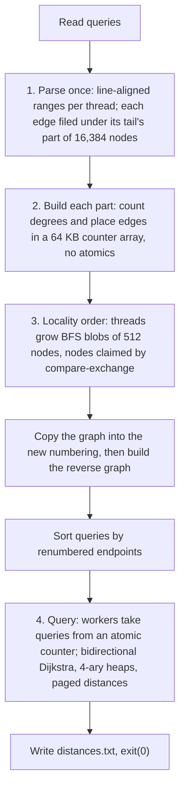

# Track D: Traverse (Rust)

Reads `/data/graph.txt` (a directed weighted graph, one edge per line) and the queries, and writes `/out/distances.txt`: the shortest distance for each query, `-1` if the target is unreachable. The exact task and output format are in the [spec](https://github.com/hackathon-raptors/speed-demon-2026/blob/main/specs/d-traverse.md). The public graph has 1,740,512 nodes, 5,000,000 edges and 2,000 queries.

## Result

Tag `best-50» (commit `2b3efbe»): 0.1729 s, 66.3 MiB, S 518, 68.58 on the board (`run-e682dbdc30a2»). Track D is not counted in the overall score (the best three tracks count) and had its last source change on Nov 1 (commit `4d1d805», exit right after the output). Progress (running best points, rows from `real-spec/board-runs.jsonl»): 63.02 (`run-0a5e5f081b09», Oct 31), 68.83 (`run-237237831d54», Oct 31 18:30, after the new design: S 680 to 517), 69.02 (`run-1e5e115c0722», the best row, a reading of unchanged code). The long table is in [`PERF.md»](PERF.md).



Caption: parse and file, build parts, BFS-blob renumbering plus reverse graph, then bidirectional Dijkstra on persistent workers.

## Approach

One Rust file, `src/main.rs`, std only (no crates), built for x86-64-v3 through `.cargo/config.toml`. Threads come from `available_parallelism`, capped at 12.

1. **Parse once.** `graph.txt` is mapped over a spare zero page and cut at line ends into one range per thread. Each thread files every edge, as sequential appends, under the part of the node range its tail falls in (parts of 16,384 nodes, about 107). An edge is one 32-bit word: the head in the low bits and the weight above it; a weight too large for its field is stored as all ones with its value on a side list. Numbers up to 7 digits are read from one 8-byte load. Self-loops are dropped.
2. **Build each part on its own.** A thread takes a part, counts its nodes' out-degrees and places its edges inside a 64 KB counter array, so the adjacency is built with no atomics.
3. **Renumber for locality.** The input ids are a random relabelling of a road-like lattice. Threads grow compact blobs of 512 nodes by BFS (nodes claimed with a compare-exchange on one byte each, next rows and edges prefetched), and the graph is copied into that numbering and then reversed (in-degrees counted atomically, edges placed with atomic cursors). The numbering differs from run to run; the distances do not.
4. **Query.** Queries are sorted by their renumbered endpoints and taken from an atomic counter by persistent workers. Each answers with bidirectional Dijkstra over the forward and reverse graphs with 4-ary heaps, always growing the side with the smaller queue, and stops when the two smallest keys sum to at least the best meeting distance. A target with no in-edge is `-1` at once. Distances are `u64` and sit in pages of 256 handed out on first touch and taken back after each query. The process ends with `exit(0)` without freeing the big arrays.

## Research and technique

Local numbers (laptop, Docker with the board's flags; see `PERF.md» for the step table; D never had a board-based phase profile):

- **Relabel nodes in BFS order.** The input ids are a random relabelling of a road-like lattice, so queries chased cache misses. A BFS order took the query phase from 2.4 s to 0.83 s locally (an earlier design); the final design grows compact blobs of 512 nodes in parallel.
- **Expand the side with the smaller queue.** 3.93 s to 2.58 s, three times fewer heap pops.
- **Filing edges under their owner part before building the CSR** (no atomics in the build): the forward CSR 153 ms to 74 ms in an earlier design; in the final design each thread builds a 16,384-node part inside a 64 KB counter array.
- **Smaller labels.** `u32» instead of `u64» labels: 384 MB to 261 MB and 1.04 s to 0.89 s (earlier design); the final design keeps `u64» distances in pages of 256 handed out on first touch, which allowed 12 query workers instead of 6 (829 ms to 595 ms locally).
- **Word-at-a-time digit reader and prefetching in the ordering:** the original-id CSR phase 112 ms to 82 ms; ordering 85 ms to 72 ms.
- **Final design against the one before it** (15 interleaved rounds, locally): median wall 321 ms against 455 ms, `memory.peak» 67.2 MiB against 93.7 MiB; on the board about 0.23 s and S 680 to about 0.17 s and S 518.

## What failed and why

| Attempt | Result | Why |
|---|---|---|
| Queries in source order with chained regions | no change in the query phase | |
| Each worker scanning the whole edge stream | 150-165 ms against 100-170 ms for filing | worse |
| Hash labels instead of arrays | 300-370 ms against 245-285 ms for the query phase | slower than arrays |
| Atomic row cursors for the original-id CSR | 60-75 ms for placement | locked instructions serialise cache misses |
| Packing the heap entry into one `u64» | 430 against 436 ms, 2-3% | not worth 8 lines and an assert |
| Dropping the sweep-clear of labels | peak memory unchanged, slightly slower | |
| Label page size 8, 16, 32 or 64 | no difference within noise | |
| First version of interleaved labels | 14% slower (about 7% after the sweep-clear) | |
| Deeper prefetch (12 rows ahead) in the ordering | equal minimum | not kept for its extra lines |
| Twelve query workers with array labels | about 20% faster queries but 84 MB more | 6 stayed until paged labels |
| Radix heap | 2,100 ms to about 1,100 ms single-worker query phase (earlier design) | replaced by 4-ary heaps in the current draft |

## Assumptions and known limits

- `n` below 2^31, with the weight sharing the 32-bit word with a node id: weights that do not fit go to side lists, so all `u32` weights are exact. `m` below 2^32.
- At most 65,535 distance pages in use per side in one search (the page table holds `u16` entries).
- A part holds 2^14 nodes, so offsets within a part fit 16 bits.
- A worker thread that panics leaves the others waiting on a barrier, so a bug would hang rather than abort.

## Dependencies

None.

## Verification

Needs Docker; the datasets are generated with the contest's generator and are not in the repository. From the repository root:

```
python3 check.py d --data <directory with the graph.txt and queries.txt> --expected a23dbdf0a3e49cc8901310a9ee1dc6a9a569a85297b6da75c2a7002cb2ed277e
.\real-spec\dock.ps1 -Track d -Scale full -Runs 20
```

The first builds the track image offline and compares the SHA-256 of the output with the published hash of the seed-1 data; the second replicates the board run (pre-warmed volume, board flags, `memory.peak`) and prints MATCH or MISMATCH. The current source was checked against the published hash, generated seeds 2, 3 and 7, tiny and sample scales and an edge-case suite (66 cases); `cargo clippy -D warnings` was clean. There are no unit tests for this implementation (`tests/track_d.rs` targets the earlier one and is not compiled). The history with run IDs is in [`PERF.md`](PERF.md); the whole-repo architecture is in [`../docs/OVERVIEW.md`](../docs/OVERVIEW.md).

## Reproduction

```
git checkout best-50                      # or this branch's head
python3 check.py d --data <dir with graph.txt and queries.txt> --expected a23dbdf0a3e49cc8901310a9ee1dc6a9a569a85297b6da75c2a7002cb2ed277e
.\real-spec\dock.ps1 -Track d -Scale full -Runs 20
```

## Provenance

This source started as a draft written with ChatGPT/Codex (OpenAI; AI assistance is allowed by the contest rules) by the team, then reviewed and tested here. Five lines were changed in review: one fixes a panic (a prefetch indexed the edge array at the offset of a trailing node with no out-edges, one past its end); the rest satisfy clippy. The earlier region-growing / radix-heap implementation and its history are in git history.
